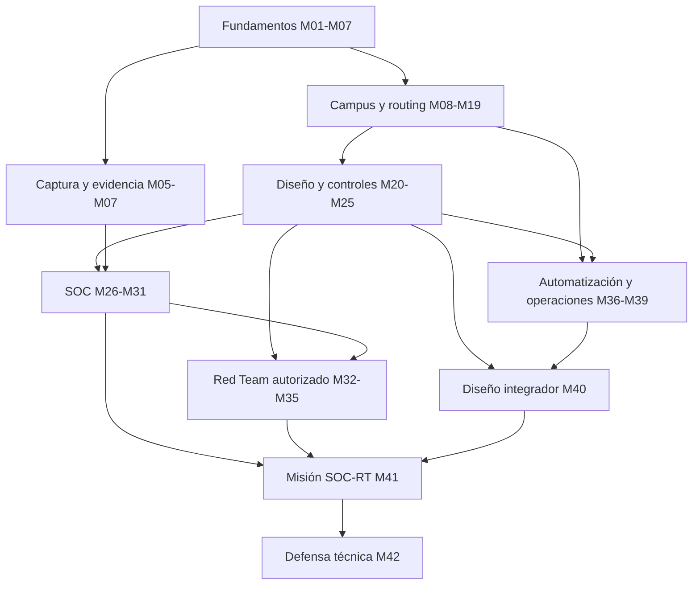

# MUNDO DE REDES — TANDA 2/7
## Arquitectura curricular, diagnóstico, dependencias y auditoría de diseño

**Fecha de consulta y diseño:** 18-10-2026. **Estado:** propuesta de investigación/diseño para revisión humana, NO implementada, NO probada en laboratorio. **Base:** `redes.txt` y `MUNDO_REDES_TANDA1_INVESTIGACION_2026-10-18.md`.

**Convención:** **[D]** afirmación documentada en fuente externa; **[R]** decisión/recomendación curricular original que necesita aprobación; **[P]** aspecto que requiere investigación/validación. Los títulos de lecciones son propuestas, no lecciones redactadas.

## 1. Decisión de arquitectura

- **[R]** Diseñar la progresión **Mundo → Etapa → Módulo → Lección → Práctica → Evaluación**, con 8 etapas, 42 módulos y 168 títulos de lección propuestos (sin redactar su contenido).
- **[R]** Mantener un **tronco común** de fundamentos, acceso, routing y seguridad; abrir itinerarios SOC, Red Team y automatización cuando se demuestran prerrequisitos, **sin obligar a estudiar toda una rama para comenzar otra**.
- **[R]** La etapa es una agrupación curricular y de navegación, **no** un bloqueo: los desbloqueos dependen únicamente de competencias/prerrequisitos demostrables, y son posibles convalidaciones por diagnóstico práctico.
- **[D]** NIST NICE organiza trabajo en Task, Knowledge y Skill y ENISA ECSF describe funciones y competencias profesionales; justifican diseñar evidencias observables de capacidades y no un itinerario de consumo de vídeos. Ver P01 y P02.
- **[R]** Cisco es fuente de áreas técnicas, NO certificación automática: CCNA 200-301 v1.1 vigente en la fecha; v2.0 anunciado para febrero 2027; CCNP ENCOR v1.2 y concentraciones selectivas. Matriz examen-subobjetivo sigue pendiente.

### Vista por etapa y estimación

| Etapa | Módulos | Nivel de entrada | Horas estimadas | Propósito |
|---|---:|---|---:|---|
| E1 — Fundamentos, direccionamiento y lectura de tráfico | 6 | Desde cero | 64 h | Construir modelo y leer tráfico |
| E2 — Servicios, campus básico y redes inalámbricas | 5 | Básico | 58 h | Operar capa 2 y servicios |
| E3 — Routing empresarial, WAN y rendimiento | 8 | Intermedio → avanzado | 120 h | Ingeniería L3 y WAN |
| E4 — Arquitectura y seguridad de la red | 6 | Intermedio → avanzado | 88 h | Diseñar/proteger redes |
| E5 — Observabilidad e investigación SOC | 6 | Especialización SOC | 90 h | Investigar desde SOC |
| E6 — Red Team de redes autorizado | 4 | Especialización Red Team | 54 h | Validar controles autorizado |
| E7 — Automatización, cambio y operaciones | 4 | Ingeniería avanzada | 62 h | Operar y automatizar cambios |
| E8 — Proyectos finales y defensa técnica | 3 | Integración | 56 h | Demostrar transferencia integrada |
| **TOTAL** | **42** | Desde cero → avanzado | **592 h** | **Cursarlo todo, sin convalidaciones** |

**Supuesto explícito de horas:** carga estimada de explicación, lectura, práctica guiada, ejercicios independientes, troubleshooting y evaluación para una persona que comienza desde cero. No constituye duración medida ni garantía: margen inicial de incertidumbre recomendado ±30–40 %. No incluye tiempo de instalación/setup aún no validado (Tanda 5), sesiones de repaso a largo plazo ni retrasos de hardware/licencias.

### Caminos competenciales según cierre transitivo de prerrequisitos

| Recorrido demostrable | Módulos implicados (cierre de prerrequisitos) | Horas acumuladas estimadas |
|---|---:|---:|
| Diseño de conectividad híbrida (hito M25) | 18 | 224 h |
| Investigación y respuesta SOC | 22 | 282 h |
| Validación Red Team y retest | 29 | 374 h |
| Automatización/operación avanzada | 21 | 258 h |
| Dos proyectos + defensa final | 42 | 592 h |

**Advertencia:** estos recorridos están calculados a partir de los prerequisitos registrados; un título de itinerario NO demuestra por sí solo que están presentes todas las competencias ocupacionales deseables. Algunos módulos no están en el camino mínimo de un hito, pero pueden ser recomendables. No sumar recorridos: comparten módulos.

## 2. Evaluación diagnóstica (DIAG-RED-00), sin prueba realizada

**Objetivo:** medir conocimientos REALES de redes, sin presuponerlos por estudios ASIR, cloud, SOC, Active Directory o certificaciones ofensivas. Se permite comenzar desde cero; los resultados NO bloquean entrada al mundo.

**Propuesta de instrumentos (estimación de 3–5 horas si se ejecuta completa):**

1. **Cuestionario razonado** (30 preguntas, 45–60 minutos): encapsulación, subnetting IPv4, IPv6/ND, TCP y DNS, switching, rutas, Wi-Fi, ACL y observabilidad. Debe requerir justificación, no solo opción múltiple.
2. **Tarea operativa A** (45–60 min): plan de VLSM dual stack e identificación de error de ruta, explicando causa y verificación en diagrama/lab conceptual.
3. **Tarea operativa B** (45–75 min): interpretar datos de VLAN/trunk y routing procedentes de una topología **docente** y corregir un fallo sembrado; nunca tocar infraestructura real.
4. **Tarea de análisis** (45–60 min): PCAP + DNS + Syslog *sintéticos declarados*, extraer hechos, UTC, hipótesis y vacíos probatorios.
5. **Tarea de seguridad** (20–30 min): definir alcance, criterio de parada y prueba mínima de una ACL en laboratorio hipotético.

**Resultado por competencia** (no una nota global ficticia): **No evaluada / Inicial / Comprende / Demuestra / Transfiere**. Una competencia se considera convalidable solo si la prueba práctica acredita el nivel exigido por el módulo. En subáreas sin evaluación disponible, se conserva su ruta. Las evidencias se revalidan cuando cambian el objetivo, la tecnología o el contexto.

**Rúbrica propuesta por módulo:** precisión técnica 0–3; diagnóstico/método 0–3; prueba y trazabilidad 0–3; alcance/seguridad/cambio 0–3. **Aprobación propuesta:** ≥2/3 en cada dimensión aplicable y ningún fallo crítico. En módulos exclusivamente conceptuales, la cuarta dimensión puede ser «no aplica», sin inflar nota. El criterio se revisará con pilotos educativos en Tanda 5.

**Reglas anti-falsa competencia:** aprobar 30 respuestas teóricas NO convalida un laboratorio de configurar/diagnosticar; completar una práctica guiada NO equivale a transferencia a un fallo nuevo; un resultado SOC requiere hipótesis alternativa y límites; uno Red Team requiere autorización y evidencia de ausencia de impactos indebidos.

## 3. Catálogo completo propuesto, módulo a módulo

**Leyenda de profundidad:** F = fundamento; C = configuración verificable; T = troubleshooting; D = diseño; I = investigación SOC; V = validación de controles autorizada. Las prácticas citadas son **diseñadas/no ejecutadas**; su factibilidad, versión y licencia se comprobarán en Tanda 5. Herramientas candidatas (sin afirmación de licencia para todos los módulos): Packet Tracer/alternativa a confirmar, entornos Linux virtuales aislados, FRRouting, Wireshark, tcpdump, registros sintéticos, entornos docentes de cloud, siempre dependiendo de la validación posterior.

### E1 — Fundamentos, direccionamiento y lectura de tráfico

#### RED-M01 — Modelo de comunicaciones y diagnóstico físico (8 h, nivel Desde cero)
- **Resultado medible:** Explicar una comunicación extremo a extremo y aislar un fallo físico/L1-L2. **Profundidad:** F/T.
- **Prerrequisitos:** ninguno, inicio real desde cero.
- **Lecciones propuestas:** OSI frente a TCP/IP; Medios, interfaces y velocidad/dúplex; Encapsulación y Ethernet; Errores y límites del modelo.
- **Práctica diseñada:** Interpretar salidas y fallos de interfaces de una topología docente. **Herramientas candidatas:** consultar catálogo Tanda 5, no validadas por módulo.
- **Evaluación/evidencia:** Diagrama, síntomas, pruebas y causa raíz. **Éxito:** Identifica correctamente capa, evidencia y corrección. **Fallo crítico:** Confundir conjetura con observación.
- **Aplicación SOC:** Identificar causas de desconexión. **Aplicación Red Team:** Distinguir exposición de conectividad real.
- **Referencias de mundo:** LX. **Fuentes T1:** C01, C03, T04. **Estado:** diseñado, no ejecutado ni validado.

#### RED-M02 — IPv4, CIDR, VLSM y plan de direccionamiento (12 h, nivel Desde cero)
- **Resultado medible:** Diseñar y justificar un esquema IPv4 sin solapamientos. **Profundidad:** F/C/T/D.
- **Prerrequisitos:** RED-M01.
- **Lecciones propuestas:** Direcciones, máscaras y CIDR; Subredes y VLSM; Sumarización y asignación; Diagnóstico de direcciones.
- **Práctica diseñada:** Diseñar direccionamiento para varias sedes y detectar conflictos sembrados. **Herramientas candidatas:** consultar catálogo Tanda 5, no validadas por módulo.
- **Evaluación/evidencia:** Tabla de prefijos, asignación y pruebas de no solapamiento. **Éxito:** Cumple capacidad, agregación y ausencia de conflictos. **Fallo crítico:** Confundir dirección de red, gateway y host.
- **Aplicación SOC:** Interpretar subredes y saltos de origen. **Aplicación Red Team:** Delimitar rangos autorizados de laboratorio.
- **Referencias de mundo:** LX, SIM. **Fuentes T1:** C01, C03, C07. **Estado:** diseñado, no ejecutado ni validado.

#### RED-M03 — IPv6, ND y autoconfiguración (12 h, nivel Desde cero)
- **Resultado medible:** Planificar prefijos IPv6 y resolver fallos de vecindad/autoconfiguración. **Profundidad:** F/C/T/D.
- **Prerrequisitos:** RED-M01, RED-M02.
- **Lecciones propuestas:** Formato IPv6 y tipos; ICMPv6, ND y RA; SLAAC, DAD y DHCPv6; IPv6 y control de acceso.
- **Práctica diseñada:** Diagnosticar un caso con RA o prefijos incorrectos en entorno diseñado. **Herramientas candidatas:** consultar catálogo Tanda 5, no validadas por módulo.
- **Evaluación/evidencia:** Plan de prefijos dual stack, trazas y causa raíz. **Éxito:** Identifica dependencia ND/ICMPv6 y corrección. **Fallo crítico:** Bloquear indiscriminadamente ICMPv6.
- **Aplicación SOC:** Analizar telemetría IPv6 sin analogías falsas con ARP. **Aplicación Red Team:** Verificar segmentación IPv6 en alcance aislado.
- **Referencias de mundo:** LX, SIM. **Fuentes T1:** C01, C03, I02. **Estado:** diseñado, no ejecutado ni validado.

#### RED-M04 — TCP, UDP, MTU/MSS y transporte (10 h, nivel Desde cero)
- **Resultado medible:** Separar fallo de red, transporte y aplicación con trazas observables. **Profundidad:** F/T/I.
- **Prerrequisitos:** RED-M01, RED-M02.
- **Lecciones propuestas:** TCP y UDP; Handshake, estados y ventanas; Retransmisiones y resets; MTU/MSS, fragmentación IPv4 y PMTUD.
- **Práctica diseñada:** Comparar flujos PCAP con pérdida y fragmentación simuladas. **Herramientas candidatas:** consultar catálogo Tanda 5, no validadas por módulo.
- **Evaluación/evidencia:** Filtros, secuencia TCP, hipótesis y límites. **Éxito:** Distingue pérdida, reset, bloqueo y no observabilidad. **Fallo crítico:** Afirmar que retransmisión siempre significa ataque.
- **Aplicación SOC:** Discriminar anomalías y degradación. **Aplicación Red Team:** Estimar alcance real de comunicaciones.
- **Referencias de mundo:** LX, SIM. **Fuentes T1:** I01, T04. **Estado:** diseñado, no ejecutado ni validado.

#### RED-M05 — Captura y evidencia de red inicial (10 h, nivel Desde cero)
- **Resultado medible:** Obtener e interpretar una captura de laboratorio preservando procedencia. **Profundidad:** F/C/T/I.
- **Prerrequisitos:** RED-M01, RED-M02, RED-M04.
- **Lecciones propuestas:** Captura frente a filtro visual; Interfaces y puntos de observación; PCAP y metadatos; Primeras consultas DNS/TCP/TLS.
- **Práctica diseñada:** Analizar PCAP proporcionado y justificar qué no permite inferir. **Herramientas candidatas:** consultar catálogo Tanda 5, no validadas por módulo.
- **Evaluación/evidencia:** Archivo origen, hash, filtros y hallazgos observables. **Éxito:** Reproduce filtros, conserva original y declara límites. **Fallo crítico:** Modificar original sin registro ni cadena de procedencia.
- **Aplicación SOC:** Preparar base de investigación PCAP. **Aplicación Red Team:** Comprobar telemetría generada por actividad autorizada.
- **Referencias de mundo:** LX, SIM, MS, SPL. **Fuentes T1:** T04, I01, I04. **Estado:** diseñado, no ejecutado ni validado.

#### RED-M06 — Servicios y protocolos empresariales observables (12 h, nivel Desde cero)
- **Resultado medible:** Describir dependencias y evidencias de TLS, HTTP, SSH, SMB, RDP, LDAP y Kerberos. **Profundidad:** F/T/I.
- **Prerrequisitos:** RED-M04, RED-M05.
- **Lecciones propuestas:** HTTP/HTTPS y TLS; Administración SSH/RDP; SMB y directorio LDAP/Kerberos; Qué revela u oculta el cifrado.
- **Práctica diseñada:** Construir mapa de dependencias de una aplicación y explicar trazas parciales. **Herramientas candidatas:** consultar catálogo Tanda 5, no validadas por módulo.
- **Evaluación/evidencia:** Diagrama de dependencias y hechos/hipótesis etiquetados. **Éxito:** Distingue negociación visible de contenido inaccesible. **Fallo crítico:** Inferir credenciales o contenidos cifrados sin prueba.
- **Aplicación SOC:** Comprender contexto de conexiones en investigación. **Aplicación Red Team:** Reconocer servicios expuestos sin explotarlos.
- **Referencias de mundo:** AD, LX, MS, SPL. **Fuentes T1:** I04, T04. **Estado:** diseñado, no ejecutado ni validado.

### E2 — Servicios, campus básico y redes inalámbricas

#### RED-M07 — DNS, DHCP, NTP y resolución de fallos (12 h, nivel Básico)
- **Resultado medible:** Configurar/diagnosticar servicios de nombres, dirección y tiempo en topología docente. **Profundidad:** F/C/T/I.
- **Prerrequisitos:** RED-M02, RED-M03, RED-M05.
- **Lecciones propuestas:** Resolución recursiva y caches; DHCPv4 y DHCPv6/SLAAC; Sincronía y UTC; Fallos de servicio y dependencia.
- **Práctica diseñada:** Corregir incidente combinado DNS/DHCP/reloj. **Herramientas candidatas:** consultar catálogo Tanda 5, no validadas por módulo.
- **Evaluación/evidencia:** Trazas de consultas, leases, cronología y causa. **Éxito:** Recupera los tres servicios y verifica hora. **Fallo crítico:** Confundir timestamp de evento con ingesta.
- **Aplicación SOC:** Investigar DNS anómalo con baseline. **Aplicación Red Team:** Verificar que servicios de pruebas no salen del lab.
- **Referencias de mundo:** AD, LX, SIM, MS, SPL. **Fuentes T1:** C01, C03, T01. **Estado:** diseñado, no ejecutado ni validado.

#### RED-M08 — Switching Ethernet, tablas MAC y descubrimiento (8 h, nivel Básico)
- **Resultado medible:** Reconstruir conectividad capa 2 e interpretar MAC table y LLDP. **Profundidad:** F/C/T.
- **Prerrequisitos:** RED-M01, RED-M02.
- **Lecciones propuestas:** Aprendizaje MAC y ARP; Dominios de broadcast; LLDP y CDP; Errores de puertos y documentación.
- **Práctica diseñada:** Recomponer topología con evidencias de vecinos y tablas. **Herramientas candidatas:** consultar catálogo Tanda 5, no validadas por módulo.
- **Evaluación/evidencia:** Plano de puertos, MAC y rutas L2. **Éxito:** Mapa consistente con evidencias L2. **Fallo crítico:** Dar por hecho topología por una sola tabla.
- **Aplicación SOC:** Ubicar punto de captura y equipo probable. **Aplicación Red Team:** Inventario de activos dentro de alcance.
- **Referencias de mundo:** LX, SIM. **Fuentes T1:** C01, C03, C05. **Estado:** diseñado, no ejecutado ni validado.

#### RED-M09 — VLAN, 802.1Q, trunks e inter-VLAN (14 h, nivel Básico)
- **Resultado medible:** Diseñar y verificar segmentación L2/L3 básica. **Profundidad:** F/C/T/D/V.
- **Prerrequisitos:** RED-M02, RED-M08.
- **Lecciones propuestas:** VLAN y access ports; Etiquetado 802.1Q/nativa; Trunks y propagación; Inter-VLAN y troubleshooting.
- **Práctica diseñada:** Separar redes de usuarios y servidores y corregir trunk incorrecto. **Herramientas candidatas:** consultar catálogo Tanda 5, no validadas por módulo.
- **Evaluación/evidencia:** Matriz VLAN, config/estado y flujos permitidos. **Éxito:** Aislamiento y conectividad autorizada comprobados. **Fallo crítico:** Suponer que VLAN implica firewall.
- **Aplicación SOC:** Correlacionar VLAN con zonas y rutas. **Aplicación Red Team:** Comprobar de forma mínima el aislamiento entre segmentos.
- **Referencias de mundo:** LX, SIM. **Fuentes T1:** C01, C03, C05. **Estado:** diseñado, no ejecutado ni validado.

#### RED-M10 — STP/RSTP/MSTP y LACP (12 h, nivel Básico)
- **Resultado medible:** Diagnosticar redundancia de campus sin bucles ni blackholes. **Profundidad:** F/C/T/D.
- **Prerrequisitos:** RED-M08, RED-M09.
- **Lecciones propuestas:** STP/RSTP/MSTP; Root bridge y convergencia; Guardias y protecciones; LACP/port channels.
- **Práctica diseñada:** Diagnosticar root inesperado y agregado desalineado. **Herramientas candidatas:** consultar catálogo Tanda 5, no validadas por módulo.
- **Evaluación/evidencia:** Estados de puerto, cambios y pruebas de recuperación. **Éxito:** Restaurar la topología y justificar árbol activo. **Fallo crítico:** Reconfigurar sin verificar impacto de bucles.
- **Aplicación SOC:** Reconocer pérdida/duplicación por convergencia. **Aplicación Red Team:** Ensayar controles solo en switches simulados.
- **Referencias de mundo:** LX, SIM. **Fuentes T1:** C01, C04, C07. **Estado:** diseñado, no ejecutado ni validado.

#### RED-M11 — Fundamentos Wi-Fi, RF y conectividad (12 h, nivel Básico)
- **Resultado medible:** Distinguir problemas RF, autenticación y direccionamiento WLAN. **Profundidad:** F/C/T/D.
- **Prerrequisitos:** RED-M02, RED-M03, RED-M07.
- **Lecciones propuestas:** 802.11, bandas y canales; Interferencia y capacidad; Roaming; Diagnóstico de cliente inalámbrico.
- **Práctica diseñada:** Clasificar tres incidencias Wi-Fi a partir de datos docentes. **Herramientas candidatas:** consultar catálogo Tanda 5, no validadas por módulo.
- **Evaluación/evidencia:** Mapa RF simplificado y diagrama de decisión. **Éxito:** Identifica la capa causal sin atribuciones erróneas. **Fallo crítico:** Confundir mala RSSI con intrusión.
- **Aplicación SOC:** Interpretar degradación inalámbrica. **Aplicación Red Team:** Restringir pruebas a APs y clientes propios.
- **Referencias de mundo:** LX, SIM. **Fuentes T1:** C01, C13, I08. **Estado:** diseñado, no ejecutado ni validado.

### E3 — Routing empresarial, WAN y rendimiento

#### RED-M12 — Tablas de rutas y enrutamiento estático (12 h, nivel Intermedio → avanzado)
- **Resultado medible:** Predecir la ruta seleccionada y reparar ausencia de ruta de retorno. **Profundidad:** F/C/T.
- **Prerrequisitos:** RED-M02, RED-M03, RED-M09.
- **Lecciones propuestas:** Conectadas y estáticas; Default route; Longest-prefix match y AD; Diagnóstico de camino ida/vuelta.
- **Práctica diseñada:** Restaurar conectividad en topología con rutas contradictorias. **Herramientas candidatas:** consultar catálogo Tanda 5, no validadas por módulo.
- **Evaluación/evidencia:** Tablas, traceroute lab y justificación de selección. **Éxito:** Determina ida y retorno en IPv4/IPv6. **Fallo crítico:** Confundir coincidencia más larga con métrica.
- **Aplicación SOC:** Interpretar caminos aparentes en flows. **Aplicación Red Team:** Delimitar rutas por las que pasa el tráfico del ensayo.
- **Referencias de mundo:** LX, SIM. **Fuentes T1:** C01, C03. **Estado:** diseñado, no ejecutado ni validado.

#### RED-M13 — OSPFv2/v3 empresarial (18 h, nivel Intermedio → avanzado)
- **Resultado medible:** Configurar y diagnosticar OSPF y justificar uso de áreas. **Profundidad:** F/C/T/D.
- **Prerrequisitos:** RED-M12.
- **Lecciones propuestas:** Vecinos y áreas; Estados, LSDB y SPF; OSPFv2/v3 y autenticación aplicable; Sumarización y averías.
- **Práctica diseñada:** Resolver vecindad y alcance roto en doble área docente. **Herramientas candidatas:** consultar catálogo Tanda 5, no validadas por módulo.
- **Evaluación/evidencia:** Salida de adyacencia, LSDB y mapa de caminos. **Éxito:** Restituye anuncios y justifica raíz y política. **Fallo crítico:** Introducir redistribución sin controlar bucles.
- **Aplicación SOC:** Contextualizar cambios de rutas/ventanas de evento. **Aplicación Red Team:** Evaluar efectos de políticas OSPF solo en lab.
- **Referencias de mundo:** LX, SIM. **Fuentes T1:** C05, C06, C07. **Estado:** diseñado, no ejecutado ni validado.

#### RED-M14 — BGP y políticas de rutas (22 h, nivel Intermedio → avanzado)
- **Resultado medible:** Justificar selección de rutas y aplicar filtros BGP en dos AS simulados. **Profundidad:** F/C/T/D/V.
- **Prerrequisitos:** RED-M12, RED-M13.
- **Lecciones propuestas:** Sesiones eBGP/iBGP; Atributos y best-path; Políticas, filtros y comunidades; Diagnóstico y controles operativos.
- **Práctica diseñada:** Resolver selección de salida y prefijos inadvertidos. **Herramientas candidatas:** consultar catálogo Tanda 5, no validadas por módulo.
- **Evaluación/evidencia:** RIB, anuncios, políticas y prueba antes/después. **Éxito:** No hay anuncios no autorizados; selección explicada. **Fallo crítico:** Publicar rutas más amplias de lo permitido.
- **Aplicación SOC:** Leer decisiones de camino que afectan visibilidad. **Aplicación Red Team:** Validar filtrado de prefijos en entorno aislado.
- **Referencias de mundo:** LX, SIM. **Fuentes T1:** C05, C06, C07, I03. **Estado:** diseñado, no ejecutado ni validado.

#### RED-M15 — Routing avanzado, VRF y redistribución (18 h, nivel Intermedio → avanzado)
- **Resultado medible:** Evitar bucles y fugas mediante redistribución y separación de planos. **Profundidad:** F/C/T/D/V.
- **Prerrequisitos:** RED-M12, RED-M13, RED-M14.
- **Lecciones propuestas:** Rutas y filtrado; Redistribución y route maps; VRF-Lite y PBR; uRPF, EIGRP/IS-IS comparados.
- **Práctica diseñada:** Solucionar fuga intencionada de rutas en VRF docente. **Herramientas candidatas:** consultar catálogo Tanda 5, no validadas por módulo.
- **Evaluación/evidencia:** Política, tablas antes/después y criterio de reversión. **Éxito:** No hay bucles ni fuga tras corrección. **Fallo crítico:** Activar políticas sin ruta de gestión conservada.
- **Aplicación SOC:** Explicar asimetría/telemetría por VRF. **Aplicación Red Team:** Comprobar bypass de segmentación en lab.
- **Referencias de mundo:** LX, SIM. **Fuentes T1:** C05, C06, C07. **Estado:** diseñado, no ejecutado ni validado.

#### RED-M16 — Gateway redundante y convergencia (12 h, nivel Intermedio → avanzado)
- **Resultado medible:** Diseñar recuperación cuando falla enlace o gateway. **Profundidad:** F/C/T/D.
- **Prerrequisitos:** RED-M09, RED-M10, RED-M12.
- **Lecciones propuestas:** FHRP y elección; BFD y monitoreo; Convergencia L2/L3; Pruebas de fallo y recuperación.
- **Práctica diseñada:** Ensayar un fallo controlado de gateway simulable. **Herramientas candidatas:** consultar catálogo Tanda 5, no validadas por módulo.
- **Evaluación/evidencia:** Cronología de reconvergencia, tablas y reporte. **Éxito:** Recuperación funcional y medida; no ocultar fallos. **Fallo crítico:** Confundir redundancia con eliminación de todo SPOF.
- **Aplicación SOC:** Separar fallo previsto de anomalía. **Aplicación Red Team:** Evaluar rutas alternativas bajo fallo autorizado.
- **Referencias de mundo:** LX, SIM. **Fuentes T1:** C01, C05, C07. **Estado:** diseñado, no ejecutado ni validado.

#### RED-M17 — NAT, PAT, proxies y asimetría (12 h, nivel Intermedio → avanzado)
- **Resultado medible:** Explicar traducciones y las limitaciones para atribuir clientes. **Profundidad:** F/C/T/I.
- **Prerrequisitos:** RED-M04, RED-M07, RED-M12.
- **Lecciones propuestas:** SNAT/DNAT/PAT; Tablas de estado; Proxies y balanceadores; Rutas asimétricas y atribución.
- **Práctica diseñada:** Correlacionar registro NAT, flow y petición docente. **Herramientas candidatas:** consultar catálogo Tanda 5, no validadas por módulo.
- **Evaluación/evidencia:** Tabla pre/post traducción con UTC y grado de confianza. **Éxito:** No atribuye persona solo por IP pública. **Fallo crítico:** Atribución individual sin logs de traducción.
- **Aplicación SOC:** Construir pivotes temporales con NAT. **Aplicación Red Team:** Validar una regla NAT de alcance delimitado.
- **Referencias de mundo:** LX, SIM, MS, SPL. **Fuentes T1:** C01, C05, T01. **Estado:** diseñado, no ejecutado ni validado.

#### RED-M18 — WAN, VPN, IPsec, GRE, MPLS y SD-WAN (16 h, nivel Intermedio → avanzado)
- **Resultado medible:** Diseñar conectividad remota y diagnosticar overlay/underlay. **Profundidad:** F/C/T/D.
- **Prerrequisitos:** RED-M12, RED-M17.
- **Lecciones propuestas:** WAN y proveedores; IPsec/TLS y GRE; MPLS como servicio; SD-WAN y políticas.
- **Práctica diseñada:** Comparar dos arquitecturas de sedes y un túnel con fallo. **Herramientas candidatas:** consultar catálogo Tanda 5, no validadas por módulo.
- **Evaluación/evidencia:** Diseño, dependencia de rutas y plan de diagnóstico. **Éxito:** Explica seguridad/cifrado y rutas sin falsas garantías. **Fallo crítico:** Presentar MPLS como cifrado extremo a extremo.
- **Aplicación SOC:** Investigar cambios de origen y túnel. **Aplicación Red Team:** Identificar exposición de management/WAN lab.
- **Referencias de mundo:** LX, MS, SPL. **Fuentes T1:** C05, C06, C07, C10. **Estado:** diseñado, no ejecutado ni validado.

#### RED-M19 — QoS, multicast y calidad de experiencia (10 h, nivel Intermedio → avanzado)
- **Resultado medible:** Justificar decisiones de rendimiento con mediciones. **Profundidad:** F/T/D.
- **Prerrequisitos:** RED-M04, RED-M12, RED-M18.
- **Lecciones propuestas:** Latencia/jitter/pérdida; Colas y marking; Multicast conceptos; Baselines de voz/vídeo.
- **Práctica diseñada:** Analizar degradación de aplicación bajo tráfico docente. **Herramientas candidatas:** consultar catálogo Tanda 5, no validadas por módulo.
- **Evaluación/evidencia:** Métricas con baseline, hipótesis y prioridades. **Éxito:** Conecta síntomas con medida y límites. **Fallo crítico:** Afirmar mejora sin medición de antes/después.
- **Aplicación SOC:** Diferenciar congestión de actividad maliciosa. **Aplicación Red Team:** Evaluar impacto de cambios en pruebas de servicio.
- **Referencias de mundo:** LX, SIM. **Fuentes T1:** C05, C07, C09. **Estado:** diseñado, no ejecutado ni validado.

### E4 — Arquitectura y seguridad de la red

#### RED-M20 — Diseño de campus, zonas y resiliencia (16 h, nivel Intermedio → avanzado)
- **Resultado medible:** Diseñar red empresarial escalable con documentación y riesgos. **Profundidad:** F/C/T/D.
- **Prerrequisitos:** RED-M09, RED-M10, RED-M12, RED-M16.
- **Lecciones propuestas:** Modelo jerárquico; Dominios de fallo; Zonas y DMZ; Alta disponibilidad y crecimiento.
- **Práctica diseñada:** Proponer plano de campus dual stack con política de zonas. **Herramientas candidatas:** consultar catálogo Tanda 5, no validadas por módulo.
- **Evaluación/evidencia:** Diagrama L2/L3, matriz de tráfico y riesgos. **Éxito:** Sin solapamientos, SPOF explícitos y ruta de administración. **Fallo crítico:** Confundir diagrama ideal con estado real.
- **Aplicación SOC:** Definir sensores y puntos de correlación. **Aplicación Red Team:** Delimitar superficies y rutas críticas.
- **Referencias de mundo:** LX, MS, SPL. **Fuentes T1:** C05, C07, S02. **Estado:** diseñado, no ejecutado ni validado.

#### RED-M21 — ACL, firewall stateful y segmentación (18 h, nivel Intermedio → avanzado)
- **Resultado medible:** Aplicar política de mínimos privilegios y validar flujos. **Profundidad:** F/C/T/D/V/I.
- **Prerrequisitos:** RED-M09, RED-M12, RED-M17, RED-M20.
- **Lecciones propuestas:** ACL y orden; Stateful vs stateless; DMZ y egress; Microsegmentación/Zero Trust.
- **Práctica diseñada:** Corregir regla que permite salto indebido entre dos redes lab. **Herramientas candidatas:** consultar catálogo Tanda 5, no validadas por módulo.
- **Evaluación/evidencia:** Matriz allow/deny, capturas, config y retest. **Éxito:** Flujos esperados pasan y no esperados se bloquean. **Fallo crítico:** Declarar seguro por un único ping rechazado.
- **Aplicación SOC:** Vincular evento deny/allow a investigación. **Aplicación Red Team:** Prueba mínima de aislamiento en lab autorizado.
- **Referencias de mundo:** LX, MS, SPL, SIM. **Fuentes T1:** C01, C05, S02. **Estado:** diseñado, no ejecutado ni validado.

#### RED-M22 — Planos, AAA y hardening de infraestructura (12 h, nivel Intermedio → avanzado)
- **Resultado medible:** Separar gestión/control/datos y proteger administración. **Profundidad:** F/C/T/D/V.
- **Prerrequisitos:** RED-M06, RED-M09, RED-M12.
- **Lecciones propuestas:** Planos de red; AAA, SSH y roles; NTP, backup y control de cambios; CoPP y administración fuera de banda.
- **Práctica diseñada:** Auditar acceso administrativo y restaurar backup docente. **Herramientas candidatas:** consultar catálogo Tanda 5, no validadas por módulo.
- **Evaluación/evidencia:** Inventario de interfaces, política, respaldo y evidencias. **Éxito:** Sólo admin aprobado y recuperación reproducible. **Fallo crítico:** Bloquear gestión sin ruta de recuperación.
- **Aplicación SOC:** Identificar acceso administrativo anómalo. **Aplicación Red Team:** Validar exposición de plano de gestión.
- **Referencias de mundo:** LX, MS, SPL. **Fuentes T1:** C05, C06, S02. **Estado:** diseñado, no ejecutado ni validado.

#### RED-M23 — Controles L2, 802.1X y NAC (14 h, nivel Intermedio → avanzado)
- **Resultado medible:** Defender acceso de red y demostrar límites por plataforma. **Profundidad:** F/C/T/D/V.
- **Prerrequisitos:** RED-M07, RED-M09, RED-M22.
- **Lecciones propuestas:** Port security y DHCP snooping; DAI/IP Source Guard; 802.1X y RADIUS/TACACS+; Políticas NAC y excepciones.
- **Práctica diseñada:** Probar aislamiento de cliente no autorizado en lab simulado. **Herramientas candidatas:** consultar catálogo Tanda 5, no validadas por módulo.
- **Evaluación/evidencia:** Estados de puerto, logs de auth y matriz de excepciones. **Éxito:** Cliente autorizado entra; rechazado no; logs explican. **Fallo crítico:** Asegurar que todas las plataformas soportan DAI igual.
- **Aplicación SOC:** Investigar rechazados y posibles falsos positivos. **Aplicación Red Team:** Comprobar control L2 con mínimo tráfico controlado.
- **Referencias de mundo:** LX, SIM, MS. **Fuentes T1:** C01, C05, C06. **Estado:** diseñado, no ejecutado ni validado.

#### RED-M24 — WLAN empresarial y seguridad inalámbrica (12 h, nivel Intermedio → avanzado)
- **Resultado medible:** Diagnosticar WPA2/WPA3-Enterprise y segmentación Wi-Fi. **Profundidad:** F/C/T/D/V.
- **Prerrequisitos:** RED-M11, RED-M21, RED-M23.
- **Lecciones propuestas:** WPA2/WPA3 y PMF; RADIUS/802.1X; SSID-VLAN y roaming; Visibilidad defensiva y errores RF.
- **Práctica diseñada:** Resolver incidente Wi-Fi de autenticación o VLAN lab. **Herramientas candidatas:** consultar catálogo Tanda 5, no validadas por módulo.
- **Evaluación/evidencia:** Flujo 802.1X, logs y topología SSID-VLAN. **Éxito:** Distingue fallo RF, auth y direccionamiento. **Fallo crítico:** Escanear redes vecinas fuera de autorización.
- **Aplicación SOC:** Correlacionar autenticación y tráfico WLAN. **Aplicación Red Team:** Pruebas únicamente en equipos propios.
- **Referencias de mundo:** LX, SIM, MS. **Fuentes T1:** C01, C13, I08. **Estado:** diseñado, no ejecutado ni validado.

#### RED-M25 — Cloud networking e interconexión híbrida (16 h, nivel Intermedio → avanzado)
- **Resultado medible:** Diseñar conectividad VNet/VPC híbrida y sus fuentes de evidencia. **Profundidad:** F/C/T/D/I.
- **Prerrequisitos:** RED-M18, RED-M20, RED-M21, RED-M22.
- **Lecciones propuestas:** VNet/VPC, subredes y tablas; SG/NSG/NACL conceptuales; DNS, VPN y peering; Telemetría y costes estimados pendientes.
- **Práctica diseñada:** Evaluar diseño de conectividad híbrida con tabla de flujos. **Herramientas candidatas:** consultar catálogo Tanda 5, no validadas por módulo.
- **Evaluación/evidencia:** Plano y controles por proveedor etiquetados; supuestos de coste. **Éxito:** Identifica rutas y puntos de inspección; no presupone equivalencias. **Fallo crítico:** Confundir nombres similares entre AWS/Azure con conducta idéntica.
- **Aplicación SOC:** Analizar fuentes cloud con procedencia explícita. **Aplicación Red Team:** Validar acceso remoto sin desplegar infraestructura real.
- **Referencias de mundo:** MS, SPL, LX. **Fuentes T1:** C05, C07, C10, T01. **Estado:** diseñado, no ejecutado ni validado.

### E5 — Observabilidad e investigación SOC

#### RED-M26 — Syslog, SNMP, NTP y observabilidad de equipos (12 h, nivel Especialización SOC)
- **Resultado medible:** Explicar producción y calidad de logs y métricas de red. **Profundidad:** F/C/T/I.
- **Prerrequisitos:** RED-M05, RED-M07, RED-M22.
- **Lecciones propuestas:** Syslog y facility/severity; SNMP y polling/traps; UTC/NTP y delay; Pérdidas, retención y duplicados.
- **Práctica diseñada:** Reconstruir incidente con eventos desordenados. **Herramientas candidatas:** consultar catálogo Tanda 5, no validadas por módulo.
- **Evaluación/evidencia:** Registro con fuente, hora evento/ingesta y cobertura. **Éxito:** Orden correcto y limitaciones cuantificadas. **Fallo crítico:** Tratar hora de ingesta como evento.
- **Aplicación SOC:** Triar logs de red en SIEM. **Aplicación Red Team:** Comprobar alertas derivadas de control de acceso.
- **Referencias de mundo:** MS, SPL, LX, SIM. **Fuentes T1:** I05, T01, T02. **Estado:** diseñado, no ejecutado ni validado.

#### RED-M27 — IPFIX/NetFlow, IDS/IPS y NDR (16 h, nivel Especialización SOC)
- **Resultado medible:** Distinguir flujos, alertas y paquetes y reconocer sesgos. **Profundidad:** F/C/T/I.
- **Prerrequisitos:** RED-M17, RED-M21, RED-M26.
- **Lecciones propuestas:** 5-tupla y plantillas IPFIX; Muestreo y asimetría; IDS/IPS firmas y anomalías; NDR y falsos positivos.
- **Práctica diseñada:** Triangular flow, deny firewall y alerta IDS docentes. **Herramientas candidatas:** consultar catálogo Tanda 5, no validadas por módulo.
- **Evaluación/evidencia:** Tabla de eventos, sesgos y corroboración necesaria. **Éxito:** No confunde una alerta con incidente probado. **Fallo crítico:** Inferir volumen exacto de muestreo sin factor.
- **Aplicación SOC:** Construir evidencia multi-sensor. **Aplicación Red Team:** Probar alerta bajo tráfico controlado.
- **Referencias de mundo:** MS, SPL, SIM. **Fuentes T1:** I06, C05, C09. **Estado:** diseñado, no ejecutado ni validado.

#### RED-M28 — Análisis PCAP avanzado y protocolos (16 h, nivel Especialización SOC)
- **Resultado medible:** Interpretar sesiones y artefactos de red sin sobreafirmar. **Profundidad:** F/T/I.
- **Prerrequisitos:** RED-M05, RED-M06, RED-M07, RED-M17.
- **Lecciones propuestas:** Filtros avanzados; TCP/DNS/HTTP/TLS; SMB/Kerberos visibles; Captura parcial, checksum/offload.
- **Práctica diseñada:** Comparar PCAP de referencia con incidente de fallo/intrusión sintético. **Herramientas candidatas:** consultar catálogo Tanda 5, no validadas por módulo.
- **Evaluación/evidencia:** Flujos reconstruidos, hechos y límites de visibilidad. **Éxito:** Localiza evidencia favorable y contraria. **Fallo crítico:** Leer contenido cifrado sin claves/evidencia.
- **Aplicación SOC:** Análisis en profundidad de sesión sospechosa. **Aplicación Red Team:** Confirmar visibilidad de ensayo mínimo.
- **Referencias de mundo:** AD, LX, SIM, MS, SPL. **Fuentes T1:** T04, I01, I04. **Estado:** diseñado, no ejecutado ni validado.

#### RED-M29 — Investigación SOC de hipótesis y cronologías (16 h, nivel Especialización SOC)
- **Resultado medible:** Investigar hipótesis alternativas y escalar con grado de confianza. **Profundidad:** F/T/I.
- **Prerrequisitos:** RED-M26, RED-M27, RED-M28.
- **Lecciones propuestas:** Hipótesis versus hecho; Cronología UTC; Pivotes DNS/flow/identidad; Alcance y niveles de certeza.
- **Práctica diseñada:** Investigar incidente ficticio con falsos positivos. **Herramientas candidatas:** consultar catálogo Tanda 5, no validadas por módulo.
- **Evaluación/evidencia:** Timeline, alternativas, alcance y solicitud de datos. **Éxito:** Decisión reproducible basada en evidencias. **Fallo crítico:** Afirmar C2/exfiltración por indicador aislado.
- **Aplicación SOC:** Competencia central de investigación. **Aplicación Red Team:** Formular prueba adicional mínima y autorizada.
- **Referencias de mundo:** MS, SPL, AD, LX, SIM. **Fuentes T1:** S01, P01, P02, T01, T02. **Estado:** diseñado, no ejecutado ni validado.

#### RED-M30 — Correlación, normalización y detección (18 h, nivel Especialización SOC)
- **Resultado medible:** Diseñar y evaluar una detección docente multiplataforma. **Profundidad:** F/C/T/I.
- **Prerrequisitos:** RED-M26, RED-M27, RED-M29.
- **Lecciones propuestas:** Campos y procedencia; Normalización CIM/CEF/DCR; Correlación con endpoint/identidad; Ruido, FPR/FNR y ATT&CK.
- **Práctica diseñada:** Especificar detección con telemetría sintética etiquetada. **Herramientas candidatas:** consultar catálogo Tanda 5, no validadas por módulo.
- **Evaluación/evidencia:** Esquema, conjunto de pruebas, casos FP/FN, resultados. **Éxito:** Reproducible en datasets declarados; sin inventar KQL/SPL. **Fallo crítico:** Presentar consulta no probada como compatible.
- **Aplicación SOC:** Diseñar casos SOC Sentinel/Splunk. **Aplicación Red Team:** Verificar detectabilidad de actividad permitida.
- **Referencias de mundo:** MS, SPL, AD, LX, SIM. **Fuentes T1:** T01, T02, S03. **Estado:** diseñado, no ejecutado ni validado.

#### RED-M31 — Respuesta a incidentes y recuperación de red (12 h, nivel Especialización SOC)
- **Resultado medible:** Proponer contención proporcionada, preservación y verificación. **Profundidad:** F/T/I/D.
- **Prerrequisitos:** RED-M22, RED-M29, RED-M30.
- **Lecciones propuestas:** Triage y escalado; Preservación; Contención y disponibilidad; Restauración y lessons learned.
- **Práctica diseñada:** Evaluar decisión de bloquear ruta versus aislar un activo lab. **Herramientas candidatas:** consultar catálogo Tanda 5, no validadas por módulo.
- **Evaluación/evidencia:** Plan de acción, impacto, autorización y verificación. **Éxito:** Diferencia recomendación de acción ejecutada. **Fallo crítico:** Aplicar contención real sin aprobación.
- **Aplicación SOC:** Gestionar escalado y comunicación SOC. **Aplicación Red Team:** Verificar remediación sin generar daño.
- **Referencias de mundo:** MS, SPL, SIM. **Fuentes T1:** S01, P01. **Estado:** diseñado, no ejecutado ni validado.

### E6 — Red Team de redes autorizado

#### RED-M32 — Autorización, alcance y reglas de actuación (8 h, nivel Especialización Red Team)
- **Resultado medible:** Definir límites y condiciones de parada de una prueba de red. **Profundidad:** F/V.
- **Prerrequisitos:** RED-M01.
- **Lecciones propuestas:** Autorización escrita; Scope, ventanas y activos; Riesgo de disponibilidad y datos; Criterios de parada y reporte.
- **Práctica diseñada:** Redactar reglas de ensayo para topología aislada ficticia. **Herramientas candidatas:** consultar catálogo Tanda 5, no validadas por módulo.
- **Evaluación/evidencia:** Documento de alcance y responsabilidades. **Éxito:** Todos los activos, límites y paradas explícitos. **Fallo crítico:** Cualquier acción fuera de alcance.
- **Aplicación SOC:** Determinar logs que deberían registrarse. **Aplicación Red Team:** Competencia central de seguridad profesional.
- **Referencias de mundo:** SIM. **Fuentes T1:** P01, S03. **Estado:** diseñado, no ejecutado ni validado.

#### RED-M33 — Descubrimiento y enumeración seguros (12 h, nivel Especialización Red Team)
- **Resultado medible:** Crear inventario de activos y verificar servicios únicamente en lab. **Profundidad:** F/C/T/V/I.
- **Prerrequisitos:** RED-M07, RED-M12, RED-M32.
- **Lecciones propuestas:** Inventario y descubrimiento; Enumeración limitada; Verificación manual; Registro de comandos y resultados.
- **Práctica diseñada:** Reconocer servicios de una subred aislada docente. **Herramientas candidatas:** consultar catálogo Tanda 5, no validadas por módulo.
- **Evaluación/evidencia:** Tabla activo-puerto-evidencia-hora y límites. **Éxito:** Sin objetivos externos y con mínimo tráfico. **Fallo crítico:** Escaneo hacia redes públicas o producción.
- **Aplicación SOC:** Identificar actividad detectable y ruido. **Aplicación Red Team:** Competencia central de reconocimiento controlado.
- **Referencias de mundo:** LX, SIM, MS, SPL. **Fuentes T1:** P01, S03. **Estado:** diseñado, no ejecutado ni validado.

#### RED-M34 — Evaluación autorizada de controles de red (18 h, nivel Especialización Red Team)
- **Resultado medible:** Demostrar el comportamiento de ACL, NAC, Wi-Fi y rutas en lab. **Profundidad:** F/C/T/V/I.
- **Prerrequisitos:** RED-M23, RED-M24, RED-M33.
- **Lecciones propuestas:** Casos permitidos/negados; Pruebas L2 y L3; Wi-Fi y policy; Indicios versus vulnerabilidad confirmada.
- **Práctica diseñada:** Evaluar segmentación y publicar alcance de la prueba. **Herramientas candidatas:** consultar catálogo Tanda 5, no validadas por módulo.
- **Evaluación/evidencia:** Matriz expected/observed y corroboración de logs. **Éxito:** Valida al menos dos controles con pruebas reversibles. **Fallo crítico:** Hacer flooding/DoS o usar red de terceros.
- **Aplicación SOC:** Observar los eventos generados por las pruebas. **Aplicación Red Team:** Competencia central de validación de controles.
- **Referencias de mundo:** LX, SIM, MS, SPL. **Fuentes T1:** P01, S03, S02. **Estado:** diseñado, no ejecutado ni validado.

#### RED-M35 — Validación conjunta, remediación y retest (16 h, nivel Especialización Red Team)
- **Resultado medible:** Coordinar ensayo controlado, investigación SOC y corrección. **Profundidad:** F/T/I/V/D.
- **Prerrequisitos:** RED-M30, RED-M31, RED-M34.
- **Lecciones propuestas:** Plan compartido Blue/Red; Telemetría por actividad; Informe y mitigación; Retest y efectos secundarios.
- **Práctica diseñada:** Planear ciclo completo actividad-alerta-corrección-retest. **Herramientas candidatas:** consultar catálogo Tanda 5, no validadas por módulo.
- **Evaluación/evidencia:** Informe con evidencia ofensiva/defensiva y validación. **Éxito:** Control corregido y detectabilidad medida por pruebas. **Fallo crítico:** Declarar mitigación sin retest o fuera de alcance.
- **Aplicación SOC:** Validar detecciones y respuesta. **Aplicación Red Team:** Demostrar impacto mínimo y corrección.
- **Referencias de mundo:** MS, SPL, SIM, LX. **Fuentes T1:** P01, S01, S03. **Estado:** diseñado, no ejecutado ni validado.

### E7 — Automatización, cambio y operaciones

#### RED-M36 — Python, datos y Git para operaciones de red (16 h, nivel Ingeniería avanzada)
- **Resultado medible:** Analizar logs/redes mediante scripts probados y versionados. **Profundidad:** F/C/T.
- **Prerrequisitos:** RED-M05, RED-M07, RED-M12.
- **Lecciones propuestas:** Python básico y parsing; JSON/YAML; Git y pruebas; Manejo de errores.
- **Práctica diseñada:** Especificar un parser de logs y casos de prueba. **Herramientas candidatas:** consultar catálogo Tanda 5, no validadas por módulo.
- **Evaluación/evidencia:** Contrato de entrada/salida, tests y control de versión. **Éxito:** No pierde registros ni interpreta mal marcas de tiempo. **Fallo crítico:** Modificar datos originales sin trazabilidad.
- **Aplicación SOC:** Preparar datos y normalización. **Aplicación Red Team:** Automatizar validación mínima de resultados.
- **Referencias de mundo:** LX, MS, SPL. **Fuentes T1:** C08, P02. **Estado:** diseñado, no ejecutado ni validado.

#### RED-M37 — APIs, YANG y automatización de dispositivos (18 h, nivel Ingeniería avanzada)
- **Resultado medible:** Diseñar tareas de inventario/configuración con API y modelo de datos. **Profundidad:** F/C/T/D.
- **Prerrequisitos:** RED-M22, RED-M26, RED-M36.
- **Lecciones propuestas:** REST y autenticación; YANG/NETCONF/RESTCONF; Ansible y estados deseados; Errores, secretos y logging.
- **Práctica diseñada:** Diseñar job de lectura inventario y diff de configuración. **Herramientas candidatas:** consultar catálogo Tanda 5, no validadas por módulo.
- **Evaluación/evidencia:** Esquema, plan, secretos excluidos, resultado esperado. **Éxito:** Comportamiento predecible con fallos controlados. **Fallo crítico:** Exponer credenciales o ejecutar escritura sin rollback.
- **Aplicación SOC:** Recuperar configuraciones para contexto. **Aplicación Red Team:** Comparar configuraciones esperadas y reales.
- **Referencias de mundo:** LX. **Fuentes T1:** C08, I07. **Estado:** diseñado, no ejecutado ni validado.

#### RED-M38 — Cambios controlados, idempotencia y rollback (16 h, nivel Ingeniería avanzada)
- **Resultado medible:** Planear cambios reproducibles y recuperación ante fallos. **Profundidad:** F/C/T/D.
- **Prerrequisitos:** RED-M21, RED-M25, RED-M36, RED-M37.
- **Lecciones propuestas:** Pre-checks y diffs; Idempotencia; Canary/despliegue gradual; Rollback y auditoría.
- **Práctica diseñada:** Diseñar cambio de política con plan de reversión. **Herramientas candidatas:** consultar catálogo Tanda 5, no validadas por módulo.
- **Evaluación/evidencia:** Playbook conceptual, test previo/post y rollback documentado. **Éxito:** Valida estado antes/después y camino de gestión. **Fallo crítico:** Desplegar globalmente sin ventana ni recuperación.
- **Aplicación SOC:** Asegurar continuidad de fuentes de eventos. **Aplicación Red Team:** Retest de controles tras actualización.
- **Referencias de mundo:** LX, MS, SPL. **Fuentes T1:** C08, C05. **Estado:** diseñado, no ejecutado ni validado.

#### RED-M39 — Troubleshooting avanzado, capacidad y assurance (12 h, nivel Ingeniería avanzada)
- **Resultado medible:** Encontrar causa raíz con hipótesis y métricas de red. **Profundidad:** F/T/D/I.
- **Prerrequisitos:** RED-M16, RED-M19, RED-M26, RED-M27.
- **Lecciones propuestas:** Baselines; SLA, pérdida y jitter; Telemetría comparativa; Diagnóstico transversal.
- **Práctica diseñada:** Resolver problema multi-capa con evidencias contradictorias. **Herramientas candidatas:** consultar catálogo Tanda 5, no validadas por módulo.
- **Evaluación/evidencia:** Hipótesis descartadas, baseline y resultado. **Éxito:** Aísla causa sin confundir coincidencia con causalidad. **Fallo crítico:** Proponer cambio destructivo sin análisis de impacto.
- **Aplicación SOC:** Investigar degradación no necesariamente maliciosa. **Aplicación Red Team:** Diferenciar prueba normal de degradación inducida.
- **Referencias de mundo:** LX, SIM. **Fuentes T1:** C09, C05. **Estado:** diseñado, no ejecutado ni validado.

### E8 — Proyectos finales y defensa técnica

#### RED-M40 — Proyecto final: diseño de red empresarial (22 h, nivel Integración)
- **Resultado medible:** Entregar arquitectura de red empresarial defendible y recuperable. **Profundidad:** C/T/D/V/I.
- **Prerrequisitos:** RED-M14, RED-M15, RED-M20, RED-M21, RED-M23, RED-M25, RED-M38, RED-M39.
- **Lecciones propuestas:** Requisitos y restricciones; Diseño L2/L3 y acceso; Seguridad/observabilidad; Pruebas y documentación.
- **Práctica diseñada:** Diseñar campus + sede + cloud conceptual con fallos y reversión. **Herramientas candidatas:** consultar catálogo Tanda 5, no validadas por módulo.
- **Evaluación/evidencia:** Topología, direccionamiento, políticas, pruebas, observabilidad. **Éxito:** Supera revisión de seguridad, diseño y recuperación. **Fallo crítico:** Aprobar arquitectura sin demostrar flujos críticos.
- **Aplicación SOC:** Definir cobertura de sensores realista. **Aplicación Red Team:** Verificar controles de arquitectura.
- **Referencias de mundo:** MS, SPL, LX, SIM. **Fuentes T1:** C05, C07, C09, S02. **Estado:** diseñado, no ejecutado ni validado.

#### RED-M41 — Proyecto final: operación SOC ↔ Red Team (24 h, nivel Integración)
- **Resultado medible:** Unir actividad autorizada, observación, investigación y corrección. **Profundidad:** T/I/V/D.
- **Prerrequisitos:** RED-M31, RED-M35, RED-M40.
- **Lecciones propuestas:** Plan de ensayo; Generación controlada y fuentes; Investigación e informe; Corrección, retest y conclusiones.
- **Práctica diseñada:** Resolver misión completa con escenarios sintéticos y lab aislado. **Herramientas candidatas:** consultar catálogo Tanda 5, no validadas por módulo.
- **Evaluación/evidencia:** Paquete de trazas/flows/registros, cronología y retest. **Éxito:** Hipótesis sustentadas, cero salidas de alcance, retest. **Fallo crítico:** Llamar real a dato sintético; actuar sin permiso.
- **Aplicación SOC:** Demostrar investigación multifuente. **Aplicación Red Team:** Demostrar verificación mínima y comunicación.
- **Referencias de mundo:** MS, SPL, AD, LX, SIM. **Fuentes T1:** S01, P01, T01, T02. **Estado:** diseñado, no ejecutado ni validado.

#### RED-M42 — Defensa técnica, diagnóstico de egreso y plan de retención (10 h, nivel Integración)
- **Resultado medible:** Defender decisiones ante revisión y mostrar retención de competencias. **Profundidad:** T/D/I/V.
- **Prerrequisitos:** RED-M40, RED-M41.
- **Lecciones propuestas:** Defensa de arquitectura; Incidente alternativo; Fallos sembrados nuevos; Plan de repaso espaciado.
- **Práctica diseñada:** Responder a revisión técnica cruzada con un nuevo fallo. **Herramientas candidatas:** consultar catálogo Tanda 5, no validadas por módulo.
- **Evaluación/evidencia:** Presentación, pruebas y mapa de fortalezas/debilidades. **Éxito:** No depende de memoria del caso original; demuestra transferencia. **Fallo crítico:** Equivaler XP/completitud a dominio.
- **Aplicación SOC:** Argumentar decisiones bajo incertidumbre. **Aplicación Red Team:** Justificar límites técnicos y de autorización.
- **Referencias de mundo:** MS, SPL, SIM. **Fuentes T1:** P01, P02. **Estado:** diseñado, no ejecutado ni validado.

## 4. Grafo de prerrequisitos (DAG validado estructuralmente)

- **Nodos:** 42 módulos; **aristas:** 119; **ciclos detectados:** 0 (validación automática por ordenación topológica y comprobación de dependencias).
- El diagrama siguiente muestra la **vista resumida de ramas**, no todas las aristas. Las **dependencias completas** figuran en cada módulo y en el JSON adjunto (campo `prerequisites`).

**Excepciones justificadas:** M32 (alcance/autorización) puede estudiarse de forma temprana tras M01. M36 (scripts) solo requiere fundamentos y no toda la especialización SOC/Red Team. E5/E6/E7 son ramas solapadas, no etapas con cierre secuencial obligatorio. No se exigen conocimientos específicos de Microsoft o Splunk para entender protocolos: se introducen como reutilización/aplicación, no como requisitos ocultos.

## 5. Matriz de trazabilidad con las 34 áreas de la Tanda 1

Se conserva **la numeración exacta** de la matriz temática original, no de los subobjetivos Cisco. Cada área tiene al menos un módulo destino; eso NO demuestra cobertura total de cada examen ni calidad de las prácticas.

| Área temática T1 | Módulos destino (propuesta) | Área temática T1 | Módulos destino (propuesta) |
|---|---|---|---|
| 1 | M01 | 18 | M16, M39 |
| 2 | M02 | 19 | M17, M27 |
| 3 | M03 | 20 | M19 |
| 4 | M04, M05, M28 | 21 | M18, M25 |
| 5 | M07, M26 | 22 | M18, M25 |
| 6 | M06, M28 | 23 | M11, M24 |
| 7 | M08, M09, M20 | 24 | M20, M21, M34 |
| 8 | M08 | 25 | M22, M38 |
| 9 | M10 | 26 | M07, M26 |
| 10 | M10, M16 | 27 | M05, M28 |
| 11 | M23 | 28 | M27 |
| 12 | M22, M23, M24 | 29 | M29, M30, M31 |
| 13 | M12 | 30 | M32, M33, M34, M35 |
| 14 | M13 | 31 | M36, M37, M38 |
| 15 | M14 | 32 | M25 |
| 16 | M15 | 33 | M19, M39 |
| 17 | M15 | 34 | M42 |

## 6. Integración conceptual entre mundos (pendiente auditoría Tanda 6)

| Código | Mundo | Qué enseña Redes | Qué NO se duplica y dónde se aplica |
|---|---|---|---|
| MS | Microsoft Sentinel/Defender XDR | DNS, firewall, syslog/CEF, procedencia, husos y correlación como conceptos | Uso concreto de AMA/DCR y reglas KQL en Mundo Microsoft; conectores/campos por verificar |
| SPL | Splunk SOC | Orígenes, campos, NAT, flow y eventos | SPL, ingestión/CIM y reglas específicas en Mundo Splunk; syntaxis y esquema requieren dataset real documentado |
| AD | Windows/AD | LDAP, Kerberos, SMB, DNS y controles de red | Administración de dominios/GPO solo en futuro Mundo Windows/AD |
| LX | Linux | Interfaces, rutas, tcpdump y SSH como herramientas de observación | Sistemas/servicios Linux, nftables/firewalld, journald en futuro Mundo Linux |
| SIM | Simulador SOC | Hipótesis, timelines, pruebas y decisiones | Misiones y sistema de puntuación en el simulador existente, sin cambiarlo |

**Estado de integración:** son contratos didácticos propuestos, no referencias a rutas/IDs inspeccionados en la academia. No se afirma que existan integraciones, tablas/campos determinados o capacidad de importar progreso.

## 7. Especificación de evaluación y retención

**Tres tipos de actividad:** `knowledge_check` para comprender; `performance_task` para configuración/diseño/diagnóstico; `incident_case`/`authorized_validation` para investigación y Red Team. La conclusión «domina» exige evidencia de los tipos pertinentes, no XP.

**Validaciones propuestas:** artefacto identificable, contexto/versiones/simulación, antes/después, decisión argumentada, resultado negativo/positivo, límites, riesgos y recuperación. Para SOC: fuentes, desfase, hipótesis y escalado. Para Red Team: alcance, autorización, mínima prueba, criterio de parada, remediación y retest.

**Retención (propuesta sujeta a evaluación docente):** recuperación activa 2 días, 2 semanas y 6 semanas después de superar competencia; variar escenario y crear fallo nuevo para distinguir transferencia de memoria. Los plazos son decisiones pedagógicas, no promesas científicas de eficacia ni requisitos de certificación.

**Progreso conceptual:** `{competency_id, required_level, demonstrated_level, assessment_id, artifact_id, assessed_at_utc, reassess_due_at, status, source_rev}`. Mantener separado `{completion, XP, achievements}` de `competency_mastery`; sin migraciones ni cambios al software.

## 8. CRITIC: revisión crítica de la arquitectura

| Hallazgo / riesgo | Impacto | Medida tomada o evidencia pendiente | Estado |
|---|---|---|---|
| Arquitectura solo lineal bloquearía ramas útiles | Alto | DAG por módulo, etapas no son bloqueos; cierre transitivo validado | Resuelto en propuesta |
| CV equivale erróneamente a dominio redes | Alto | DIAG con evidencia práctica y convalidación por competencia | Diseñado; sin ejecutar |
| Confusión entre palabras de profundidad (describe/configura/diseña) | Alto | F/C/T/D/I/V más artefacto y fallo crítico por módulo | Diseñado; piloto pendiente |
| Disponibilidad real de BGP multi-AS, WPA-Enterprise, NAC y VPN | Alto | Herramientas/licencias/versiones sin validar | Tanda 5 |
| Secuenciación de routing avanzado antes de experiencia de investigación | Medio | M05 temprano, ramificación SOC desde fundamentos, M32 accesible | Mitigado |
| Rutas por cierre transitivo no sustituyen evaluación competencial | Alto | Requiere criterio rubrica + evidencia por módulo | Pendiente pilotaje |
| 34 áreas cubiertas temáticamente ≠ subobjetivos de examen cubiertos | Alto | Índice T1→módulos completo; matriz cada subobjetivo pendiente | Tandas 3/7 |
| 592 h puede ser inasumible para parte del alumnado | Alto | Módulos independientes y convalidación; ajustar después de medir prácticas | Estimación preliminar |
| Falta distinción segura entre actividades de lab vs reales | Crítico | M32 autorización, fallos críticos y restricción explícita | Diseñado; pruebas pendientes |
| Redundancia entre M05/M28, M11/M24, M23/M34, M29/M30 | Medio | Separación fundamento→análisis avanzado, RF→seguridad, control→validación, investigación→detección | Mitigado con objetivos distintos |
| Atribución de flujos cifrados y logs incompletos | Alto | M17, M26–30 exigen límites y evidencia favorable/contraria | Diseñado |
| Cronología puede usar datos de procedencia desconocida | Alto | Fuente/event/ingest UTC explicitados en rúbricas | Diseñado; datasets pendientes |
| Costes, licencias, capacidad HW, pruebas, alternativas | Alto | No se inventan; diseñar por lab en Tanda 5 | Pendiente |
| Vínculos físicos/IDs de mundos preexistentes no inspeccionados | Medio | Contratos MS/SPL/AD/LX/SIM solo conceptuales | Tanda 6 |
| Presentar alcance selectivo como certificado CCNA/CCNP | Crítico | Prohibido hasta auditar subobjetivos y ejecutar evaluaciones | Abierto |

### Fuera del troncal o de configuración obligatoria (R)

Interiores MPLS de proveedor, multicast a escala de operador, EIGRP/IS-IS especialistas en profundidad, automatización propietaria de controladoras, surveys inalámbricos profesionales de gran escala y productos vendor avanzados se describen/contrastan pero NO se ofrecen como competencias de implementación universal. El motivo es el objetivo SOC/Red Team empresarial, no una afirmación de irrelevancia técnica.

## 9. Pendientes concretos y criterios de aprobación de la Tanda 2

1. [x] Etapas con progresión real desde cero y 42 módulos identificados con IDs estables.
2. [x] Competencias, prerrequisitos, lecciones, prácticas, evidencia, fallos críticos, horas y aplicaciones SOC/Red Team por módulo.
3. [x] DAG de 42 nodos comprobado automáticamente sin ciclos y mapa de 34 áreas de Tanda 1 a módulos.
4. [x] Diagnóstico de entrada y modelo conceptual de progreso separado de XP.
5. [ ] Revisar con experto/propietario la magnitud 592 h y pesos de rutas; no aprobados.
6. [ ] Completar correspondencia exacta de cada subobjetivo Cisco en Tanda 3 y auditoría final; NO afirmar equivalencia.
7. [ ] Verificar licencia/coste/capacidad y ejecución de cada práctica en Tanda 5.
8. [ ] Verificar cruces a estructuras existentes y permisos para el futuro en Tanda 6; sin tocar sistemas.
9. [ ] Pilotar rúbricas con casos y medir discriminación entre comprensión y transferencia.

**Siguiente paso recomendado: Tanda 3, auditoría técnica tema por tema**, priorizando routing (OSPF, BGP, VRF), switching/L2, IPv6, wireless y aspectos que requieren soporte/lab real. Si una tecnología está solo propuesta y no sustentada por una prueba o licencia, conservar estado [P].

## 10. Fuentes principales, vigencia y alcance

**[D]** Versiones, fuentes y referencias técnicas primarias heredadas de la Tanda 1; para cada referencia completa y fecha consultar su §8. Reconsulta selectiva de NIST/ENISA/Cisco el 18-10-2026:

- CCNA v1.1 y calendario v2.0: https://www.cisco.com/web/go/ccna/
- ENCOR 350-401, núcleo Enterprise: https://www.cisco.com/site/us/en/learn/training-certifications/exams/encor.html
- NIST NICE componentes v2.2.0 (anuncio 28/04/2026): https://www.nist.gov/news-events/news/2026/04/nice-releases-nice-framework-components-v220
- NIST NICE changelog (fecha 2026, prevalece frente al posible error 2025 de otra página NIST): https://www.nist.gov/itl/applied-cybersecurity/nice/nice-framework-resource-center/current-version/change-logs
- ENISA ECSF perfiles: https://www.enisa.europa.eu/publications/european-cybersecurity-skills-framework-role-profiles
- ENISA competencias: https://www.enisa.europa.eu/topics/skills-and-competences/skills-development/european-cybersecurity-skills-framework-ecsf

### Tabla de referencias directas heredadas de la Tanda 1

| ID | Fuente / URL |
|---|---|
| C01 | Cisco CCNA v1.1 https://learningcontent.cisco.com/documents/marketing/exam-topics/200-301-CCNA-v1.1.pdf |
| C03 | Cisco CCNA v2.0 (futura) https://learningcontent.cisco.com/documents/marketing/exam-topics/200-301_CCNA_v2.0_Exam_Topics_PDF.pdf |
| C04 | Cisco ENCOR changes https://learningcontent.cisco.com/documents/marketing/exam-topics/CCNP_Enterprise_v1.1_and_1.2_Release_Notes.pdf |
| C05 | Cisco ENCOR v1.2 https://learningcontent.cisco.com/documents/marketing/exam-topics/350-401-ENCORE-v1.2.pdf |
| C06 | Cisco ENARSI v1.1 https://learningcontent.cisco.com/documents/300-410-ENARSI-v1.1.7-2025.pdf |
| C07 | Cisco ENSLD v1.1 https://learningcontent.cisco.com/documents/marketing/exam-topics/300-420-ENSLD-v1.1-7-2025.pdf |
| C08 | Cisco ENAUTO v2.0 https://learningcontent.cisco.com/documents/marketing/exam-topics/300-435-ENAUTO-v2.0-7-9-2025.pdf |
| C09 | Cisco ENNA v1.0 https://learningcontent.cisco.com/documents/marketing/exam-topics/300-445-ENNA-v1.0.pdf |
| C10 | Cisco ENCC v1.0 https://learningcontent.cisco.com/documents/marketing/exam-topics/300-440-ENCC-v1.0-7-2025.pdf |
| C13 | Cisco CCNP Wireless https://www.cisco.com/site/us/en/learn/training-certifications/certifications/wireless/ccnp-wireless/index.html |
| I01 | IETF RFC 9293 TCP https://www.rfc-editor.org/info/rfc9293 |
| I02 | IETF RFC 8200 IPv6 https://www.rfc-editor.org/info/rfc8200 |
| I03 | IETF RFC 4271 BGP https://www.rfc-editor.org/info/rfc4271 |
| I04 | IETF RFC 8446 TLS https://www.rfc-editor.org/info/rfc8446 |
| I05 | IETF RFC 5424 Syslog https://www.rfc-editor.org/info/rfc5424 |
| I06 | IETF RFC 7011 IPFIX https://www.rfc-editor.org/info/rfc7011 |
| I07 | IETF RFC 6241 NETCONF https://www.rfc-editor.org/info/rfc6241 |
| I08 | IEEE 802.11 Working Group https://www.ieee802.org/11/ |
| P01 | ENISA ECSF Role Profiles https://www.enisa.europa.eu/publications/european-cybersecurity-skills-framework-role-profiles |
| P02 | NIST NICE v2.2.0 https://www.nist.gov/news-events/news/2026/04/nice-releases-nice-framework-components-v220 |
| S01 | NIST SP 800-61 Rev.3 https://csrc.nist.gov/pubs/sp/800/61/r3/final |
| S02 | NIST SP 800-207 https://www.nist.gov/publications/zero-trust-architecture |
| S03 | MITRE ATT&CK T1046 https://attack.mitre.org/techniques/T1046/ |
| T01 | Microsoft Syslog/CEF AMA https://learn.microsoft.com/azure/sentinel/cef-syslog-ama-overview |
| T02 | Splunk CIM 6.4 https://help.splunk.com/en/data-management/common-information-model/6.4/introduction/release-notes-for-the-splunk-common-information-model-add-on |
| T04 | Wireshark User Guide https://www.wireshark.org/docs/wsug_html/ |

**Nota de control de calidad de la documentación:** el archivo JSON anexo es un **modelo de propuesta** para inspeccionar dependencias y cobertura, NO un esquema compatible garantizado con la academia ni un plan de migración. Fuente humana requerida antes de diseño de implementación.
