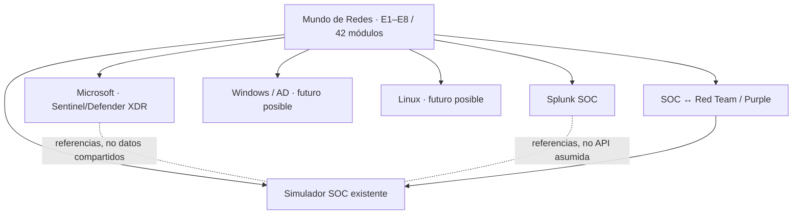

# Mundo de Redes — Tanda 6/7: Integración entre mundos
**Fecha:** 2026-10-18 · **Estado:** propuesta curricular/documental para revisión humana; no se ha inspeccionado ni modificado ningún repositorio, web, base de datos, simulador, XP, cuenta o sistema.

## 0. Alcance, procedencia y límites
**Base leída realmente:** `redes.txt`, catálogo T2 (8 etapas, 42 módulos, 168 lecciones propuestas, 592 h estimadas), auditoría T3, T4 (12 casos SOC/Red) y laboratorios T5 (20 + 2 opcionales). Son referencias de diseño, no implementación ejecutada. Las 592 h y las 275 h prácticas de T5 no se suman. Todos los entregables previos permanecen inalterados.

**Método:** RESEARCHER compara documentación oficial y registra 24 fuentes; CRITIC identifica incompatibilidades, solapamientos, pérdida semántica y riesgos de progreso. Clasificación: **[D]** documentado externamente, **[R]** recomendación curricular, **[P]** requiere inspección/validación. No se afirman capacidades concretas de la academia sin leer sus fuentes, no se ejecuta código externo o pruebas, no se instalan herramientas.

### Decisiones principales
- **[R] Redes es propietario conceptual de los fundamentos y semántica de tráfico.** Los mundos Microsoft y Splunk lo son de sus consultas, ingesta y detecciones. Windows/AD y Linux conservan administración del host; el simulador conserva la experiencia de casos. Los enlaces son referencias docentes, nunca integración técnica supuesta.
- **[R] Mantener 42 módulos, 168 títulos y 592 h estimadas hasta auditoría T7.** No añadir lecciones completas ni fijar estimaciones extras no contrastadas.
- **[R] Resolver prerequisitos por competencias demostrables; no bloquear rutas enteras por mundo ni inferir dominio por XP.** El progreso actual no se toca.
- **[P] Contratos de fuentes deben ser comprobados si se pasa a implementación:** mismas palabras para campos de proveedor distintos no implican igual semántica; ASIM y CIM no se fusionan automáticamente.

## 1. Arquitectura conceptual de cruces

**Importante:** las flechas describen dependencias de conocimiento; no rutas de red, endpoints, contratos de API, sincronización de progreso ni equivalencias funcionales.

| Mundo | Redes enseña | Otro mundo enseña | Riesgo de confusión |
|---|---|---|---|
| Microsoft Sentinel + Defender XDR | significado de paquetes, sesiones, DNS, firewall, procedencia de logs, limitaciones y topología | KQL y hunting, conectores, ingesta, incidentes y detecciones de Microsoft | ASIM ≠ tablas crudas, Defender XDR Advanced Hunting ≠ todas las tablas de Sentinel; políticas/licencias importan |
| Splunk SOC | semántica de DNS, sesiones, flujos, firewall, IDS/NDR y ubicación de sensores | SPL, ingesta, sourcetypes, add-ons, CIM, correlación, búsquedas e investigación Splunk | CIM no equivale a ASIM; sourcetype no garantiza conformidad CIM |
| Windows / Active Directory | protocolos DNS/Kerberos/LDAP/SMB/RDP, rutas, puertos y segmentación | administración de Windows y AD, GPO, DNS server, autenticación, auditing, Windows Firewall | evento de autenticación ≠ flujo de red, nombre de usuario ≠ atribución corroborada |
| Linux | L2-L4, direccionamiento, routing, conexión, filtrado, captura y procedencia | red Linux operativa, permisos, journal, nftables/firewalld, SSH, servicios, scripts | journal ≠ syslog exportado; nftables ≠ firewalld aunque puedan compartir backend |
| Simulador SOC | ground truth docente, hipótesis, falsos positivos, límites y contratos de evidencia | decisiones, presentación de casos, simulación, debrief y progresión interna | reproducción de JSON sintético ≠ SIEM/telemetría real; puntuación ≠ dominio sin evidencia |
| Puente SOC ↔ Red Team | alcance de segmento, rutas permitidas, evidencia de dispositivo y controles de red | orquestar pruebas controladas, revisión colaborativa, corrección y retest de escenario aislado | observabilidad ≠ vulnerabilidad confirmada; actividad simulada ≠ compromiso |

## 2. Hallazgos verificados en documentación oficial
1. **[D] Syslog/CEF AMA:** Microsoft documenta recepción/forwarder, tablas `Syslog` y `CommonSecurityLog` y diferencias de `TimeGenerated`/`EventTime` por zona horaria. Los ejercicios deben conservar hora original y hora transformada [S01–S02].
2. **[D] ASIM:** `NetworkSession`, `Flow`, `EndpointNetworkSession` e `IDS` son categorías con distinta procedencia y semántica. Los pares paquete/sesión/evento IDS no deben agregarse indiscriminadamente. ASIM tiene parsers y fuentes soportadas condicionalmente [S03–S06].
3. **[D] Defender XDR:** `DeviceNetworkEvents` y `DeviceProcessEvents` están documentados, pero la presencia real de datos depende de productos y servicios desplegados. No pueden sustituirse sin validación por eventos de firewalls externos [S07–S08].
4. **[D] Splunk:** CIM 6.1 separa `Network Traffic` e `Intrusion Detection`, y Splunk Enterprise define `sourcetype` para clasificación y procesamiento al indexar. Correlacionar exige explicar campos reales, tipo y transformaciones; no basta una etiqueta [S09–S12].
5. **[D] Windows:** solicitudes TGS generan 4769 cuando la auditoría aplicable está habilitada en DC; 4624 identifica un inicio de sesión en host destino; auditoría WFP puede generar 5156/5157. No equivalen entre sí ni a prueba de movimiento lateral [S13–S15].
6. **[D] Linux:** journald no implica Syslog exportado: su forwarding y retención requieren configuración concreta; nftables exige definir logging si se espera ese tipo de evento; firewalld aplica políticas según zonas y direcciones [S16–S19].
7. **[D] ATT&CK:** la estructura actual incluye *Detection Strategies* y *Data Components*; fuentes antiguas de ATT&CK están deprecadas desde v18, pero siguen visibles por compatibilidad. El currículo no debe tratar mapeos de técnicas como prueba concluyente [S20–S22].
8. **[D] NIST SP 800-61 Rev.3** respalda enseñar evaluación de impacto, recuperación y mejora en las decisiones SOC y Purple, no solo una alerta aislada [S24].

## 3. Catálogo de 29 cruces curriculares — contrato uno a uno
Cada fila es una **referencia conceptual propuesta**: lo que aprende en Redes; qué curso se referencia, qué se reutiliza, cuál es la práctica y cómo se demuestra. El catálogo se enlaza a módulos estables `RED-M##`, laboratorios `RED-L##` y escenarios `S##` de los archivos previos.

### 3.1. Microsoft Sentinel + Defender XDR — 6 enlaces

#### RED-X001 — Syslog/CEF: origen y colector
- **Redes aprende:** Qué emite el dispositivo, reloj, forwarder, pérdida y timestamp. **Se referencia en destino:** Configuración AMA, DCR, ingesta y tablas Syslog/CommonSecurityLog.
- **Reutiliza sin duplicar:** RFC 5424 y procedencia de evento.
- **Práctica integradora:** Sobre 4 mensajes docentes comparar emisor, colector y timestamp transformado.
- **Evidencia:** Tabla de procedencia, 2 sesgos temporales y un control de duplicación. **Aceptación:** Identifica qué hora se usa; no inventa campos o ingesta real.
- **Trazabilidad:** RED-M07, RED-M26 · RED-L13, RED-L16 · casos: sin caso específico · fuentes: S01, S02, S23. **Estado:** diseñado, no integrado/probado.

#### RED-X002 — DNS normalizado e identidad de cliente
- **Redes aprende:** Resolución, caché, respuesta, src real/observado, DoH/DoT. **Se referencia en destino:** ASIM DNS, consulta KQL en el mundo Microsoft y orígenes disponibles.
- **Reutiliza sin duplicar:** RCODE, QueryName, DNS server, host/inventory.
- **Práctica integradora:** Comparar 3 eventos DNS crudos con representación normalizada sólo si campos documentados.
- **Evidencia:** Matriz campos presentes, ausentes, transformaciones y atribución con límites. **Aceptación:** No atribuye cliente por IP de recursor sin prueba adicional.
- **Trazabilidad:** RED-M06, RED-M07, RED-M28, RED-M29 · RED-L03, RED-L15 · casos: S01 · fuentes: S06, S04. **Estado:** diseñado, no integrado/probado.

#### RED-X003 — Sesión de red vs flujo e IDS
- **Redes aprende:** 5-tupla, flujo agregado, NAT, muestreo y verdict de firewall. **Se referencia en destino:** ASIM Network Session e investigación KQL en mundo Microsoft.
- **Reutiliza sin duplicar:** NetworkSession, Flow, EndpointNetworkSession, IDS.
- **Práctica integradora:** Clasificar dataset por tipo antes de calcular conexiones/volumen.
- **Evidencia:** Inventario de tipos EventType, límites del denominador y prueba negativa. **Aceptación:** Nunca suma un IDS como volumen total de red.
- **Trazabilidad:** RED-M17, RED-M27, RED-M30 · RED-L14, RED-L16 · casos: S02, S05 · fuentes: S03, S04, S05. **Estado:** diseñado, no integrado/probado.

#### RED-X004 — Defender XDR: conexión frente a proceso
- **Redes aprende:** Paquetes no demuestran proceso local; diferenciar conexión iniciada y vista endpoint. **Se referencia en destino:** DeviceNetworkEvents + DeviceProcessEvents; Advanced Hunting en mundo Microsoft.
- **Reutiliza sin duplicar:** correlación con timestamp, DeviceId y evidencia de identidad.
- **Práctica integradora:** Investigar un PCAP sin proceso y luego añadir un evento endpoint sintético.
- **Evidencia:** Tabla de hipótesis antes/después; condiciones mínimas para atribuir a proceso. **Aceptación:** No asume MDE habilitado o que toda conexión tenga evento.
- **Trazabilidad:** RED-M28, RED-M29, RED-M30 · RED-L15, RED-L16 · casos: S04, S07 · fuentes: S07, S08. **Estado:** diseñado, no integrado/probado.

#### RED-X005 — Calidad y deduplicación AMA/DCR
- **Redes aprende:** Pérdida, recolección, timestamp origen/ingesta y validación de parser. **Se referencia en destino:** Data collection rules, conectores y pruebas de KQL documentadas.
- **Reutiliza sin duplicar:** fuente → transformación → destino.
- **Práctica integradora:** Diseñar tres controles para DCR mal filtrada, evento duplicado y DST.
- **Evidencia:** Ficha de prueba con registros de entrada/salida esperados, sin ejecutar Azure. **Aceptación:** Campos/columnas comprobados en doc y pruebas sin afirmar ingestión.
- **Trazabilidad:** RED-M26, RED-M30, RED-M37 · RED-L13, RED-L16, RED-L18 · casos: sin caso específico · fuentes: S01, S02. **Estado:** diseñado, no integrado/probado.

#### RED-X006 — Contención: propuesta ≠ acción
- **Redes aprende:** Rutas e impacto de cerrar un flujo, alternativas y rollback. **Se referencia en destino:** Incidentes/playbooks y administración Microsoft se referencian sin ejecutarlos.
- **Reutiliza sin duplicar:** criterios de parada e impacto de negocio.
- **Práctica integradora:** Elegir contención ante sesión permitida y explicar efectos secundarios.
- **Evidencia:** Orden de cambio hipotética, plan de rollback, autorizaciones. **Aceptación:** Rechaza bloquear gateway crítico sin evaluación.
- **Trazabilidad:** RED-M21, RED-M31, RED-M35 · RED-L16, RED-L20 · casos: sin caso específico · fuentes: S24, S03. **Estado:** diseñado, no integrado/probado.

### 3.2. Splunk SOC — 5 enlaces

#### RED-X007 — Ingesta, sourcetype y tiempo
- **Redes aprende:** Syslog origen, event breaking, identidad de dispositivo, hora y pérdida. **Se referencia en destino:** inputs/props, parsing, sourcetypes y SPL en mundo Splunk.
- **Reutiliza sin duplicar:** timestamp original e ingesta, RFC 5424.
- **Práctica integradora:** Comparar cinco logs con sourcetypes intencionadamente erróneos.
- **Evidencia:** Registro de eventos mal partidos, zona horaria y consecuencia en correlación. **Aceptación:** Explica que sourcetype no prueba formato correcto.
- **Trazabilidad:** RED-M07, RED-M26 · RED-L13 · casos: sin caso específico · fuentes: S11, S23. **Estado:** diseñado, no integrado/probado.

#### RED-X008 — CIM Network Traffic
- **Redes aprende:** Sesión stateful, decisión L3/L4, bytes, NAT y sensores. **Se referencia en destino:** SPL y aceleración de data models; mapeo CIM en Splunk.
- **Reutiliza sin duplicar:** src, dest, src_port, dest_port, action, bytes y campos opcionales.
- **Práctica integradora:** Mapear un evento de firewall sintético al contrato de campos CIM.
- **Evidencia:** Matriz raw/CIM/transformación/ausente, tests positivo y negativo. **Aceptación:** No atribuye bytes por dirección si el reporte no especifica dirección.
- **Trazabilidad:** RED-M17, RED-M21, RED-M27 · RED-L14, RED-L16 · casos: S02, S05 · fuentes: S09, S12. **Estado:** diseñado, no integrado/probado.

#### RED-X009 — CIM Intrusion Detection y falsos positivos
- **Redes aprende:** Diferenciar alerta IDS de denegación de firewall y evidencia corroborativa. **Se referencia en destino:** Modelo Intrusion Detection y detecciones SPL en mundo Splunk.
- **Reutiliza sin duplicar:** regla/sensor, contexto, FP/FN, enriquecimiento.
- **Práctica integradora:** Comparar una alerta IDS y un firewall allow con mismo 5-tuple.
- **Evidencia:** Caso con decisión y dos hipótesis contrastables. **Aceptación:** No transforma firma IDS en compromiso confirmado.
- **Trazabilidad:** RED-M27, RED-M29, RED-M30 · RED-L14, RED-L16 · casos: S05 · fuentes: S09, S10, S20. **Estado:** diseñado, no integrado/probado.

#### RED-X010 — DNS y correlación entre fuentes
- **Redes aprende:** DNS resolver, DHCP/NAT y sesgos de zona horaria. **Se referencia en destino:** SPL, mapeos de identidad, fuentes y correlación del mundo Splunk.
- **Reutiliza sin duplicar:** inventario IP→host→cuenta con intervalos válidos.
- **Práctica integradora:** Reconstruir secuencia DNS+DHCP+firewall con recursión y NAT.
- **Evidencia:** Cronología UTC con valores nulos y límites. **Aceptación:** No usa la misma IP histórica para usuarios de distinto lease.
- **Trazabilidad:** RED-M07, RED-M28, RED-M29 · RED-L15, RED-L16 · casos: S01 · fuentes: S11, S12, S24. **Estado:** diseñado, no integrado/probado.

#### RED-X011 — Calidad del dataset y tests de detección
- **Redes aprende:** Cobertura sensor, casos negativos, schema contract y falsos positivos. **Se referencia en destino:** búsquedas/reglas SPL/versionado/correlación en mundo Splunk.
- **Reutiliza sin duplicar:** controles de regresión, evidencia de cambios.
- **Práctica integradora:** Definir manifest de dataset, eventos esperados y ausencia esperada.
- **Evidencia:** Ficha con ground truth, casos hard negatives y rangos de tiempo. **Aceptación:** No declara detección probada sin ejecución reproducible.
- **Trazabilidad:** RED-M26, RED-M30, RED-M36 · RED-L16, RED-L18 · casos: sin caso específico · fuentes: S09, S10, S11, S24. **Estado:** diseñado, no integrado/probado.

### 3.3. Windows / Active Directory — 5 enlaces

#### RED-X012 — DNS de dominio y resolución de servicios
- **Redes aprende:** DNS, SRV, caches, ruta a DC y puertos conceptuales. **Se referencia en destino:** configuración DNS en AD y DC locator del futuro mundo Windows/AD.
- **Reutiliza sin duplicar:** fallo DNS vs fallo autenticación.
- **Práctica integradora:** Diagnóstico offline con registros sintéticos de SRV y DNS erróneo.
- **Evidencia:** Hipótesis causa raíz y solución/rollback. **Aceptación:** No infiere que Kerberos cayó solo porque DNS falló.
- **Trazabilidad:** RED-M06, RED-M07, RED-M12 · RED-L05, RED-L15 · casos: sin caso específico · fuentes: S13, S14. **Estado:** diseñado, no integrado/probado.

#### RED-X013 — Kerberos TGS y tráfico de autenticación
- **Redes aprende:** Intercambio Kerberos observable vs información invisible en TLS, tiempo y puertos. **Se referencia en destino:** eventos DC 4769, auditoría, tickets y SPN en futuro mundo AD.
- **Reutiliza sin duplicar:** DC evidencia de ticket ≠ paquete de aplicación.
- **Práctica integradora:** Correlacionar 4769 en DC con flujo sintético hacia servidor SMB.
- **Evidencia:** Cronología fuente DC+flujo, límites de usuario/dispositivo. **Aceptación:** Distingue TGS concedido de acceso exitoso al recurso.
- **Trazabilidad:** RED-M06, RED-M28, RED-M29 · RED-L03, RED-L15 · casos: S07 · fuentes: S13, S14. **Estado:** diseñado, no integrado/probado.

#### RED-X014 — SMB/LDAP/RDP y segmentación
- **Redes aprende:** puertos, sesiones, firewall en capa de red y ruta de vuelta. **Se referencia en destino:** ACL Windows/AD, permisos de recurso, GPO, roles, auditoría.
- **Reutiliza sin duplicar:** IP/puerto permitido no significa permiso de aplicación.
- **Práctica integradora:** Validar matriz allow/deny ficticia entre zonas de laboratorio aislado.
- **Evidencia:** Tráfico esperado vs observado, firewall logs y resultado de servicio. **Aceptación:** Separa fallo de ACL de acceso denegado por SMB.
- **Trazabilidad:** RED-M06, RED-M21, RED-M33, RED-M34 · RED-L10, RED-L17 · casos: S09 · fuentes: S14, S15, S24. **Estado:** diseñado, no integrado/probado.

#### RED-X015 — Windows Filtering Platform y atribución
- **Redes aprende:** firewall stateful, eventos permitidos/bloqueados y local/remote. **Se referencia en destino:** habilitación auditoría WFP y Event ID 5156/5157 en futuro AD.
- **Reutiliza sin duplicar:** ubicación evento ≠ punto intermedio.
- **Práctica integradora:** Comparar 5156 y evento firewall perimetral que ve NAT.
- **Evidencia:** Cadenas de actor, origen original/observado y campos ausentes. **Aceptación:** Evita doble contabilización y atribución sin NAT/DHCP.
- **Trazabilidad:** RED-M21, RED-M26, RED-M29 · RED-L10, RED-L15 · casos: sin caso específico · fuentes: S15, S14. **Estado:** diseñado, no integrado/probado.

#### RED-X016 — Relojes, identidad y movimiento lateral como hipótesis
- **Redes aprende:** correlación multi-fuente, ruta lateral y cronología UTC. **Se referencia en destino:** auditoría Windows/AD, registro de logon 4624 y autenticación.
- **Reutiliza sin duplicar:** logon type y observación en host destino.
- **Práctica integradora:** Investigar patrón SMB/RDP que resulta en mantenimiento autorizado.
- **Evidencia:** Informe hecho/hipótesis/alternativa; recomendación de validación. **Aceptación:** No etiqueta un 4624 tipo 3 como intrusión por sí solo.
- **Trazabilidad:** RED-M07, RED-M29, RED-M31 · RED-L15, RED-L16 · casos: S07 · fuentes: S14, S24, S20. **Estado:** diseñado, no integrado/probado.

### 3.4. Linux — 5 enlaces

#### RED-X017 — Interfaces, vecinos y rutas Linux
- **Redes aprende:** IP, ARP/ND, route, tablas y hop-by-hop. **Se referencia en destino:** iproute2, namespaces y diagnóstico de servicios en futuro mundo Linux.
- **Reutiliza sin duplicar:** subnetting, routing, gateway y MTU.
- **Práctica integradora:** Resolver una tabla de rutas pregrabada con ruta por defecto incorrecta.
- **Evidencia:** Capturas de salidas y explicación de siguiente salto. **Aceptación:** Diferencia interfaz down de ACL/firewall.
- **Trazabilidad:** RED-M01, RED-M03, RED-M12 · RED-L01, RED-L02, RED-L06 · casos: sin caso específico · fuentes: S23. **Estado:** diseñado, no integrado/probado.

#### RED-X018 — nftables: política vs observación
- **Redes aprende:** direccionalidad, conntrack, reglas, allow/deny y counters. **Se referencia en destino:** nft, política Linux y restauración en futuro mundo Linux.
- **Reutiliza sin duplicar:** estado de conexión y trazado controlado.
- **Práctica integradora:** Sobre reglas de ejemplo, localizar por qué puerto 443 queda denegado.
- **Evidencia:** Diagrama de hooks y traza esperada, plan revert. **Aceptación:** No presupone que todo drop genera syslog.
- **Trazabilidad:** RED-M21, RED-M22, RED-M34 · RED-L10, RED-L17 · casos: sin caso específico · fuentes: S17, S18, S24. **Estado:** diseñado, no integrado/probado.

#### RED-X019 — firewalld y zonas
- **Redes aprende:** segmentación L3, zonas y dirección de política. **Se referencia en destino:** firewall-cmd y políticas/zonas de Linux futuro.
- **Reutiliza sin duplicar:** camino de paquete interzona.
- **Práctica integradora:** Diagnosticar tráfico en zona incorrecta sin tocar host.
- **Evidencia:** Política de entrada/salida y dos pruebas (allow, deny). **Aceptación:** No equipara firewalld a lista literal de reglas nft.
- **Trazabilidad:** RED-M20, RED-M21, RED-M23 · RED-L10 · casos: sin caso específico · fuentes: S19. **Estado:** diseñado, no integrado/probado.

#### RED-X020 — journald/Syslog, hora y preservación
- **Redes aprende:** hora UTC, origen, colector, pérdida y permisos. **Se referencia en destino:** journalctl, rsyslog/syslog-ng y configuración en Linux futuro.
- **Reutiliza sin duplicar:** cadena de evidencia journal→relay→SIEM.
- **Práctica integradora:** Clasificar ejemplos journald y Syslog enviados/no enviados.
- **Evidencia:** Matriz de presencia, retención y sesgo UTC. **Aceptación:** No presupone ForwardToSyslog habilitado.
- **Trazabilidad:** RED-M07, RED-M26, RED-M29 · RED-L13, RED-L15 · casos: sin caso específico · fuentes: S16, S23. **Estado:** diseñado, no integrado/probado.

#### RED-X021 — SSH, servicio de red y captura
- **Redes aprende:** handshake TCP/TLS según protocolo, SSH, puertos, captura. **Se referencia en destino:** administración SSH, tcpdump, permisos y journal en mundo Linux futuro.
- **Reutiliza sin duplicar:** pcap no expone credenciales cifradas.
- **Práctica integradora:** Analizar PCAP SSH cifrado + journal sintético de login.
- **Evidencia:** Discrimina conexión, autenticación y sesión exitosa. **Aceptación:** No infiere usuario/contraseña desde captura cifrada.
- **Trazabilidad:** RED-M05, RED-M06, RED-M28 · RED-L03, RED-L15 · casos: sin caso específico · fuentes: S16, S23. **Estado:** diseñado, no integrado/probado.

### 3.5. Simulador SOC — 4 enlaces

#### RED-X022 — Caso SOC: estructura de evidencia y procedencia
- **Redes aprende:** sensor, observación, errores, incertidumbre, UTC. **Se referencia en destino:** UI de escenarios, decisiones y revisión del simulador existente (sin asumir APIs).
- **Reutiliza sin duplicar:** eventos sintéticos con origen y ground truth.
- **Práctica integradora:** Convertir caso SOC S01 en ficha portable con evidencias visibles/ocultas.
- **Evidencia:** Manifest + oráculo + 2 alternativas explicadas. **Aceptación:** Nunca muestra ground truth como evento sensor.
- **Trazabilidad:** RED-M26, RED-M29 · RED-L13, RED-L15 · casos: S01 · fuentes: S24, S20. **Estado:** diseñado, no integrado/probado.

#### RED-X023 — Árbol de decisiones e hipótesis alternativas
- **Redes aprende:** triage, FP/FN, alcance, hipótesis independientes. **Se referencia en destino:** experiencia de decisiones y feedback de simulador por decidir.
- **Reutiliza sin duplicar:** evidencia favorable y contraria; revisión explicada.
- **Práctica integradora:** Diseñar 3 decisiones para un mismo caso con información incompleta.
- **Evidencia:** Feedback distingue incertidumbre de fallo y penaliza sobreatribución. **Aceptación:** No otorga éxito por encontrar indicador aislado.
- **Trazabilidad:** RED-M29, RED-M30 · RED-L15, RED-L16 · casos: sin caso específico · fuentes: S24, S20. **Estado:** diseñado, no integrado/probado.

#### RED-X024 — Prueba de competencia sin inventar progreso
- **Redes aprende:** transferencia de criterio, evidencia en nuevos escenarios. **Se referencia en destino:** progreso/XP de simulador solo si su sistema lo permite y se aprueba.
- **Reutiliza sin duplicar:** rúbrica de competencia vs narrativa gamificada.
- **Práctica integradora:** Diseñar diagnóstico con test distinto de caso entrenado.
- **Evidencia:** Métrica correcta de habilidad independiente de XP y finalización. **Aceptación:** No cambia datos históricos/XP; no implica equivalencias automáticas.
- **Trazabilidad:** RED-M30, RED-M42 · RED-L16, RED-L20 · casos: sin caso específico · fuentes: S24. **Estado:** diseñado, no integrado/probado.

#### RED-X025 — Misión de recuperación verificable
- **Redes aprende:** contención autorizada, rollback y recuperación. **Se referencia en destino:** debrief y revisión de decisiones de simulador si soporta.
- **Reutiliza sin duplicar:** estados previo/post y evidencias.
- **Práctica integradora:** Crear caso de falso positivo en política de egress y retest.
- **Evidencia:** Aprobación por continuidad, evidencia y reversión. **Aceptación:** No marca rollback ejecutado si es ejercicio de papel.
- **Trazabilidad:** RED-M31, RED-M35, RED-M41 · RED-L20 · casos: sin caso específico · fuentes: S24. **Estado:** diseñado, no integrado/probado.

### 3.6. Puente SOC ↔ Red Team — 4 enlaces

#### RED-X026 — Alcance de prueba controlada
- **Redes aprende:** CIDR autorizado, ventana, activos, criterio de parada. **Se referencia en destino:** reutilizar resultados en ramo SOC para clasificar eventos de prueba.
- **Reutiliza sin duplicar:** ROE y etiquetas de actividad de laboratorio.
- **Práctica integradora:** Comparar lista de objetivos aprobados y 3 solicitudes fuera de alcance.
- **Evidencia:** Matriz permitidos/prohibidos y decisión de no ejecutar. **Aceptación:** Cualquier actividad fuera de alcance es fallo crítico.
- **Trazabilidad:** RED-M32, RED-M33 · RED-L17, RED-L20 · casos: S03 · fuentes: S24. **Estado:** diseñado, no integrado/probado.

#### RED-X027 — Generación de actividad vs sensores
- **Redes aprende:** punto observación, falsas ausencias, NAT/segmentación. **Se referencia en destino:** insumos de casos para analista SOC y verificación Red Team.
- **Reutiliza sin duplicar:** paquete/flow/alerta representan distintas cosas.
- **Práctica integradora:** Emular escenarios offline de descubrimiento y comprobar qué fuente detectaría.
- **Evidencia:** Tabla actividad → sensor → señal esperada → señal no observable. **Aceptación:** No declara detección real ni cobertura sin datos.
- **Trazabilidad:** RED-M27, RED-M30, RED-M33 · RED-L14, RED-L17, RED-L20 · casos: S05 · fuentes: S03, S09, S20. **Estado:** diseñado, no integrado/probado.

#### RED-X028 — Control permite/deniega y remediación
- **Redes aprende:** ACL, routing, IPsec/segmentación, prueba positiva y negativa. **Se referencia en destino:** análisis SOC asociado, evidencia de firewall y retorno.
- **Reutiliza sin duplicar:** control distinto de telemetría.
- **Práctica integradora:** Diseñar test de aislamiento entre 3 segmentos y comprobar retorno.
- **Evidencia:** Matriz de acceso antes/después + falsa alarma descartada. **Aceptación:** No declara fallo de control si una prueba falla por DNS/routing.
- **Trazabilidad:** RED-M21, RED-M34, RED-M35 · RED-L10, RED-L17, RED-L20 · casos: S09 · fuentes: S24, S15. **Estado:** diseñado, no integrado/probado.

#### RED-X029 — Corrección/retorno y reporte conjunto
- **Redes aprende:** causa raíz, cambio controlado, retest, recuperación. **Se referencia en destino:** informe Purple Team, hallazgos, validación de detecciones.
- **Reutiliza sin duplicar:** atribución con incertidumbre y autorización.
- **Práctica integradora:** Realizar en papel una corrección que preserve DNS/servicios y logging.
- **Evidencia:** Reporte SOC+Red con prueba de no regresión, criterios de rollback. **Aceptación:** Concluir solo al demostrar recuperación en entorno ejecutado.
- **Trazabilidad:** RED-M31, RED-M35, RED-M41 · RED-L16, RED-L20 · casos: sin caso específico · fuentes: S24. **Estado:** diseñado, no integrado/probado.

## 4. Cruces indexados desde los 42 módulos (vista de cobertura)
| Módulo | Etapa | Enlaces | Destinos |
|---|---|---|---|
| RED-M01 | E1 | RED-X017 | LX |
| RED-M02 | E1 | — | Solo tronco común |
| RED-M03 | E1 | RED-X017 | LX |
| RED-M04 | E1 | — | Solo tronco común |
| RED-M05 | E1 | RED-X021 | LX |
| RED-M06 | E1 | RED-X002, RED-X012, RED-X013, RED-X014, RED-X021 | MS, AD, LX |
| RED-M07 | E2 | RED-X001, RED-X002, RED-X007, RED-X010, RED-X012, RED-X016, RED-X020 | MS, SPL, AD, LX |
| RED-M08 | E2 | — | Solo tronco común |
| RED-M09 | E2 | — | Solo tronco común |
| RED-M10 | E2 | — | Solo tronco común |
| RED-M11 | E2 | — | Solo tronco común |
| RED-M12 | E3 | RED-X012, RED-X017 | AD, LX |
| RED-M13 | E3 | — | Solo tronco común |
| RED-M14 | E3 | — | Solo tronco común |
| RED-M15 | E3 | — | Solo tronco común |
| RED-M16 | E3 | — | Solo tronco común |
| RED-M17 | E3 | RED-X003, RED-X008 | MS, SPL |
| RED-M18 | E3 | — | Solo tronco común |
| RED-M19 | E3 | — | Solo tronco común |
| RED-M20 | E4 | RED-X019 | LX |
| RED-M21 | E4 | RED-X006, RED-X008, RED-X014, RED-X015, RED-X018, RED-X019, RED-X028 | MS, SPL, AD, LX, PUR |
| RED-M22 | E4 | RED-X018 | LX |
| RED-M23 | E4 | RED-X019 | LX |
| RED-M24 | E4 | — | Solo tronco común |
| RED-M25 | E4 | — | Solo tronco común |
| RED-M26 | E5 | RED-X001, RED-X005, RED-X007, RED-X011, RED-X015, RED-X020, RED-X022 | MS, SPL, AD, LX, SIM |
| RED-M27 | E5 | RED-X003, RED-X008, RED-X009, RED-X027 | MS, SPL, PUR |
| RED-M28 | E5 | RED-X002, RED-X004, RED-X010, RED-X013, RED-X021 | MS, SPL, AD, LX |
| RED-M29 | E5 | RED-X002, RED-X004, RED-X009, RED-X010, RED-X013, RED-X015, RED-X016, RED-X020, RED-X022, RED-X023 | MS, SPL, AD, LX, SIM |
| RED-M30 | E5 | RED-X003, RED-X004, RED-X005, RED-X009, RED-X011, RED-X023, RED-X024, RED-X027 | MS, SPL, SIM, PUR |
| RED-M31 | E5 | RED-X006, RED-X016, RED-X025, RED-X029 | MS, AD, SIM, PUR |
| RED-M32 | E6 | RED-X026 | PUR |
| RED-M33 | E6 | RED-X014, RED-X026, RED-X027 | AD, PUR |
| RED-M34 | E6 | RED-X014, RED-X018, RED-X028 | AD, LX, PUR |
| RED-M35 | E6 | RED-X006, RED-X025, RED-X028, RED-X029 | MS, SIM, PUR |
| RED-M36 | E7 | RED-X011 | SPL |
| RED-M37 | E7 | RED-X005 | MS |
| RED-M38 | E7 | — | Solo tronco común |
| RED-M39 | E7 | — | Solo tronco común |
| RED-M40 | E8 | — | Solo tronco común |
| RED-M41 | E8 | RED-X025, RED-X029 | SIM, PUR |
| RED-M42 | E8 | RED-X024 | SIM |

**Criterio:** los módulos sin enlace directo mantienen una función técnica propia en Redes; no se inventan integraciones por obligación. La asignación se validará contra lecciones reales en T7.

## 5. Enlaces de los 20 laboratorios y escenarios T4
| Lab | Referencias de integración propuestas | Estado de implementación |
|---|---|---|
| RED-L01 | RED-X017 | diseñado; no ejecutado/validado |
| RED-L02 | RED-X017 | diseñado; no ejecutado/validado |
| RED-L03 | RED-X002, RED-X013, RED-X021 | diseñado; no ejecutado/validado |
| RED-L04 |  | diseñado; no ejecutado/validado |
| RED-L05 | RED-X012 | diseñado; no ejecutado/validado |
| RED-L06 | RED-X017 | diseñado; no ejecutado/validado |
| RED-L07 |  | diseñado; no ejecutado/validado |
| RED-L08 |  | diseñado; no ejecutado/validado |
| RED-L09 |  | diseñado; no ejecutado/validado |
| RED-L10 | RED-X014, RED-X015, RED-X018, RED-X019, RED-X028 | diseñado; no ejecutado/validado |
| RED-L11 |  | diseñado; no ejecutado/validado |
| RED-L12 |  | diseñado; no ejecutado/validado |
| RED-L13 | RED-X001, RED-X005, RED-X007, RED-X020, RED-X022 | diseñado; no ejecutado/validado |
| RED-L14 | RED-X003, RED-X008, RED-X009, RED-X027 | diseñado; no ejecutado/validado |
| RED-L15 | RED-X002, RED-X004, RED-X010, RED-X012, RED-X013, RED-X015, RED-X016, RED-X020, RED-X021, RED-X022, RED-X023 | diseñado; no ejecutado/validado |
| RED-L16 | RED-X001, RED-X003, RED-X004, RED-X005, RED-X006, RED-X008, RED-X009, RED-X010, RED-X011, RED-X016, RED-X023, RED-X024, RED-X029 | diseñado; no ejecutado/validado |
| RED-L17 | RED-X014, RED-X018, RED-X026, RED-X027, RED-X028 | diseñado; no ejecutado/validado |
| RED-L18 | RED-X005, RED-X011 | diseñado; no ejecutado/validado |
| RED-L19 |  | diseñado; no ejecutado/validado |
| RED-L20 | RED-X006, RED-X024, RED-X025, RED-X026, RED-X027, RED-X028, RED-X029 | diseñado; no ejecutado/validado |

Los **12 escenarios** de T4 permanecen como material fuente de pruebas. Sus enlaces se generan por mapeo explícito o afinidad de módulos (no por lectura de una API). El fichero JSON especifica `case_hooks` y `source_tanda4_status` para cada uno; esta relación NO prueba que el simulador soporte importarlos.

## 6. Competencias, progreso y niveles de evidencia
**Propuesta de registro independiente del motor:** una competencia tiene ID estable, nivel `no_evaluada`/`inicial`/`comprende`/`demuestra`/`transfiere`, evaluador, evidencia, versión de rúbrica, fecha UTC y confianza. XP/medallas y finalización quedan como metadatos narrativos, nunca sustitutos de dominio. No se migran, fusionan o reescriben progresos actuales.

| ID | Competencia | Evidencia exigible |
|---|---|---|
| NET-C001 | Captura/visibilidad y semántica | fuente, punto, protocolo y campos observables; ausencia declarada |
| NET-C002 | Cronología, normalización y atribución | UTC, zona, NAT, DHCP, identidad y calidad temporal |
| NET-C003 | Diseño y verificación de controles | matriz allow/deny, reglas, rutas y control negativo |
| NET-C004 | Decisión SOC basada en evidencia | hipótesis alternativas, alcance, limitaciones y escalado |
| NET-C005 | Red Team acotado y reproducible | ROE, mínimo necesario, actividad etiquetada y prueba reversibilidad |
| NET-C006 | Remediación y recuperación | config antes/después, plan rollback, servicios no afectados, retest |
| NET-C007 | Automatización responsable | scripts controlados, idempotencia, tests y aprobación de cambios |
| NET-C009 | Fundamentos de conectividad y diagnóstico | topología, interfaces, rutas, servicios y causa raíz transferible |
| NET-C008 | Comunicación y transferencia de dominio | explicación operacional en Microsoft, Splunk, Windows y Linux sin analogías falsas |

### Grafo acíclico, navegación y variantes
- El grafo de módulos en T2 ha sido revisado mediante comprobación de orden topológico: cada prerrequisito precede al módulo dependiente. Los enlaces de esta tanda **no son aristas de prerrequisito** y no crean ciclos nuevos.
- Si Windows/AD o Linux aún no existen, una ficha de referencia permanece como material complementario dentro de Redes o estado `próximamente`, pero no bloquea una evaluación.
- Una práctica en Microsoft/Splunk puede aumentar evidencia sobre la misma competencia únicamente tras revisión explícita y rúbrica común; **no existe sincronización automática bidireccional** por diseño.

## 7. Contratos de datos sugeridos para la incorporación futura
**Son propuestas de modelo de datos, no esquema comprobado del proyecto ni contrato de API que exista actualmente.**
### reference_contract
- `id`: RED-X###
- `world_id`: MS|SPL|AD|LX|SIM|PUR
- `module_ids`: IDs T2 existentes
- `lab_ids`: IDs T5 existentes
- `case_ids`: IDs T4 existentes
- `learn_in_redes`: resultado de aprendizaje propio
- `reference_in_other_world`: responsabilidad del mundo destino
- `knowledge_reused`: competencias que evita repetir
- `source_ids`: fuentes y versión
- `acceptance_criterion`: observable, revisión humana
- `execution_status`: nunca equivale a runtime

### competency_contract
- `competency_id`: NET-C###
- `level`: no_evaluada|inicial|comprende|demuestra|transfiere
- `evidence_id`: ID estable y origen
- `assessor`: docente o evaluador autorizado
- `rubric_version`: version de rúbrica
- `assessed_at_utc`: ISO-8601 o null
- `confidence`: baja|media|alta
- `expires_policy`: reevaluación pedagógica propuesta, no TTL automático

### artifact_contract
- `artifact_id`: ID único en sistema futuro
- `scenario_id`: S## u otro
- `source_kind`: synthetic|simulated|lab_recorded|real_authorized
- `producer`: origen o colector
- `event_time_utc`: ISO 8601 o null
- `ingest_time_utc`: ISO 8601 o null
- `timezone_assumptions`: explicitar
- `observed_ip`: IP vista sin garantía de identidad
- `sensor_position`: punto observación
- `field_provenance`: mapa de campos/transformaciones
- `sha256`: sha256 si archivo materializado
- `visibility_limits`: campos/condiciones ausentes
- `ground_truth_visibility`: hidden_from_student|shared_after_assessment

### case_contract
- `case_id`: S##
- `version`: semver semántico curricular; no requisito técnico de UI
- `premise`: hipótesis y propósito
- `authorization`: scope/lab isolated/no real data
- `artifact_ids`: fuentes sintéticas etiquetadas
- `timeline_anchor`: UTC y sesgos controlados
- `alternative_hypotheses`: ≥2
- `steps`: pistas y decisiones, sin requerir motor específico
- `expected_assertions`: oráculo separado
- `anti_assertions`: qué NO se puede inferir
- `rubric_id`: criterios vigentes
- `status`: designed|tested|validated + evidencia real
- `red_team_activity`: no usada fuera del laboratorio

### integration_adapter_contract
- `source_world`: MS|SPL|AD|LX|SIM
- `target_world`: RED
- `identifier_mapping`: tabla explícita; no alias en datos existentes
- `access_strategy`: referencia externa o recurso educativo enlazado, sin write
- `version_check`: manual al incorporar
- `permission_model`: sin pedir credenciales ni conexión durante investigación
- `rollback`: deshabilitar referencia nueva sin alterar progreso viejo
- `migration_approval`: separada; nunca automática

### change_management
- `no_automatic_modification`: True
- `two_phase`: mapear/validar antes de implementar
- `legacy_progress`: preservar y no reescribir
- `user_approval`: requerida
- `no_sync_of_xp`: por defecto
- `audit_trail`: propuesta de logs de migración y versionado si implementación aprobada

### Normas invariantes para un escenario portable
1. Separar `source_kind=synthetic|simulated|lab_recorded|real_authorized`; jamás presentar eventos sintéticos como producción.
2. Conservar evento original y transformaciones; tratar alias como hipótesis hasta documentar parser/campo/versionado.
3. Registrar UTC, reloj fuente, zona, periodo NAT/DHCP y punto de observación; valores desconocidos se dejan ausentes explícitamente.
4. Ground truth y scoring deben quedar fuera de la evidencia que ve el estudiante hasta el debrief; impedir filtraciones del oráculo.
5. Auditoría de cambios y rollback separados de la puntuación y navegación actual; cambios de runtime solo con aprobación posterior.

## 8. Seis prácticas piloto para verificar utilidad del diseño (NO ejecutadas)
### RED-P6-01 — DNS: misma historia con tres representaciones
- **Entrada:** dataset DOCENTE sintético: DNS resolver, DHCP de cliente e IP de recursor; tablas simuladas ASIM/CIM solo si mapeos constan en contrato.
- **Tarea:** separar endpoint real, recursor y observación; presentar con un formato portable de evidencia.
- **Resultado esperado:** dos hipótesis; trazabilidad de cliente y hora; campo ausente marcado como null, no inventado.
- **Control negativo:** evento DNS con cliente == recursor no prueba host original.
- **Trazabilidad:** links RED-X002, RED-X010, RED-X012; labs RED-L05, RED-L15; módulos RED-M07, RED-M29. **Estado:** diseñado, no ejecutado.

### RED-P6-02 — Firewall allow / IDS alert no equivalentes
- **Entrada:** dos registros sintéticos de mismo 5-tuple: firewall allow e IDS alert.
- **Tarea:** reconciliar acciones, sensores y oportunidad de bloqueo.
- **Resultado esperado:** tres conclusiones diferenciadas: conexión permitida, coincidencia de firma y compromiso no demostrado.
- **Control negativo:** detector no suma IDS al total de bytes/sesiones.
- **Trazabilidad:** links RED-X003, RED-X008, RED-X009; labs RED-L14, RED-L16; módulos RED-M27, RED-M30. **Estado:** diseñado, no ejecutado.

### RED-P6-03 — SMB/Kerberos: red vs identidad
- **Entrada:** flow SMB, evento 4769 y 4624 sintéticos con desfase UTC y host equivocado.
- **Tarea:** distinguir solicitud de ticket, inicio sesión y acceso efectivo.
- **Resultado esperado:** informe cronológico con evidencia positiva/negativa y lagunas.
- **Control negativo:** 4769 o 4624 aislado no confirma movimiento lateral.
- **Trazabilidad:** links RED-X013, RED-X014, RED-X016; labs RED-L15; módulos RED-M06, RED-M29. **Estado:** diseñado, no ejecutado.

### RED-P6-04 — Linux firewall: falta de log ≠ conexión ausente
- **Entrada:** reglas nftables y journald ficticios con política drop sin regla de logging.
- **Tarea:** explicar por qué falta evidencia y qué mediciones serían necesarias.
- **Resultado esperado:** diferencia config allow/deny vs log; control negativo trazable.
- **Control negativo:** sin syslog no significa sin paquete.
- **Trazabilidad:** links RED-X018, RED-X020; labs RED-L10, RED-L13; módulos RED-M21, RED-M26. **Estado:** diseñado, no ejecutado.

### RED-P6-05 — Caso SOC portable para simulador
- **Entrada:** S01 de T4 con hipótesis legítima y datos reducidos.
- **Tarea:** definir preguntas, decisiones, pistas, ground truth separado y rúbrica.
- **Resultado esperado:** manifest versionado y feedback explicable; sin persistir puntuación real.
- **Control negativo:** puntuar detección unívoca maliciosa es un fallo de diseño.
- **Trazabilidad:** links RED-X022, RED-X023, RED-X024; labs RED-L15, RED-L20; módulos RED-M29, RED-M42. **Estado:** diseñado, no ejecutado.

### RED-P6-06 — Purple Team: corrección que no rompe producción ficticia
- **Entrada:** topología aislada hipotética con DMZ, clientes y servidor DNS; ROE de prueba.
- **Tarea:** diseñar pruebas de aislamiento/retorno, correlación SOC y rollback.
- **Resultado esperado:** prueba positiva, negativa, decisión de parada, informe conjunto y retest condicionado.
- **Control negativo:** si la prueba falla por DNS no se etiqueta bypass de firewall.
- **Trazabilidad:** links RED-X026, RED-X027, RED-X028, RED-X029; labs RED-L17, RED-L20; módulos RED-M31, RED-M35, RED-M41. **Estado:** diseñado, no ejecutado.

## 9. Auditoría CRITIC — brechas, impacto, evidencia faltante y siguiente paso
| ID | Gravedad | Brecha | Impacto | Evidencia pendiente | Resolución sugerida |
|---|---|---|---|---|---|
| R01 | CRÍTICA | Motor/código de los mundos actuales no inspeccionado | Enlaces podrían romper navegación/progreso o crear duplicados | modelo actual de IDs, rutas y datos; lectura aprobada por propietario | revisar esquema/repositorio en etapa posterior, read-only, y definir adaptadores |
| R02 | CRÍTICA | Equivalencia de campos ASIM ↔ CIM ↔ CEF falsa | Pérdida de significado e informes erróneos | fixtures crudos y prueba de mapeos 1:1 condicionados por fuente | validar semántica y nulls por contrato y versión |
| R03 | ALTA | Conectores/licencias de Microsoft no verificados en entorno | Ejercicios presentan tablas inexistentes | inventario de servicios habilitados/licencias y sample data consentidos | mantener datasets sintéticos de aprendizaje y marcar rutas opcionales |
| R04 | ALTA | SPL y estructura de índices/add-ons del mundo Splunk desconocidos | Referencias duplican curso o queries fallan | currículo exacto y sourcetypes instalados; lectura aprobada | mapear lecciones reales sin generar SPL no verificado |
| R05 | ALTA | Futuros mundos Windows y Linux podrían no publicarse | Enlaces rotos o bloqueos indebidos | roadmap y política de disponibilidad | referencias soft y recursos fallback de Redes |
| R06 | ALTA | Simulador SOC sin contrato de importación conocido | Datos no portables y XP corrompida si se fuerza | export/schema/API documentados y semántica de rúbricas | usar fixtures externos y nunca mutar el simulador por ahora |
| R07 | ALTA | Diferencias TimeGenerated/EventTime y hora de origen | Falsas cronologías y atribución equivocada | registros de ejemplo con timezone y forwarder | test de desfase y registrar confidence por timestamp |
| R08 | ALTA | Diferencia de semántica Flow vs IDS y contadores | Doble conteo y métricas inválidas | declaración sensor/campo y test de volumen | separar conjuntos de eventos por EventType/modelo |
| R09 | ALTA | NAT, DHCP y atribución de identidad no garantizados | Asignación falsa a usuario o host | lease histórico, timestamps, NAT logs y sensor | permitir conclusiones desconocidas y confidence explícita |
| R10 | MEDIA | Cambio de versiones y documentación dinámica | Lecciones envejecen, parsers cambian | source version/date/last_checked + changelog | revisión periódica editorial, no afirmar reconfirmación sin acceso |
| R11 | MEDIA | Sobrecarga de evaluación 42 módulos + 20 labs | Curso se vuelve impracticable | piloto de tiempos/relevancia y ratio rúbricas | priorizar evidencias transferibles y rúbricas reutilizables |
| R12 | CRÍTICA | Actividad Red Team fuera de alcance aislado | Riesgo legal y técnico, indisponibilidad o datos reales | ROE, test aislamiento, permiso, reversibilidad | parada inmediata y fallo crítico; sin acciones en investigación |
| R13 | ALTA | Confundir estado diseñado con validado/ejecutado | Falsa sensación de completitud | captura de ejecución, logs, versiones, aprobador | estados separados con firmas y fecha UTC |
| R14 | ALTA | Reflejo de progreso/XP del simulador en evidencias | Convalidaciones injustificadas y posible pérdida de progreso | modelo gamificado actual, consentimiento y reglas explícitas | no conectar XP a dominio sin rúbrica y aprobación |

### Revisión de duplicados y conflictos
- DNS: concepto de resolución vive en Redes M07; implementación del servicio en AD/Linux; parsers/búsquedas de DNS en Microsoft/Splunk. Evitar repetir la misma lección DNS tres veces.
- Firewall: política/ruta y NAT viven en Redes M21/M17; nftables/Windows Firewall como instancias de OS; CIM/ASIM/SPL/KQL como observación. No extrapolar tags de una fuente a otra.
- Kerberos/SMB/RDP: Redes M06/M28 enseña flujo y observabilidad; AD futuro enseña autenticación, auditoría y permisos. Solicitud Kerberos no prueba acceso al recurso.
- PCAP: captura inicial M05 vs interpretación M28; los mundos SIEM consumen conclusión y provenance, no duplican formación Wireshark.
- SOC/Red Team: mismos datasets pueden alimentar evidencias distintas; separar autorización, hipótesis, detección y remediación. Se exige prueba positiva y negativa.
- Evaluación: las rúbricas SOC/Red/Purple de T4/T5 pueden ofrecer criterio común, pero no se suman puntajes de mundos como si fueran equivalentes. La aprobación requiere evidencias concretas.

## 10. Orden de posible incorporación (NO autorización para ejecutar)
| Orden | Fase posterior | Esfuerzo orientativo | Gate previo |
|---|---|---|---|
| 1 | inventario y solo lectura de arquitectura existente | 2–5 días-persona estimados | autorización del propietario para inspección; sin escribir |
| 2 | validación de enlaces y no duplicación | 3–6 días-persona estimados | revisión de responsables de MS, Splunk y simulador |
| 3 | prototipo documental de contratos y fixtures | 3–7 días-persona estimados | revision de documentación técnica y seguridad |
| 4 | piloto de 3 puentes conceptuales en copia aislada (fase posterior) | 5–10 días-persona estimados | permiso de implementación separado |
| 5 | extensión futura si pilotos pasan | sin base fiable hasta inspeccionar motores días-persona estimados | aprobación explícita y test de rollback |

**Esfuerzo expresamente orientativo de coordinación/diseño**, no presupuesto comercial, ni plazo de trabajo actual, ni compromiso de ejecución. Hasta inspeccionar la plataforma se desconoce el esfuerzo real de integración. La Tanda 6 se limita al diseño que ya se entrega.

## 11. Fuentes verificadas y fecha de consulta
Las fechas de publicación se incluyen solo cuando constan; para páginas dinámicas la versión de documentación y la versión efectiva en el entorno del alumno pueden divergir. IEEE/formatos propietarios no se inventan ni se redistribuyen. Todas las fuentes siguientes se consultaron documentalmente el 2026-10-18 y requieren reconfirmación antes de implementación.
| ID | Organización y título | Versión/documento | URL directa | Soporta | Confianza |
|---|---|---|---|---|---|
| S01 | Microsoft — Syslog and CEF AMA connectors — Microsoft Sentinel | sin versión fija; documentación dinámica | https://learn.microsoft.com/en-us/azure/sentinel/cef-syslog-ama-overview | CommonSecurityLog, Syslog, forwards, TimeGenerated/EventTime y posibles discrepancias | alta |
| S02 | Microsoft — Data Collection Rules in Azure Monitor | sin versión fija; documentación dinámica | https://learn.microsoft.com/en-us/azure/azure-monitor/data-collection/data-collection-rule-overview | DCR/DCRA, selección, transformación y destinos; revisar permisos/configuración de verdad | alta |
| S03 | Microsoft — The Advanced Security Information Model (ASIM) Network Session normalization schema | sin versión fija; documentación dinámica | https://learn.microsoft.com/en-us/azure/sentinel/normalization-schema-network | EventType NetworkSession/L2NetworkSession/Flow/EndpointNetworkSession/IDS; distinción de semántica | alta |
| S04 | Microsoft — Using the Advanced Security Information Model (ASIM) | sin versión fija; documentación dinámica | https://learn.microsoft.com/en-us/azure/sentinel/normalization-about-parsers | parsers unificadores y normalización; verificar fuente habilitada | alta |
| S05 | Microsoft — List of Microsoft Sentinel Advanced Security Information Model parsers | sin versión fija; documentación dinámica | https://learn.microsoft.com/en-us/azure/sentinel/normalization-parsers-list | matriz de parsers y fuentes de Network Session; no asumir instalación | alta |
| S06 | Microsoft — DNS over AMA connector reference — available fields and normalization schema | sin versión fija; documentación dinámica | https://learn.microsoft.com/en-us/azure/sentinel/dns-ama-fields | ASimDnsActivityLog y campos Windows DNS; disponibilidad condicional | alta |
| S07 | Microsoft — DeviceNetworkEvents table in the advanced hunting schema | sin versión fija; documentación dinámica | https://learn.microsoft.com/en-us/defender-xdr/advanced-hunting-devicenetworkevents-table | conexiones endpoint; campos y prerrequisito Defender for Endpoint | alta |
| S08 | Microsoft — Understand the advanced hunting schema | sin versión fija; documentación dinámica | https://learn.microsoft.com/en-us/defender-xdr/advanced-hunting-schema-tables | DeviceNetworkEvents, DeviceProcessEvents y entidades; implementación condicional | alta |
| S09 | Splunk — Common Information Model 6.1 — Network Traffic | CIM 6.1; doc 2025-07-10 | https://help.splunk.com/en/splunk-cloud-platform/common-information-model/6.1/data-models/network-traffic | campos src, dest, action, transport, bytes; diferencia frente Intrusion Detection | alta |
| S10 | Splunk — Common Information Model 6.1 — Intrusion Detection | CIM 6.1; doc 2025-07-10 | https://help.splunk.com/en/splunk-enterprise/common-information-model/6.1/data-models/intrusion-detection | distinción entre decisiones de conexión y alertas IDS | alta |
| S11 | Splunk — Why source types matter | Splunk Enterprise 10.0; doc 2025-07-18 | https://help.splunk.com/en/splunk-enterprise/get-started/get-data-in/10.0/configure-source-types/why-source-types-matter | sourcetype, event breaking y reconocimiento de timestamps | alta |
| S12 | Splunk — Network Traffic Field Mapping | CIM 6.1; doc 2025-07-10 | https://help.splunk.com/en/splunk-enterprise/common-information-model/6.1/field-mappings/network-traffic-field-mapping | mapeos por fuente no automáticos ni 1:1 | alta |
| S13 | Microsoft — Audit Kerberos Service Ticket Operations | documentación dinámica | https://learn.microsoft.com/en-us/windows/security/threat-protection/auditing/audit-kerberos-service-ticket-operations | evento 4769 en DC, volumen y condiciones de auditoría | alta |
| S14 | Microsoft — 4624: An account was successfully logged on | documentación dinámica | https://learn.microsoft.com/en-us/windows/security/threat-protection/auditing/event-4624 | evento 4624 y logon type; equipo donde se registra | alta |
| S15 | Microsoft — Audit Filtering Platform Connection | documentación dinámica | https://learn.microsoft.com/en-us/windows/security/threat-protection/auditing/audit-filtering-platform-connection | 5156/5157 éxito/fracaso y alto volumen potencial | alta |
| S16 | systemd / man-pages — journald.conf(5) | documentación dinámica de sistema | https://www.man7.org/linux/man-pages/man5/journald.conf.5.html | retención y ForwardToSyslog dependiente de receptor/almacenamiento | alta |
| S17 | netfilter — nftables wiki — Logging traffic | documentación dinámica | https://wiki.nftables.org/wiki-nftables/index.php/Logging_traffic | logging explícito y evaluación de reglas | alta |
| S18 | netfilter — nftables wiki — Ruleset debug/tracing | documentación dinámica | https://wiki.nftables.org/wiki-nftables/index.php/Ruleset_debug/tracing | diagnóstico por nftrace en entornos propios; controlar volumen | alta |
| S19 | firewalld — firewalld policies | documentación dinámica | https://firewalld.org/documentation/man-pages/firewalld.policies | políticas de zona, direccionalidad y activación | alta |
| S20 | MITRE — ATT&CK — Detection Strategies | documentación dinámica; marco posterior a v18 | https://attack.mitre.org/detectionstrategies/ | estrategias de detección y su distinción respecto de evidencia | alta |
| S21 | MITRE — ATT&CK — Data Components | documentación dinámica | https://attack.mitre.org/datacomponents/ | componentes observables; no validan por sí solos una técnica | alta |
| S22 | MITRE — ATT&CK — Data Sources deprecation | v18, octubre 2025 | https://attack.mitre.org/datasources/ | Data Sources legado deprecado, preferir nuevas referencias | alta |
| S23 | IETF — RFC 5424 — The Syslog Protocol | RFC 5424 (2009) | https://www.rfc-editor.org/rfc/rfc5424 | estructura Syslog para diferenciar formato en origen y parser | alta |
| S24 | NIST — SP 800-61 Rev.3 Incident Response Recommendations | Rev 3 final abril 2025 | https://csrc.nist.gov/pubs/sp/800/61/r3/final | preparación, respuesta, mejora y coordinación organizativa | alta |

## 12. Límites, revisión humana y entrega a Tanda 7
- **No comprobado:** estructura de carpetas o APIs de la academia, contenidos publicados, IDs de XP/progreso, migración posible, conectores realmente habilitados, versiones en equipos, licencias comerciales, ejecución o validación de prácticas; quedan como [P].
- **Sí comprobado localmente:** integridad referencial 42/42 módulos, 20/20 laboratorios, 12/12 casos T4, 29 enlaces propuestos, 24 fuentes, 9 competencias y grafo T2 sin ciclos. Eso **no equivale** a calidad pedagógica validada.
- **Tanda 7:** auditar transversalmente los seis entregables A–F del encargo, cerrar contradicciones entre tandas, reexaminar cobertura granular CCNA→CCNP, priorizar investigación faltante y emitir veredicto de preparación para revisión del propietario. **No pasar a implementación sin su aprobación.**

---
**Estado final T6:** investigación y diseño completados; ninguna lección final creada; ningún laboratorio, integración o prueba ejecutados; no se han modificado los entregables T1–T5.
