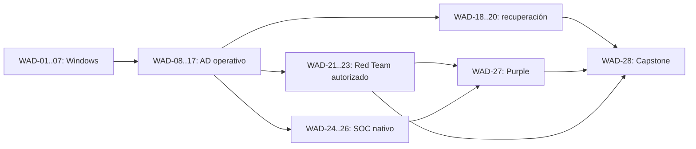

# TANDA 4 — WINDOWS + ACTIVE DIRECTORY: CONTINUIDAD, RECUPERACIÓN Y CURRÍCULO CONSOLIDADO

> **Tipo:** investigación documental y diseño curricular; **no** ejecución técnica, curso final publicado ni acreditación de laboratorios.  
> **Corte:** 18/10/2026 · **Estado:** entregable para revisión · **Tanda:** 4/4 · **Base:** `adwin(1).txt` (14 líneas) y entregables T1–T3 presentes en este proyecto.  
> **Formato pareado:** este informe Markdown y `Windows_AD_Tanda_4_Estructurado.json` comparten IDs de fuentes, etapas, lecciones, laboratorios y dependencias.

## 0. Resumen ejecutivo y decisiones verificables

**Decisión 1 — La recuperación es una competencia operativa, no un apéndice.** Hay que poder justificar qué restaurar, desde qué copia, con qué dependencias, tiempo aceptable de indisponibilidad y qué datos cambiarán. No basta saber ejecutar `wbadmin`; debe demostrarse restauración **y validación**. [D01–D07]

**Decisión 2 — Separar cuatro problemas muy distintos.** (a) Restauración de archivos/host, (b) restauración granular de objetos AD, (c) recuperación de un DC que conserva pares sanos y (d) recuperación de todo el bosque o de uno de sus dominios. Cada situación tiene condiciones, pérdida de datos y riesgos propios. [D02,D03,D10,D12,D33,D34]

**Decisión 3 — Protección frente a ransomware no equivale a sincronización ni a snapshot.** La replicación puede propagar borrados o configuraciones incorrectas; una instantánea de hipervisor no sustituye una copia AD-compatible. Para continuidad son esenciales respaldos protegidos, fuera de línea o equivalentes, y ensayos reales de restauración. [D13,D14,D27]

**Decisión 4 — Recuperar AD no siempre restaura la seguridad.** Si hubo una intrusión, una copia puede incluir configuraciones inseguras, permisos dañinos o mecanismos de autenticación ya comprometidos. La selección de una copia *de confianza* depende del momento y causa del incidente; la recuperación de bosque suele reservarse como última opción. [D03,D30]

**Decisión 5 — PKI y Tier 0 forman parte de la continuidad.** La recuperación de una autoridad de certificación requiere contemplar su base de datos, certificados, configuración y **clave privada**; el DSRM, la custodia de claves y las cuentas privilegiadas deben ser recuperables sin hacerlas públicas. [D16–D20]

**Decisión 6 — Consolidar, no sumar todos los esquemas provisionales.** Las tandas anteriores diseñaron 9 etapas WIN, 15 AD, 8 RT y 8 SOC. Esos **40 identificadores preliminares** convergen en **28 etapas finales propuestas**, con referencias cruzadas a cada ID original. Las lecciones y laboratorios están *propuestos*, no elaborados por completo ni probados. La reducción elimina repeticiones (p. ej., telemetría o autenticación reaparecían en diferentes rutas), sin suprimir competencias exigidas.

**Decisión 7 — Mapa secuencial con prerrequisitos reales.** La numeración refleja un orden pedagógico; el desbloqueo requiere la competencia que efectivamente se reutiliza. Así, la ruta de SOC puede empezar una vez dominados Windows y AD pertinentes, **sin obligar a aprobar Red Team**. La ruta completa alcanza administración, seguridad ofensiva autorizada, defensiva y recuperación.

**No se hizo:** no se instalaron VMs ni herramientas, no se accedió a un bosque real, no se ejecutó un restore, no se modificó ninguna web, no se validaron los 155 apuntes del *otro* prompt. No se afirma certificación de un entorno ni se asignan costes reales de hardware sin comprobar.

## 1. Alcance, método y grados de confianza

El archivo correcto, `adwin(1).txt`, pide administración Windows, AD DS, seguridad delegada y Tier 0, AD CS, backup/recuperación, Red Team autorizado, eventos/auditoría SOC, laboratorios seguros y secuencia de aprendizaje. Este informe completa esas áreas mediante el **diseño y la revisión**, no implementa el mundo.

- **Hecho documentado:** afirmación respaldada por una fuente primaria citada con su ID y URL exacta en § Bibliografía.
- **Decisión curricular:** orden, prerrequisito, métrica pedagógica o nivel; fundamentado en el modelo técnico pero no impuesto por Microsoft.
- **Estimación:** tiempo, RAM, almacenamiento, RTO/RPO objetivo y número de estudiantes son supuestos de planificación; se modificarán tras pilotos.
- **Pendiente de laboratorio:** comandos concretos bajo edición/rol, comportamiento de auditoría y recuperación, tiempos reales y compatibilidad del hipervisor.
- **Pendiente de alcance:** licencias de Windows cliente, CAL, costes de virtualización/almacenamiento; no afirmar gratuidad integral.

Se revisaron documentos de Microsoft Learn, Microsoft Evaluation Center y CISA; la bibliografía registra explícitamente la fecha de consulta y, si es visible, la fecha de la fuente. La referencia «s/f» significa **fecha editorial no verificada**, no que sea una guía antigua ni incorrecta. El índice de recuperación de Microsoft incluye Windows Server 2025, pero hay apartados que conservan ejemplos y consideraciones de otras versiones: verificar sus pasos contra la instalación real. [D02,D05,D31]

## 2. Recuperación: taxonomía y árbol de decisiones

### 2.1. Objetivo del negocio antes del comando

**RTO (Recovery Time Objective)** = duración máxima tolerada antes de recuperar un servicio crítico, objetivo acordado; **RPO (Recovery Point Objective)** = pérdida temporal máxima aceptable de datos, expresada como distancia respecto del punto recuperado. **RTA / RPA observados** son los resultados reales del ensayo; no se deben confundir con objetivos. Ejemplo *ficticio didáctico*: «RTO 2 h; RPO 4 h» significa que el plan debe intentar restablecer el servicio en dos horas y perder como máximo cuatro horas de modificaciones. No demuestra que el laboratorio lo consiga.

El primer paso es construir un BIA básico (Business Impact Analysis): procesos dependientes de inicio de sesión, DNS, LDAP, Kerberos, GPO, certificados, servidores de aplicaciones y credenciales de administración. Sin esto, «AD levantó» podría coexistir con autenticación de aplicaciones rota.

**Tabla de elección de mecanismo (simplificada; requiere validación situacional):**

| Incidente | Primera alternativa evaluable | Qué hay que comprobar | Opción de escalado / cuidado |
|---|---|---|---|
| Archivo accidentalmente borrado en miembro | Restauración granular del respaldo del archivo | Integridad, versión, propietario y permisos | No exige recuperar DC ni bosque. |
| Usuario/OU borrado | Papelera de AD si estaba habilitada **antes** y objeto aún recuperable | DN, grupos, atributos, periodo de retención | Si no aplica, valorar restauración autoritativa con equipo AD; no confundir con sincronización. |
| Fallo de un DC con otro DC sano | Reemplazo/promoción o recuperación compatible según causa | DNS, replicación, SYSVOL, salud del segundo DC | Restaurar snapshots indiscriminadamente puede generar inconsistencia. |
| Datos AD lógicamente incorrectos, replicados | Análisis de causa y mecanismo compatible; restauración granular/autor. según caso | Qué se replicó, tiempo de error, efectos de cambios posteriores | Una restauración no autoritativa podría volver a recibir los mismos datos incorrectos. |
| DC único dañado | Copia consistente y DSRM / BMR apropiados | Integridad backup, identidad DC, RTO posible | Alto riesgo sin DC par y sin backup verificado. |
| Bosque completo irrecuperable/comprometido | Proceso formal de forest recovery aislado | Copia confiable, una DC escribible por dominio, DNS, cuentas | Último recurso: obliga a limpieza y validación antes de reconectar. |
| CA / PKI comprometida o averiada | Plan de recuperación/migración CA y gestión de confianza | Clave privada, BD, plantillas, AIA, CRL, usuarios | Restaurar BD sin clave de CA no recupera la identidad criptográfica. |

La Papelera de AD no está activa por defecto, su habilitación no puede deshacerse y solo puede recuperar objetos eliminados **después** de habilitarla; por eso el LAB-13 usa un bosque descartable. [D12,D35]

### 2.2. System State, full server/BMR y snapshot no son equivalentes

**System State:** protege componentes del estado del sistema incluidos los datos y registros de AD en DC, registro, SYSVOL y otros componentes según roles. Microsoft documenta `Windows Server Backup` y `wbadmin start systemstatebackup`; el destino debe configurarse explícitamente y comprobarse después. [D06,D08]

**Full/Bare-Metal Recovery (BMR):** prepara para restaurar el sistema completo; es particularmente pertinente cuando no existe una instalación utilizable. Microsoft lo recomienda para estar preparado ante forest recovery. Las condiciones de discos, arranque y destino varían. [D07,D34]

**Snapshot/Checkpoint:** punto de estado del hipervisor. AD DS puede utilizar **VM-GenerationID** para detectar ciertas restauraciones y descartar el RID pool / renovar Invocation ID, siempre que la pila de virtualización realmente lo admita. Esto **no** convierte snapshots en backup válido de AD ni repara cualquier corrupción. No debe «volver atrás» todo un bosque restaurando varios DC simultáneamente. [D13–D15]

**Replicación:** mecanismo de convergencia de datos entre DC; no es backup, porque una operación de borrado accidental o cambio dañino correctamente replicado también puede propagarse. (Inferencia operativa derivada del modelo de replicación y recuperación; no es una cita literal.)

**Regla para la academia:** cada práctica debe demostrar una copia recuperable: catálogo de backup, integridad, restauración, conectividad, autenticación y aplicación. «Backup completed» no acredita capacidad de restauración. La recomendación de CISA es mantener copias offline/cifradas y comprobar regularmente su disponibilidad e integridad. [D27]

### 2.3. Caducidad lógica y confianza de los respaldos

Una copia muy reciente puede contener configuraciones ya comprometidas. Una copia demasiado antigua puede haber superado límites de retención de objetos eliminados y generar problemas de replicación (lingering objects). El **tombstone lifetime es configurable y su valor depende del historial de creación/actualización del bosque**: no enseñar un número universal de 60/180 días sin comprobar el atributo vigente. [D03,D23]

Antes de usar un backup se debe comprobar: fecha y cadena de custodia; procedencia y controles de acceso; validez de VSS/AD; versión de SO y roles; relación con momento de corrupción; edad frente a tombstone lifetime; credenciales DSRM/administración disponibles; impacto de cambios perdidos; y posibilidad real de restauración en aislamiento.

## 3. Recuperación a detalle: escenarios y procedimientos soportados

### 3.1. Granular: AD Recycle Bin y objetos

Condiciones: funcionalidad habilitada en el bosque antes de la eliminación, nivel funcional compatible, permisos apropiados y objeto dentro de su fase recuperable. Microsoft documenta ADAC y `Restore-ADObject`; la recuperación debe comprobar identidad, DN, grupos y accesos. Una restauración que regresa la cuenta a AD pero conserva permisos rotos **no está terminada**. [D12,D35]

**Propuesta de evaluación:** crear un usuario sintético, documentar atributos/membresías antes, eliminarlo dentro del alcance, recuperarlo, probar que las membresías y acceso a recurso señuelo son correctos y registrar el tiempo observado. Prueba negativa: un objeto eliminado antes de habilitar la Papelera no debe declararse recuperable por ella.

### 3.2. DC individual: reemplazo, no autoritativa y DSRM

Si hay otros DC sanos, no asumir que restaurar el DC dañado es la única alternativa. Comparar reconstrucción de un DC nuevo frente a restauración de estado del sistema de la misma instancia, con soporte del fabricante y condiciones de backup. La **restauración no autoritativa** permite que los datos existentes en réplicas sanas se sincronicen de nuevo; por definición no resuelve por sí sola un cambio lógico dañino ya replicado. [D10,D15]

El DSRM es un modo especial para restauración de servicios de directorio. La contraseña debe estar bajo custodia recuperable y segura. Windows LAPS contempla contraseñas DSRM respaldadas en AD con cifrado y requisitos concretos; el propio desastre puede dejar los DC inaccesibles, por lo que el procedimiento de recuperación de esas credenciales debe ensayarse *offline*. [D19,D20]

**Controles de no ejecución accidental:** no ejecutar `wbadmin start systemstaterecovery`, `ntdsutil`, restauraciones de VHD, ni manipulación de SYSVOL sin aprobación específica, respaldo verificado, ambiente aislado y plan de vuelta atrás. Las instrucciones de laboratorio se etiquetan como diseño hasta que un docente las valide.

### 3.3. SYSVOL: autoridad diferente de AD DS

SYSVOL, GPO y DFS Replication requieren decisiones específicas. Recuperar objetos de AD **no asegura** que las plantillas/archivos de GPO coincidan en SYSVOL. Microsoft diferencia recuperación autoritativa de DFSR replicado y ofrece alternativas según se realice System State restore o bare-metal restore; confundir «autoritativo para la base AD» con «autoritativo para SYSVOL» es un error operativo importante. [D11]

**Prueba prevista:** comprobar `\\dominio\SYSVOL`, versiones de GPO en AD y archivos, estado del servicio DFSR, coherencia de dos DC y `gpresult` tras recuperación. La extensión EXT-01 aísla una práctica autoritativa y exige instructor.

### 3.4. Recuperación de bosque: una secuencia de decisiones, no un comando único

Microsoft presenta un proceso de **último recurso**: determinar problema y causa → elegir modo de recuperación y copia confiable → restaurar **en aislamiento** el primer DC escribible de cada dominio (empezando raíz) → limpiar/reasegurar identidad, DNS, replicación y funciones → redesplegar otros DC → restaurar servicios y configuración de salida. [D02–D05,D30]

**Puntos críticos investigados:**

1. Inventariar *antes* dominios, DC, GC, FSMO, DNS, sites, trusts, CA y aplicaciones que dependen de identidad.
2. Definir cuál backup de cada dominio es *confiable*, y registrar los objetos/modificaciones que desaparecerán desde el corte.
3. Aislar la red de recuperación para impedir reconexión con DC dañinos. Evitar iniciar copias de DC antiguos que arriesguen contaminar el bosque.
4. Recuperar un DC escribible en cada dominio según el orden documentado; validar que DNS, tiempo, rol y servicios permiten autenticación.
5. Tratar FSMO, catálogo global, metadatos de DC abandonados y RID pools **según el procedimiento específico**, no por intuición. Son acciones potencialmente destructivas. [D04,D26]
6. Restablecer cuentas y confianza según causa y runbook aprobado, no por reflejo automático. En un forest recovery documentado, Microsoft exige **dos restablecimientos de `krbtgt` con espera de 10 h por defecto**, o más si se han ampliado las vidas de tickets; nunca automatizarlo en entorno operativo sin diseño y ventana. [D24]
7. Rediseñar/reintegrar nuevos DC y comprobar convergencia con `repadmin`/`dcdiag`, DNS y SYSVOL. La restauración inicial aislada es una fase; la recuperación de servicio depende de pruebas funcionales. [D21,D25]
8. Revalidar PKI, confianzas y aplicaciones y levantar un inventario de pérdidas: cuentas, equipos, contraseñas, objetos, GPO y cambios posteriores a copia. [D25]

**Importante:** la guía de recuperación forestal no es un manual completo de *incident response tras intrusión*: Microsoft advierte esa distinción. Las decisiones de erradicación, evidencia forense y regreso a producción requieren supervisión del equipo de respuesta, no simplemente «formatear y restaurar». [D30]

### 3.5. AD CS: recuperar confianza, no solo un servicio

Una CA funcional implica al menos **certificado/clave privada de CA, base de datos, configuración, lista de plantillas y distribución de confianza y revocación**. Microsoft separa explícitamente el backup de base de datos (`certutil -backupdb`) de la clave (`certutil -backupkey`); un PFX protegido sigue siendo secreto crítico. [D16–D18]

La recuperación debe comprobar emisión **y** rechazo de una solicitud fuera de permisos, validez de cadena, puntos CDP/CRL y AIA, continuidad del emisor, reglas de inscripción y compatibilidad de aplicaciones. Una CA restablecida que firma certificados pero tiene CRL inaccesibles o plantilla sobrepermisiva no cumple el objetivo.

**Árbol de dependencia PKI para el proyecto:** DNS disponible → repositorio de CA accesible → certificado/clave e identidad emisora correctos → plantillas/ACL correctas → CRL/AIA disponibles → emisión y revocación probadas → servicios consumidores validados. El orden exacto depende de topología de CA raíz subordinada/offline y del alcance real; diseño conceptual, no procedimiento universal.

## 4. Continuidad y defensa SOC/Red Team: hechos, límites, preguntas

| Condición de pérdida o ataque | Administración / continuidad | SOC en el origen | Red Team autorizado |
|---|---|---|---|
| Borrado de cuenta | Evaluar Recycle Bin, grupos, impacto y reversibilidad | Conservar registro de borrado si auditoría configurada; confirmar actor/host | Reportar alcance de delegación y contraprueba; no borrados masivos. |
| Fallo de autenticación | DNS, hora, SPN, trust, salud DC antes de cambiar credenciales | Correlacionar actividad de auth y calidad de logs; inferencia prudente | Estudiar rutas de SPN/delegación solo con cuentas sintéticas. |
| Cambio de GPO | RSOP, versión AD/SYSVOL, delegación y rollback | Auditar cambios si política/SACL los produce; documentar huecos | Validación inocua de ACL/scope, no persistencia sobre hosts reales. |
| Pérdida de DC | Determinar backup o redespliegue, replicación, role holders | Ver pérdida de fuente y cobertura residual | Evaluar riesgo de controles dependientes de DC, nunca causar interrupción real. |
| Ransomware / corrupción | Contener, seleccionar copia confiable, plan aislado | Preservar evidencia antes de reconstrucción; documentar pérdida volátil | Modelar capacidad de afectar backups bajo autorización; no cifrar datos. |
| CA comprometida | Revocar/reemitir y recuperar según plan PKI | Registrar hechos de solicitud/expedición si habilitados | Revisar plantillas y derechos; prueba sintética de petición. |

**No duplicar plataformas SIEM**: aquí se diseñan generación de eventos, política de auditoría, procedencia, retención, ausencia de datos y respuesta de host/directorio. No se crean reglas SPL/KQL, conectores, dashboards, playbooks de Sentinel o búsquedas Splunk: se referencian esos mundos existentes.

**Controles críticos de recuperación:** inventario de dependencias; MFA/custodia privilegiada donde aplique; copias protegidas con credenciales distintas y capacidad de restauración offline; LAPS y recuperación DSRM; ACL de backup/CA; segmentación de la red de rescate; vigilancia de errores de replicación; verificación de procesos de reaprovisionamiento tras crisis. Cada control requiere una prueba observable y un modo de fallo.

## 5. Laboratorios: infraestructura mínima, seguridad, costes y estados

### 5.1. Tres tamaños pedagógicos, no un hardware impuesto

| Perfil | VMs simultáneas previstas | RAM de VMs estimada | Uso | Limitaciones |
|---|---|---|---|---|
| Ligero | Win11 + Server Core DC | ~6–9 GiB agregados | Windows, DNS, identidad, GPO, autenticación y lecturas | 1 DC: sin escenario de replicación; margen del host aparte. |
| Estándar | Win11 + 2 DC Server Core | ~9–13 GiB de VMs | Replicación, fallos y recuperación con compañero | Equipo anfitrión de 16 GiB puede quedarse corto. |
| Ampliado | Win11 + 2 DC + CA/member + colector opcional | ~14–22+ GiB de VMs | PKI, Purple, simulacros completos | Puede requerir >=32 GiB anfitriona o ejecución por turnos. |

RAM, CPU, disco y tiempo son **estimaciones pedagógicas, no mínimos oficiales**. Microsoft publica requisitos mínimos del sistema, que no equivalen a desempeño de un laboratorio multivm. Para evitar sobrecargar una máquina, encender solo los nodos de cada ejercicio, ejecutar escenarios por turnos y emplear tabletop offline cuando sea suficiente. [D29]

**Software:** Windows Server 2025 Evaluation dispone de prueba de **180 días** bajo términos oficiales; la edición de Windows cliente puede requerir licencia propia. PowerShell, RSAT, herramientas nativas y documentación Microsoft se incluyen según SO/rol/edición. Los hipervisores locales pueden usarse si soportan el escenario; la compatibilidad **VM-GenerationID** se debe comprobar explícitamente antes de cualquier restore de DC. [D13,D28]

**Coste:** la prueba Server puede no tener precio por 180 días conforme a términos; esto **no** hace gratuitos electricidad, equipo, almacenamiento, hipervisor comercial, licencias de clientes o CAL en usos fuera de evaluación. Presupuesto operativo pendiente; ningún gasto, descarga ni instalación se ha efectuado.

### 5.2. Aislamiento y cadena de evidencia

Todas las VMs y cuentas deben ser **sintéticas**; red `host-only`/aislada y sin puentes a entornos reales. El DNS `ad.lab.test` usado en fichas es **ejemplo**, no un dominio registrado. No usar nombres reales, secretos ni datos de clientes. Deshabilitar enrutamiento/port-forward no aprobado. El instructor conserva un baseline y documenta cuándo un restore es destructivo.

**Ficha común obligatoria:** alcance, responsable, topología/versiones, prerequisitos, cambio solicitado, consecuencias, preparación/backup, resultado esperado, prueba positiva y negativa, evidencias con fuente/hora/hash cuando proceda, revisión de seguridad, tiempo estimado/observado, estado y limpieza. Si el ejercicio fue únicamente documental, anotar `diseñado_no_ejecutado` y no utilizar tiempos «medidos» inventados.

**Riesgo por clase:** LAB-01…LAB-12 mayoritariamente bajo/moderado (salvo cambios de DC y CA); LAB-13 habilita característica irreversible en bosque de prueba; LAB-14 contempla restauración de DC solo aislada; LAB-15 tabletop; extensiones SYSVOL/forest/PKI exigen autorización ampliada, instructor y respaldo verificable. Ninguna instrucción autoriza trabajo en sistemas ajenos.

## 6. Laboratorios propuestos (fichas operativas)

En la sección de fichas generada a continuación se documentan **20 laboratorios principales y 4 extensiones avanzadas opcionales**. El conjunto cubre de forma explícita administración, autenticación, GPO, replicación, PKI, hardening, SOC, Red Team autorizado y recuperación. Cada ficha requiere al menos una prueba positiva y una negativa para evitar validaciones superficiales.

### LAB-01 · Inventario y baseline Windows 

- **Etapas / nivel:** WAD-01, WAD-02 · base · **duración estimada:** 2–3 h · **estado:** diseñado, no ejecutado.
- **Topología y versiones de referencia:** 1 Win11 VM (Server 2025/Windows 11 según papel); red virtual aislada.
- **Preparación y dependencias:** Identidades sintéticas; baseline inicial; snapshot de la VM no-DC.
- **Tarea controlada:** Inventariar servicios, tareas, inicio, sistema de archivos y salud sin cambios.
- **Prueba positiva:** Identificar 5 servicios con PID, estado y ruta conforme a evidencia.
- **Prueba negativa:** Justificar por qué un proceso conocido no demuestra legitimidad.
- **Evidencia de aprobación:** Inventory.csv; esquema user/kernel; baseline firmado.
- **Límites y custodia:** Solo lectura, evitar reportar secretos.
- **Limpieza / reversión:** Sin cambios; verificar estado y destruir exportación sensible.
- **Herramientas y costes:** Windows/PowerShell/RSAT/Windows Server Backup/eventing nativo; extras según escenario y licencia. Evaluación Server 2025 180 días para aprendizaje conforme a términos; hardware/energía y disco no presupuestados, no afirmar coste cero integral.
- **Rúbrica y fuentes:** rúbrica estándar § 7; aprobado solo con resultado + contraprueba + reversión. [D29]

### LAB-02 · Tokens, DACL y acceso efectivo 

- **Etapas / nivel:** WAD-03, WAD-04 · base · **duración estimada:** 2–4 h · **estado:** diseñado, no ejecutado.
- **Topología y versiones de referencia:** 1 Win11 VM (Server 2025/Windows 11 según papel); red virtual aislada.
- **Preparación y dependencias:** Crear carpeta señuelo y 2 usuarios/grupos de laboratorio.
- **Tarea controlada:** Estudiar token, UAC, DACL, NTFS y share; corregir delegación excesiva.
- **Prueba positiva:** Usuario A entra donde hay permiso exacto.
- **Prueba negativa:** Usuario B no entra; revalidar no sobrepermisos.
- **Evidencia de aprobación:** Matriz identidad/objeto/permisos + pruebas testigo.
- **Límites y custodia:** No alterar permisos del host físico.
- **Limpieza / reversión:** Borrar usuarios y recurso señuelo; recuperar baseline.
- **Herramientas y costes:** Windows/PowerShell/RSAT/Windows Server Backup/eventing nativo; extras según escenario y licencia. Evaluación Server 2025 180 días para aprendizaje conforme a términos; hardware/energía y disco no presupuestados, no afirmar coste cero integral.
- **Rúbrica y fuentes:** rúbrica estándar § 7; aprobado solo con resultado + contraprueba + reversión. [D21]

### LAB-03 · PowerShell seguro y repeatability 

- **Etapas / nivel:** WAD-05 · base · **duración estimada:** 3–4 h · **estado:** diseñado, no ejecutado.
- **Topología y versiones de referencia:** 1 Win11 VM (Server 2025/Windows 11 según papel); red virtual aislada.
- **Preparación y dependencias:** Preparar datos no personales y carpeta temporal.
- **Tarea controlada:** Construir inventario con objetos estructurados, help, captura de errores y -WhatIf donde exista.
- **Prueba positiva:** Dos ejecuciones con el mismo inventario válido.
- **Prueba negativa:** Una ejecución frente a permiso denegado falla de forma explícita.
- **Evidencia de aprobación:** Script, logs, salida JSON/CSV, plan rollback.
- **Límites y custodia:** No elevar derechos de forma innecesaria.
- **Limpieza / reversión:** Eliminar temporales generados.
- **Herramientas y costes:** Windows/PowerShell/RSAT/Windows Server Backup/eventing nativo; extras según escenario y licencia. Evaluación Server 2025 180 días para aprendizaje conforme a términos; hardware/energía y disco no presupuestados, no afirmar coste cero integral.
- **Rúbrica y fuentes:** rúbrica estándar § 7; aprobado solo con resultado + contraprueba + reversión. [D21]

### LAB-04 · Servicio, DNS cliente y firewall 

- **Etapas / nivel:** WAD-06, WAD-07 · base · **duración estimada:** 3–4 h · **estado:** diseñado, no ejecutado.
- **Topología y versiones de referencia:** 2 hosts virtuales o 1 Win11 + servicio local (Server 2025/Windows 11 según papel); red virtual aislada.
- **Preparación y dependencias:** Reglas temporales para tráfico sintético en red virtual cerrada.
- **Tarea controlada:** Sembrar fallo benigno de conectividad, distinguir DNS de firewall/servicio y remediar.
- **Prueba positiva:** Funcionalidad vuelve con regla específica.
- **Prueba negativa:** Regla general «permitir todo» explícitamente rechazada.
- **Evidencia de aprobación:** Antes/después de Test-NetConnection y firewall + causa raíz.
- **Límites y custodia:** Nunca interferir con red anfitriona.
- **Limpieza / reversión:** Revertir reglas y servicios; comprobar conectividad original.
- **Herramientas y costes:** Windows/PowerShell/RSAT/Windows Server Backup/eventing nativo; extras según escenario y licencia. Evaluación Server 2025 180 días para aprendizaje conforme a términos; hardware/energía y disco no presupuestados, no afirmar coste cero integral.
- **Rúbrica y fuentes:** rúbrica estándar § 7; aprobado solo con resultado + contraprueba + reversión. [D21]

### LAB-05 · DC aislado, DNS y cliente 

- **Etapas / nivel:** WAD-08, WAD-09 · base · **duración estimada:** 4–6 h · **estado:** diseñado, no ejecutado.
- **Topología y versiones de referencia:** DC01 Server2025 + Win11 cliente en host-only (Server 2025/Windows 11 según papel); red virtual aislada.
- **Preparación y dependencias:** Dominio ficticio ad.lab.test; DNS interno; nombres/IP de ejemplo.
- **Tarea controlada:** Promover DC, publicar registros SRV, unir cliente y comprobar reloj.
- **Prueba positiva:** Join y autenticación sintética exitosos.
- **Prueba negativa:** Cliente sin DNS AD falla de modo explicado.
- **Evidencia de aprobación:** Mapa de topología, resultados nltest/dcdiag y DNS.
- **Límites y custodia:** Aislamiento: sin bridge a red corporativa/Internet de terceros.
- **Limpieza / reversión:** Destruir red y VM tras exportar inventario despersonalizado.
- **Herramientas y costes:** Windows/PowerShell/RSAT/Windows Server Backup/eventing nativo; extras según escenario y licencia. Evaluación Server 2025 180 días para aprendizaje conforme a términos; hardware/energía y disco no presupuestados, no afirmar coste cero integral.
- **Rúbrica y fuentes:** rúbrica estándar § 7; aprobado solo con resultado + contraprueba + reversión. [D21], [D29]

### LAB-06 · Usuarios, grupos, delegación y GPO 

- **Etapas / nivel:** WAD-10, WAD-12 · base · **duración estimada:** 3–5 h · **estado:** diseñado, no ejecutado.
- **Topología y versiones de referencia:** DC01 + Win11 (Server 2025/Windows 11 según papel); red virtual aislada.
- **Preparación y dependencias:** OU Operaciones, Helpdesk, usuario sin privilegios, GPO inocua.
- **Tarea controlada:** Crear cuentas sintéticas, delegar reseteo dentro de una OU y aplicar GPO reversible.
- **Prueba positiva:** Delegado solo modifica cuentas de OU; cliente recibe GPO.
- **Prueba negativa:** Acceso fuera de OU se deniega y una OU exenta no recibe GPO.
- **Evidencia de aprobación:** ACL delegación, gpresult/RSOP y estado final.
- **Límites y custodia:** Prohibido otorgar Domain Admin para «resolver» tareas.
- **Limpieza / reversión:** Revertir GPO y ACL, borrar señuelos.
- **Herramientas y costes:** Windows/PowerShell/RSAT/Windows Server Backup/eventing nativo; extras según escenario y licencia. Evaluación Server 2025 180 días para aprendizaje conforme a términos; hardware/energía y disco no presupuestados, no afirmar coste cero integral.
- **Rúbrica y fuentes:** rúbrica estándar § 7; aprobado solo con resultado + contraprueba + reversión. [D21]

### LAB-07 · Kerberos, SPN y cuenta servicio 

- **Etapas / nivel:** WAD-11 · base · **duración estimada:** 3–5 h · **estado:** diseñado, no ejecutado.
- **Topología y versiones de referencia:** DC01 + 1 miembro + Win11 (Server 2025/Windows 11 según papel); red virtual aislada.
- **Preparación y dependencias:** SPN y servicio de ejemplo sin credenciales reutilizadas.
- **Tarea controlada:** Trazar autenticación sintética, consultar SPN, documentar fallback y gMSA como alternativa.
- **Prueba positiva:** Servicio autorizado autentica y registra hechos esperados.
- **Prueba negativa:** SPN ausente provoca fallo diagnosticado sin asignar culpa a ataque.
- **Evidencia de aprobación:** Flujo AS/TGS, comandos de lectura, matriz explicación.
- **Límites y custodia:** Nunca extraer claves, tickets ajenos ni volcar LSASS.
- **Limpieza / reversión:** Restaurar configuración SPN original.
- **Herramientas y costes:** Windows/PowerShell/RSAT/Windows Server Backup/eventing nativo; extras según escenario y licencia. Evaluación Server 2025 180 días para aprendizaje conforme a términos; hardware/energía y disco no presupuestados, no afirmar coste cero integral.
- **Rúbrica y fuentes:** rúbrica estándar § 7; aprobado solo con resultado + contraprueba + reversión. [D21]

### LAB-08 · Replicación de dos DC sin sabotaje 

- **Etapas / nivel:** WAD-13 · base · **duración estimada:** 4–6 h · **estado:** diseñado, no ejecutado.
- **Topología y versiones de referencia:** DC01 + DC02 Server2025, red host-only (Server 2025/Windows 11 según papel); red virtual aislada.
- **Preparación y dependencias:** Promoción secundaria y línea base de replicación.
- **Tarea controlada:** Crear objetos señuelo, medir convergencia y simular caída de enlace virtual de prueba.
- **Prueba positiva:** Datos convergen al recuperar enlace y repadmin evidencia estado.
- **Prueba negativa:** Durante aislamiento no debe concluirse corrupción por un retraso aislado.
- **Evidencia de aprobación:** repadmin /replsummary; dcdiag; línea temporal; causa.
- **Límites y custodia:** Nunca forzar FSMO ni restaurar snapshot a ambos DC a la vez.
- **Limpieza / reversión:** Restablecer enlace y validar convergencia.
- **Herramientas y costes:** Windows/PowerShell/RSAT/Windows Server Backup/eventing nativo; extras según escenario y licencia. Evaluación Server 2025 180 días para aprendizaje conforme a términos; hardware/energía y disco no presupuestados, no afirmar coste cero integral.
- **Rúbrica y fuentes:** rúbrica estándar § 7; aprobado solo con resultado + contraprueba + reversión. [D21], [D22], [D13]

### LAB-09 · Tier 0 y custodia DSRM 

- **Etapas / nivel:** WAD-15 · base · **duración estimada:** 3–5 h · **estado:** diseñado, no ejecutado.
- **Topología y versiones de referencia:** DC01 + Win11 (Server 2025/Windows 11 según papel); red virtual aislada.
- **Preparación y dependencias:** Cuentas administrativas distintas en lab; roles y ACL ficticias.
- **Tarea controlada:** Mapear Tier 0, disminuir un permiso excesivo y diseñar custodia DSRM/LAPS.
- **Prueba positiva:** Admin Tier0 ejerce función permitida sin cuentas generalistas.
- **Prueba negativa:** Helpdesk no tiene permisos sobre DC ni lectura DSRM.
- **Evidencia de aprobación:** Matriz de roles, derechos efectivos y plan break-glass.
- **Límites y custodia:** No guardar contraseñas DSRM en evidencias ni repositorio.
- **Limpieza / reversión:** Revertir políticas y limpiar cuentas de prueba.
- **Herramientas y costes:** Windows/PowerShell/RSAT/Windows Server Backup/eventing nativo; extras según escenario y licencia. Evaluación Server 2025 180 días para aprendizaje conforme a términos; hardware/energía y disco no presupuestados, no afirmar coste cero integral.
- **Rúbrica y fuentes:** rúbrica estándar § 7; aprobado solo con resultado + contraprueba + reversión. [D19], [D20]

### LAB-10 · PKI de laboratorio y revocación 

- **Etapas / nivel:** WAD-16 · base · **duración estimada:** 4–7 h · **estado:** diseñado, no ejecutado.
- **Topología y versiones de referencia:** CA01 Server2025 (separado de DC) + 1 cliente (Server 2025/Windows 11 según papel); red virtual aislada.
- **Preparación y dependencias:** CA y plantilla de laboratorio; datos sintéticos; reglas de emisión.
- **Tarea controlada:** Verificar permisos de inscripción, EKU, CRL/AIA y rechazo de petición improcedente.
- **Prueba positiva:** Certificado de entidad permitida y revocación verificada.
- **Prueba negativa:** Solicitud no autorizada se rechaza; CRL no disponible se reconoce como falla.
- **Evidencia de aprobación:** Plantilla, ACL, cadena y estado CRL + informe de controles.
- **Límites y custodia:** La clave privada CA no se comparte ni exporta sin necesidad.
- **Limpieza / reversión:** Desinstalar CA de lab y borrar almacenes aislados según plan.
- **Herramientas y costes:** Windows/PowerShell/RSAT/Windows Server Backup/eventing nativo; extras según escenario y licencia. Evaluación Server 2025 180 días para aprendizaje conforme a términos; hardware/energía y disco no presupuestados, no afirmar coste cero integral.
- **Rúbrica y fuentes:** rúbrica estándar § 7; aprobado solo con resultado + contraprueba + reversión. [D16], [D17], [D18]

### LAB-11 · Diagnóstico de AD por fallos sembrados 

- **Etapas / nivel:** WAD-17 · base · **duración estimada:** 4–6 h · **estado:** diseñado, no ejecutado.
- **Topología y versiones de referencia:** DC01 + DC02 + Win11 (Server 2025/Windows 11 según papel); red virtual aislada.
- **Preparación y dependencias:** Fallas inocuas definidas por instructor: DNS cliente, hora, GPO scope.
- **Tarea controlada:** Investigar con hipótesis y herramientas de solo lectura antes de cambiar.
- **Prueba positiva:** Recupera autenticación/GPO de la OU objetivo.
- **Prueba negativa:** Una hipótesis refutada se documenta y no causa cambios.
- **Evidencia de aprobación:** Bitácora, diagnóstico diferencial, prueba regresión.
- **Límites y custodia:** Nunca probar fixes destructivos en DNS productivo.
- **Limpieza / reversión:** Revertir 3 cambios sembrados y verificar baseline.
- **Herramientas y costes:** Windows/PowerShell/RSAT/Windows Server Backup/eventing nativo; extras según escenario y licencia. Evaluación Server 2025 180 días para aprendizaje conforme a términos; hardware/energía y disco no presupuestados, no afirmar coste cero integral.
- **Rúbrica y fuentes:** rúbrica estándar § 7; aprobado solo con resultado + contraprueba + reversión. [D21], [D22]

### LAB-12 · Backup y restauración de archivo en host 

- **Etapas / nivel:** WAD-18 · recuperacion · **duración estimada:** 2–4 h · **estado:** diseñado, no ejecutado.
- **Topología y versiones de referencia:** 1 Win11 VM o miembro Server (Server 2025/Windows 11 según papel); red virtual aislada.
- **Preparación y dependencias:** Directorio señuelo y almacenamiento backup separado.
- **Tarea controlada:** Seleccionar estrategia por RPO/RTO objetivo; crear respaldo y restaurar versión comprobada.
- **Prueba positiva:** Archivo íntegro con hash y marca temporal esperada.
- **Prueba negativa:** Archivo posterior a backup no debe declararse restaurado.
- **Evidencia de aprobación:** RPO observado, hash, tiempos de operación, custodia.
- **Límites y custodia:** Copias no disponibles para lectura amplia de usuarios de lab.
- **Limpieza / reversión:** Borrar respaldo sintético tras verificación.
- **Herramientas y costes:** Windows/PowerShell/RSAT/Windows Server Backup/eventing nativo; extras según escenario y licencia. Evaluación Server 2025 180 días para aprendizaje conforme a términos; hardware/energía y disco no presupuestados, no afirmar coste cero integral.
- **Rúbrica y fuentes:** rúbrica estándar § 7; aprobado solo con resultado + contraprueba + reversión. [D27], [D07]

### LAB-13 · AD Recycle Bin y objeto eliminado 

- **Etapas / nivel:** WAD-19 · recuperacion · **duración estimada:** 3–5 h · **estado:** diseñado, no ejecutado.
- **Topología y versiones de referencia:** DC01 aislado (Server 2025/Windows 11 según papel); red virtual aislada.
- **Preparación y dependencias:** Habilitar primero en bosque nuevo; crear usuarios/grupos prueba.
- **Tarea controlada:** Eliminar objeto autorizado y restaurarlo desde ADAC/PowerShell, confirmar memberships.
- **Prueba positiva:** Objeto y membresías presentes tras recuperación.
- **Prueba negativa:** Objeto borrado antes de activar la papelera no se etiqueta como recuperable.
- **Evidencia de aprobación:** Atributos pre/post, tiempo recuperación, control de identidad.
- **Límites y custodia:** Habilitar Papelera es irreversible; solo bosque descartable.
- **Limpieza / reversión:** Eliminar dominio descartable al concluir; no prometer disable.
- **Herramientas y costes:** Windows/PowerShell/RSAT/Windows Server Backup/eventing nativo; extras según escenario y licencia. Evaluación Server 2025 180 días para aprendizaje conforme a términos; hardware/energía y disco no presupuestados, no afirmar coste cero integral.
- **Rúbrica y fuentes:** rúbrica estándar § 7; aprobado solo con resultado + contraprueba + reversión. [D12], [D35]

### LAB-14 · DC: System State y restauración no autoritativa 

- **Etapas / nivel:** WAD-18, WAD-19 · recuperacion · **duración estimada:** 6–10 h · **estado:** diseñado, no ejecutado.
- **Topología y versiones de referencia:** DC01 + DC02, clon aislamiento de la red de producción (Server 2025/Windows 11 según papel); red virtual aislada.
- **Preparación y dependencias:** Respaldos VSS compatibles probados; DSRM controlado; ejecución solo con instructor.
- **Tarea controlada:** Planear, ejecutar en VM desechable, validar recuperación de DC y replicación con DC saludable.
- **Prueba positiva:** DC restaurado inicia, SYSVOL correcto y replicación converge.
- **Prueba negativa:** Restauración de imagen manual o backup caducado es rechazada.
- **Evidencia de aprobación:** Acta VSS, identificación de backup, dcdiag/repadmin post, RTO observado.
- **Límites y custodia:** Operación de alto impacto: no ejecutar sin aislamiento y respaldo recuperable.
- **Limpieza / reversión:** Apagar y destruir rama restaurada después de exportar evidencias.
- **Herramientas y costes:** Windows/PowerShell/RSAT/Windows Server Backup/eventing nativo; extras según escenario y licencia. Evaluación Server 2025 180 días para aprendizaje conforme a términos; hardware/energía y disco no presupuestados, no afirmar coste cero integral.
- **Rúbrica y fuentes:** rúbrica estándar § 7; aprobado solo con resultado + contraprueba + reversión. [D06], [D09], [D10], [D13], [D15]

### LAB-15 · Tabletop de desastre forestal 

- **Etapas / nivel:** WAD-20 · recuperacion · **duración estimada:** 4–6 h · **estado:** diseñado, no ejecutado.
- **Topología y versiones de referencia:** Diagramas de 2 dominios, 3 DC y CA ficticia; sin VM obligatoria (Server 2025/Windows 11 según papel); red virtual aislada.
- **Preparación y dependencias:** Entregar mapas, backups de distintas fechas, lista de funciones y fallos.
- **Tarea controlada:** Seleccionar DC/backup confiable, plan aislar, recuperar primer DC/dominio, reintroducir servicios.
- **Prueba positiva:** Orden contempla DNS, FSMO, RID, contraseñas, trusts, CA y validación.
- **Prueba negativa:** Se rechaza reintegrar un DC no saneado o «restaurar todo» sin clasificar.
- **Evidencia de aprobación:** Runbook de crisis, árbol decisión, RPO/RTO estimados, roles RACI.
- **Límites y custodia:** No ejecutar reset krbtgt / seize / metadatos desde tabletop.
- **Limpieza / reversión:** No aplica: ejercicio documental; destruir credenciales ficticias.
- **Herramientas y costes:** Windows/PowerShell/RSAT/Windows Server Backup/eventing nativo; extras según escenario y licencia. Evaluación Server 2025 180 días para aprendizaje conforme a términos; hardware/energía y disco no presupuestados, no afirmar coste cero integral.
- **Rúbrica y fuentes:** rúbrica estándar § 7; aprobado solo con resultado + contraprueba + reversión. [D01], [D02], [D03], [D04], [D24]

### LAB-16 · Auditoría Red Team autorizada de permisos 

- **Etapas / nivel:** WAD-21, WAD-22 · adversarial · **duración estimada:** 3–5 h · **estado:** diseñado, no ejecutado.
- **Topología y versiones de referencia:** DC01 + cuentas señuelo, LDAP solo lab (Server 2025/Windows 11 según papel); red virtual aislada.
- **Preparación y dependencias:** ROE por escrito, lista de objetos, ventana y finalidad.
- **Tarea controlada:** Enumeración limitada de ACL/GPO/SPN/plantilla y priorización defensiva.
- **Prueba positiva:** Hallazgo con recurso, permiso y comprobación positiva en señuelo.
- **Prueba negativa:** No declarar acceso/impacto por mera presencia de SPN/ACL.
- **Evidencia de aprobación:** Grafo con grado de certeza, scripts de lectura y hallazgo redactado.
- **Límites y custodia:** No extracción de credenciales ni movimiento a hosts ajenos.
- **Limpieza / reversión:** Revertir delegaciones temporales; borrar datos sintéticos.
- **Herramientas y costes:** Windows/PowerShell/RSAT/Windows Server Backup/eventing nativo; extras según escenario y licencia. Evaluación Server 2025 180 días para aprendizaje conforme a términos; hardware/energía y disco no presupuestados, no afirmar coste cero integral.
- **Rúbrica y fuentes:** rúbrica estándar § 7; aprobado solo con resultado + contraprueba + reversión. [D17], [D21]

### LAB-17 · Auditoría y timeline de identidad 

- **Etapas / nivel:** WAD-24, WAD-25 · soc · **duración estimada:** 4–6 h · **estado:** diseñado, no ejecutado.
- **Topología y versiones de referencia:** DC01 + miembro + Win11 (Server 2025/Windows 11 según papel); red virtual aislada.
- **Preparación y dependencias:** GPO auditoría, cuenta sintética, plan de eventos esperado.
- **Tarea controlada:** Producir logons correctos/incorrectos inocuos y cambios de grupo; mapear eventos nativos.
- **Prueba positiva:** Timeline con fuente, host, UTC, evento y cuenta objetivo.
- **Prueba negativa:** Un 4769 no se declara Kerberoasting sin contexto.
- **Evidencia de aprobación:** Matriz auditpol/SACL/evento; timeline con incertidumbre.
- **Límites y custodia:** No capturar credenciales en claro; proteger logs.
- **Limpieza / reversión:** Eliminar usuarios sintéticos; restaurar audit policy.
- **Herramientas y costes:** Windows/PowerShell/RSAT/Windows Server Backup/eventing nativo; extras según escenario y licencia. Evaluación Server 2025 180 días para aprendizaje conforme a términos; hardware/energía y disco no presupuestados, no afirmar coste cero integral.
- **Rúbrica y fuentes:** rúbrica estándar § 7; aprobado solo con resultado + contraprueba + reversión. [D21]

### LAB-18 · Sysmon / WEF: visibilidad y huecos 

- **Etapas / nivel:** WAD-26 · soc · **duración estimada:** 4–7 h · **estado:** diseñado, no ejecutado.
- **Topología y versiones de referencia:** Win11 + servidor colector WEC en red virtual (Server 2025/Windows 11 según papel); red virtual aislada.
- **Preparación y dependencias:** Configuración mínima y fuente de evento inocuo aprobadas.
- **Tarea controlada:** Diseñar sensores, reenviar evento y registrar ausencias por permisos/filtrado.
- **Prueba positiva:** Evento sintético aparece con origen e intervalo verificable.
- **Prueba negativa:** Filtrado deliberado demuestra límite de visibilidad, no ausencia de acción.
- **Evidencia de aprobación:** Original/reenviado, horario UTC, integridad archivo, limitaciones.
- **Límites y custodia:** No aplicar recolección de datos personales.
- **Limpieza / reversión:** Revertir suscripciones/sensores en VM descartable.
- **Herramientas y costes:** Windows/PowerShell/RSAT/Windows Server Backup/eventing nativo; extras según escenario y licencia. Evaluación Server 2025 180 días para aprendizaje conforme a términos; hardware/energía y disco no presupuestados, no afirmar coste cero integral.
- **Rúbrica y fuentes:** rúbrica estándar § 7; aprobado solo con resultado + contraprueba + reversión. [D27]

### LAB-19 · Purple: GPO, evidencia y retest 

- **Etapas / nivel:** WAD-23, WAD-27 · integracion · **duración estimada:** 5–8 h · **estado:** diseñado, no ejecutado.
- **Topología y versiones de referencia:** DC01 + Win11 + logs locales o WEC (Server 2025/Windows 11 según papel); red virtual aislada.
- **Preparación y dependencias:** GPO inocua, RoE y guion de cambio autorizado.
- **Tarea controlada:** Equipo ofensivo identifica ACL delegada excesiva; administración corrige; SOC verifica eventos y límites.
- **Prueba positiva:** Acceso fuera de política queda revocado; evento útil se preserva.
- **Prueba negativa:** No afirmar detección si falta auditoría; explicar causa de ausencia.
- **Evidencia de aprobación:** Reporte hallazgo/evidencia/impacto/mitigación/retest y SOC.
- **Límites y custodia:** No tocar administradores reales ni ocultar cambios.
- **Limpieza / reversión:** Revertir todos los cambios; ejecutar pruebas regresión.
- **Herramientas y costes:** Windows/PowerShell/RSAT/Windows Server Backup/eventing nativo; extras según escenario y licencia. Evaluación Server 2025 180 días para aprendizaje conforme a términos; hardware/energía y disco no presupuestados, no afirmar coste cero integral.
- **Rúbrica y fuentes:** rúbrica estándar § 7; aprobado solo con resultado + contraprueba + reversión. [D21], [D27]

### LAB-20 · Proyecto final: operar, auditar y recuperar 

- **Etapas / nivel:** WAD-28 · integracion · **duración estimada:** 8–14 h · **estado:** diseñado, no ejecutado.
- **Topología y versiones de referencia:** DC01 + DC02 + Win11 + CA opcional; red aislada (Server 2025/Windows 11 según papel); red virtual aislada.
- **Preparación y dependencias:** Topología entregada; 3 fallas inocuas, 1 permiso excesivo, backup previo.
- **Tarea controlada:** Operar un cambio, diagnosticar falla, investigar eventos, auditar ACL, recuperar identidad y demostrar retest.
- **Prueba positiva:** Servicio principal accesible; fallo diagnosticado; RPO/RTO observado.
- **Prueba negativa:** Cuentas fuera de alcance no se modifican; falsos positivos descartados.
- **Evidencia de aprobación:** Expediente con runbooks, matriz eventos, gráficos de dependencias, RACI y defensa.
- **Límites y custodia:** Separación de roles; práctica validada antes de cualquier acción de impacto.
- **Limpieza / reversión:** Restaurar baseline o descartar VMs y claves de CA.
- **Herramientas y costes:** Windows/PowerShell/RSAT/Windows Server Backup/eventing nativo; extras según escenario y licencia. Evaluación Server 2025 180 días para aprendizaje conforme a términos; hardware/energía y disco no presupuestados, no afirmar coste cero integral.
- **Rúbrica y fuentes:** rúbrica estándar § 7; aprobado solo con resultado + contraprueba + reversión. [D01], [D02], [D12], [D27]

### EXT-01 · SYSVOL DFSR autoritativo versus no autoritativo (extensión opcional)

- **Etapas / nivel:** WAD-20 · avanzado_optativo · **duración estimada:** 5–9 h · **estado:** diseñado, no ejecutado.
- **Topología y versiones de referencia:** 2 DC descartables y backup compatible (Server 2025/Windows 11 según papel); red virtual aislada.
- **Preparación y dependencias:** Guion aprobado, observabilidad SYSVOL y respaldos fiables.
- **Tarea controlada:** Diseñar y ejecutar solo tras validación una recuperación de SYSVOL ajustada al caso.
- **Prueba positiva:** Política esperada converge, DFSR muestra estado final.
- **Prueba negativa:** No ejecutar sobre dominio operacional sin plan y aprobación.
- **Evidencia de aprobación:** Evidencia DFSR/SYSVOL + checks GPO + decisión técnica.
- **Límites y custodia:** Alto impacto: requiere instructor y restauración offline.
- **Limpieza / reversión:** Destruir red VM; nunca reintroducir clones conflictivos.
- **Herramientas y costes:** Windows/PowerShell/RSAT/Windows Server Backup/eventing nativo; extras según escenario y licencia. Evaluación Server 2025 180 días para aprendizaje conforme a términos; hardware/energía y disco no presupuestados, no afirmar coste cero integral.
- **Rúbrica y fuentes:** rúbrica estándar § 7; aprobado solo con resultado + contraprueba + reversión. [D11], [D05]

### EXT-02 · Ensayo real de recuperación forestal (extensión opcional)

- **Etapas / nivel:** WAD-20 · avanzado_optativo · **duración estimada:** 10–18 h · **estado:** diseñado, no ejecutado.
- **Topología y versiones de referencia:** Bosque desechable; >=2 DC; CA opcional (Server 2025/Windows 11 según papel); red virtual aislada.
- **Preparación y dependencias:** Backup verificado por DC y rama aislada físicamente/lógicamente.
- **Tarea controlada:** Recrear bosque con runbook y validación DNS, FSMO, identidades, SYSVOL y cuentas.
- **Prueba positiva:** Servicio funcional con métricas RTO medidas.
- **Prueba negativa:** No se reintegra DC viejo sin saneamiento, nunca en red puenteada.
- **Evidencia de aprobación:** Reporte desvíos, tiempos medidos, control de versiones backups.
- **Límites y custodia:** Riesgo alto: instructor y una ventana exclusiva.
- **Limpieza / reversión:** Destruir entorno ensayo sin redes corporativas.
- **Herramientas y costes:** Windows/PowerShell/RSAT/Windows Server Backup/eventing nativo; extras según escenario y licencia. Evaluación Server 2025 180 días para aprendizaje conforme a términos; hardware/energía y disco no presupuestados, no afirmar coste cero integral.
- **Rúbrica y fuentes:** rúbrica estándar § 7; aprobado solo con resultado + contraprueba + reversión. [D02], [D03], [D04], [D24], [D25]

### EXT-03 · Recuperación separada de AD CS (extensión opcional)

- **Etapas / nivel:** WAD-16, WAD-20 · avanzado_optativo · **duración estimada:** 5–9 h · **estado:** diseñado, no ejecutado.
- **Topología y versiones de referencia:** CA01 VM desechable + cliente (Server 2025/Windows 11 según papel); red virtual aislada.
- **Preparación y dependencias:** Backup cifrado de BD y clave privada PFX, configuración capturada.
- **Tarea controlada:** Restaurar CA en clon aislado y verificar emisión, cadena y revocación.
- **Prueba positiva:** Mismo emisor de prueba; CRL y AIA válidas.
- **Prueba negativa:** Sin clave privada correcta, BD sola no recupera identidad de CA.
- **Evidencia de aprobación:** Hashes, configuración, catálogo de plantillas, prueba revocación.
- **Límites y custodia:** Custodia estricta del PFX de prueba; no adjuntar al informe.
- **Limpieza / reversión:** Eliminar PFX/VM laboratorio de forma segura.
- **Herramientas y costes:** Windows/PowerShell/RSAT/Windows Server Backup/eventing nativo; extras según escenario y licencia. Evaluación Server 2025 180 días para aprendizaje conforme a términos; hardware/energía y disco no presupuestados, no afirmar coste cero integral.
- **Rúbrica y fuentes:** rúbrica estándar § 7; aprobado solo con resultado + contraprueba + reversión. [D16], [D17], [D18]

### EXT-04 · Trusts y recuperación de dominio multidominio (extensión opcional)

- **Etapas / nivel:** WAD-14, WAD-20 · avanzado_optativo · **duración estimada:** 5–9 h · **estado:** diseñado, no ejecutado.
- **Topología y versiones de referencia:** Dos dominios sintéticos; diagrama como opción sin VM (Server 2025/Windows 11 según papel); red virtual aislada.
- **Preparación y dependencias:** Matriz roles, vínculos, GC y DNS.
- **Tarea controlada:** Diseñar aislamiento y restauración de un dominio sin comprometer dependencias del otro.
- **Prueba positiva:** Runbook identifica GC, referencias y secuencia de trusts.
- **Prueba negativa:** No equipara restaurar dominio a restaurar bosque completo.
- **Evidencia de aprobación:** Grafo antes/después y lista de riesgos de referencias cruzadas.
- **Límites y custodia:** No ejecutar comandos de trust sobre terceros.
- **Limpieza / reversión:** Borrar configuración de lab independiente.
- **Herramientas y costes:** Windows/PowerShell/RSAT/Windows Server Backup/eventing nativo; extras según escenario y licencia. Evaluación Server 2025 180 días para aprendizaje conforme a términos; hardware/energía y disco no presupuestados, no afirmar coste cero integral.
- **Rúbrica y fuentes:** rúbrica estándar § 7; aprobado solo con resultado + contraprueba + reversión. [D33], [D25]

## 7. Currículo único: criterios de orden, etapas y lecciones

### 7.1. Modelo y dependencias

**Mundo → etapas numeradas → lecciones → práctica → evidencia → evaluación**. La vista de mapa sigue 28 nodos macroetapa. La relación de aprendizaje (prerrequisitos reales) forma un DAG, no una cadena arbitraria. Cada etapa debe tener: contenido, objetivo medible, nivel, evidencia mínima, aprobación, fuente y enlace a laboratorio. Se conserva además una tabla de equivalencias con los 40 IDs provisionales de las tandas 1–3.

Los **dos ejes especializados** se abren una vez dominadas las bases de Windows y AD:

- Ruta SOC: auditoría de origen, identidad/procesos, Sysmon/WEF, evidencia probatoria, respuesta.
- Ruta Red Team: autorización, enumeración segura, grafos de privilegio, prueba mínima autorizada y retest.

La recuperación es transversal: se introduce antes del capstone y aporta las habilidades de recuperación que ambas rutas usan. No es necesario cursar técnicas ofensivas antes de aprender eventos Windows. La secuencia visual recomendada y el bloqueo por competencia son cosas distintas. Ninguna certificación, experiencia previa o mera lectura sustituye una comprobación diagnóstica reproducible.

### 7.2. Criterios de finalización y evaluación

**Lectura** = se vio teoría; **finalización** = se entregó tarea; **aprobación** = se superó rúbrica con controles críticos; **dominio** = se repite en escenario diferente explicando límites y regresión. Solo G2 o G3 habilitan una etapa dependiente, salvo exención por diagnóstico equivalente. Un `checkbox` de lectura no puede desbloquear reparación de un dominio. La recomendación de 80/100 y el umbral de dominio son **criterios propuestos**, no estándares externos.

**Rúbrica por práctica (100 puntos):** modelo/causa raíz 20; funcionamiento correcto 25; evidencia y contraprueba 20; seguridad/ROE y privacidad 15; restauración y regresión 15; comunicación 5. Suspenso automático por daño fuera de alcance, manipular secretos reales, ocultar incertidumbre esencial, no disponer de rollback exigido o hacer cambios destructivos sin permiso, aunque los puntos sumen 80.

### 7.3. Etapas finales

### WAD-01 — Plataformas, ediciones y arranque (Windows)

**Nivel:** fundamentos · **Prerrequisitos:** ninguno · **carga estimada:** 3–5 h · **referencias previas:** WIN-01.

**Objetivo medible:** Inventariar versión, rol y cadena de arranque sin alterar sistema.  
**Lecciones propuestas:** WAD-01-L01 «Ediciones y ciclo de vida», WAD-01-L02 «UEFI, BCD, arranque y servicios base», WAD-01-L03 «Inventario reproducible».  
**Práctica / evidencia:** Ficha de host + esquema de arranque + criterios de soporte.  
**Evaluación y dominio:** Caso práctico + prueba positiva + prueba negativa + breve explicación de límites. Identifica versión/edición, dependencias de arranque y riesgos sin contradicciones.  
**Desbloqueo:** Aprobación de las evidencias críticas de sus prerrequisitos y evaluación mínima de esta etapa; exención diagnóstica posible.  
**Fuentes:** [D29].

### WAD-02 — Arquitectura, procesos, servicios y registro (Windows)

**Nivel:** fundamentos · **Prerrequisitos:** WAD-01 · **carga estimada:** 5–8 h · **referencias previas:** WIN-02, WIN-05.

**Objetivo medible:** Distinguir servicios, procesos, memoria y persistencia administrativa legítima.  
**Lecciones propuestas:** WAD-02-L01 «User mode/kernel mode y procesos», WAD-02-L02 «Servicios, tareas y dependencias», WAD-02-L03 «Registro, WMI y cambios reversibles».  
**Práctica / evidencia:** Árbol proceso-servicio con causa y prueba de reversión.  
**Evaluación y dominio:** Caso práctico + prueba positiva + prueba negativa + breve explicación de límites. Diferencia proceso de servicio, demuestra dependencia y rollback.  
**Desbloqueo:** Aprobación de las evidencias críticas de sus prerrequisitos y evaluación mínima de esta etapa; exención diagnóstica posible.  
**Fuentes:** [D21].

### WAD-03 — Identidad local, tokens y seguridad (Windows)

**Nivel:** fundamentos · **Prerrequisitos:** WAD-02 · **carga estimada:** 5–8 h · **referencias previas:** WIN-03.

**Objetivo medible:** Demostrar autorizaciones efectivas mediante sujeto, recurso y token.  
**Lecciones propuestas:** WAD-03-L01 «SAM y LSA: identidades locales», WAD-03-L02 «SID, token, privilegios y UAC», WAD-03-L03 «ACE/DACL/SACL e integridad».  
**Práctica / evidencia:** Tabla de cuentas, grupos, ACL y prueba positiva/negativa.  
**Evaluación y dominio:** Caso práctico + prueba positiva + prueba negativa + breve explicación de límites. Explica por qué una acción está permitida o denegada.  
**Desbloqueo:** Aprobación de las evidencias críticas de sus prerrequisitos y evaluación mínima de esta etapa; exención diagnóstica posible.  
**Fuentes:** [D21].

### WAD-04 — Archivos, NTFS, SMB y propietarios (Windows)

**Nivel:** fundamentos · **Prerrequisitos:** WAD-03 · **carga estimada:** 4–7 h · **referencias previas:** WIN-04.

**Objetivo medible:** Determinar y corregir permisos excesivos en un recurso aislado.  
**Lecciones propuestas:** WAD-04-L01 «NTFS, herencia y propietario», WAD-04-L02 «Permiso efectivo con share SMB», WAD-04-L03 «Auditoría de acceso y restauración».  
**Práctica / evidencia:** Matriz NTFS ∩ share + acceso probado + reversión.  
**Evaluación y dominio:** Caso práctico + prueba positiva + prueba negativa + breve explicación de límites. Sin permisos amplios residuales; explica denegaciones.  
**Desbloqueo:** Aprobación de las evidencias críticas de sus prerrequisitos y evaluación mínima de esta etapa; exención diagnóstica posible.  
**Fuentes:** [D21].

### WAD-05 — PowerShell para operación segura (Windows)

**Nivel:** fundamentos · **Prerrequisitos:** WAD-02, WAD-03 · **carga estimada:** 6–10 h · **referencias previas:** WIN-06.

**Objetivo medible:** Automatizar inventario y mantenimiento con cambios auditables.  
**Lecciones propuestas:** WAD-05-L01 «Objetos, pipeline y help», WAD-05-L02 «CIM y administración remota autorizada», WAD-05-L03 «Idempotencia, logging y recuperación».  
**Práctica / evidencia:** Script legible, dry-run y registro de efectos.  
**Evaluación y dominio:** Caso práctico + prueba positiva + prueba negativa + breve explicación de límites. Script reproducible sin efectos inesperados al repetir.  
**Desbloqueo:** Aprobación de las evidencias críticas de sus prerrequisitos y evaluación mínima de esta etapa; exención diagnóstica posible.  
**Fuentes:** [D21].

### WAD-06 — Red de host y acceso remoto (Windows)

**Nivel:** fundamentos · **Prerrequisitos:** WAD-04, WAD-05 · **carga estimada:** 4–7 h · **referencias previas:** WIN-07.

**Objetivo medible:** Diagnosticar una ruta de red sin abrir accesos indiscriminados.  
**Lecciones propuestas:** WAD-06-L01 «DNS cliente y conectividad», WAD-06-L02 «Firewall, SMB, RDP y WinRM», WAD-06-L03 «Diagnóstico por hipótesis».  
**Práctica / evidencia:** Pruebas antes/después con diagrama de dependencias.  
**Evaluación y dominio:** Caso práctico + prueba positiva + prueba negativa + breve explicación de límites. Isola causa de fallo y limita corrección a su alcance.  
**Desbloqueo:** Aprobación de las evidencias críticas de sus prerrequisitos y evaluación mínima de esta etapa; exención diagnóstica posible.  
**Fuentes:** [D21].

### WAD-07 — Hardening, auditoría y fallo de host (Windows)

**Nivel:** fundamentos · **Prerrequisitos:** WAD-03, WAD-06 · **carga estimada:** 6–9 h · **referencias previas:** WIN-08, WIN-09.

**Objetivo medible:** Aplicar y verificar un control, preservar evidencia de fallo.  
**Lecciones propuestas:** WAD-07-L01 «Auditoría local y eventos», WAD-07-L02 «Controles Defender/PowerShell», WAD-07-L03 «Investigación breve y respuesta segura».  
**Práctica / evidencia:** Baseline, evento de prueba, rollback verificado.  
**Evaluación y dominio:** Caso práctico + prueba positiva + prueba negativa + breve explicación de límites. No confunde ausencia de evento con ausencia de actividad.  
**Desbloqueo:** Aprobación de las evidencias críticas de sus prerrequisitos y evaluación mínima de esta etapa; exención diagnóstica posible.  
**Fuentes:** [D21], [D27].

### WAD-08 — Directorio, objetos y límites de confianza (AD DS)

**Nivel:** intermedio · **Prerrequisitos:** WAD-03, WAD-06 · **carga estimada:** 4–6 h · **referencias previas:** AD-01.

**Objetivo medible:** Modelar un bosque y sus límites administrativos y de seguridad.  
**Lecciones propuestas:** WAD-08-L01 «Bosque, dominio, OU y particiones», WAD-08-L02 «Esquema, LDAP y GC», WAD-08-L03 «Rol de AD DS frente a Entra ID».  
**Práctica / evidencia:** Diagrama de relaciones y tabla de objetos.  
**Evaluación y dominio:** Caso práctico + prueba positiva + prueba negativa + breve explicación de límites. Distingue OU, dominio y bosque con consecuencias reales.  
**Desbloqueo:** Aprobación de las evidencias críticas de sus prerrequisitos y evaluación mínima de esta etapa; exención diagnóstica posible.  
**Fuentes:** [D31].

### WAD-09 — DC, DNS, hora y equipos unidos (AD DS)

**Nivel:** intermedio · **Prerrequisitos:** WAD-08, WAD-05 · **carga estimada:** 7–12 h · **referencias previas:** AD-02, AD-03.

**Objetivo medible:** Diseñar dominio reproducible y comprobar autenticación básica.  
**Lecciones propuestas:** WAD-09-L01 «Instalación y promoción aislada», WAD-09-L02 «DNS SRV, DC Locator y tiempo», WAD-09-L03 «Comprobaciones cliente/DC».  
**Práctica / evidencia:** Topología, capturas de consultas y checklist de salud.  
**Evaluación y dominio:** Caso práctico + prueba positiva + prueba negativa + breve explicación de límites. DC resoluble, cliente unido, reloj coherente.  
**Desbloqueo:** Aprobación de las evidencias críticas de sus prerrequisitos y evaluación mínima de esta etapa; exención diagnóstica posible.  
**Fuentes:** [D21], [D29].

### WAD-10 — LDAP, ciclo de identidad y ACL (AD DS)

**Nivel:** intermedio · **Prerrequisitos:** WAD-09, WAD-04 · **carga estimada:** 6–10 h · **referencias previas:** AD-04, AD-06.

**Objetivo medible:** Delegar una tarea específica sin otorgar privilegios de dominio.  
**Lecciones propuestas:** WAD-10-L01 «LDAP y atributos consultables», WAD-10-L02 «Usuarios, grupos, ciclo de vida», WAD-10-L03 «Delegación mínima y acceso efectivo».  
**Práctica / evidencia:** Matriz de delegación + prueba de permiso y denegación.  
**Evaluación y dominio:** Caso práctico + prueba positiva + prueba negativa + breve explicación de límites. Gestor delegado modifica solo objetos permitidos.  
**Desbloqueo:** Aprobación de las evidencias críticas de sus prerrequisitos y evaluación mínima de esta etapa; exención diagnóstica posible.  
**Fuentes:** [D21].

### WAD-11 — Kerberos, NTLM, SPN y cuentas servicio (AD DS)

**Nivel:** intermedio · **Prerrequisitos:** WAD-09, WAD-10 · **carga estimada:** 7–11 h · **referencias previas:** AD-05, AD-09.

**Objetivo medible:** Explicar flujo de autenticación y corregir fallo SPN sintético.  
**Lecciones propuestas:** WAD-11-L01 «TGT/TGS y SPN», WAD-11-L02 «NTLM y fallbacks medidos», WAD-11-L03 «Servicios y gMSA».  
**Práctica / evidencia:** Árbol de decisión + comprobaciones sin secretos.  
**Evaluación y dominio:** Caso práctico + prueba positiva + prueba negativa + breve explicación de límites. No interpreta tickets o eventos como evidencia única de ataque.  
**Desbloqueo:** Aprobación de las evidencias críticas de sus prerrequisitos y evaluación mínima de esta etapa; exención diagnóstica posible.  
**Fuentes:** [D21].

### WAD-12 — GPO, SYSVOL y precedencia (AD DS)

**Nivel:** intermedio · **Prerrequisitos:** WAD-10, WAD-11 · **carga estimada:** 5–9 h · **referencias previas:** AD-07.

**Objetivo medible:** Predecir y demostrar política resultante con cambio reversible.  
**Lecciones propuestas:** WAD-12-L01 «GPO scope, orden y herencia», WAD-12-L02 «Filtros y RSOP/gpresult», WAD-12-L03 «SYSVOL, políticas y cambio inocuo».  
**Práctica / evidencia:** Informe RSOP + alcance de GPO + rollback.  
**Evaluación y dominio:** Caso práctico + prueba positiva + prueba negativa + breve explicación de límites. Política aplicada solo a las identidades esperadas.  
**Desbloqueo:** Aprobación de las evidencias críticas de sus prerrequisitos y evaluación mínima de esta etapa; exención diagnóstica posible.  
**Fuentes:** [D11].

### WAD-13 — Replicación, FSMO y GC (AD DS)

**Nivel:** intermedio · **Prerrequisitos:** WAD-09, WAD-12 · **carga estimada:** 7–12 h · **referencias previas:** AD-08.

**Objetivo medible:** Localizar fallo replicación sin manipular FSMO destructivamente.  
**Lecciones propuestas:** WAD-13-L01 «Topología y vectores de replicación», WAD-13-L02 «FSMO y GC», WAD-13-L03 «dcdiag/repadmin y fallos seguros».  
**Práctica / evidencia:** Hipótesis, estado previo y posterior, salida de comandos.  
**Evaluación y dominio:** Caso práctico + prueba positiva + prueba negativa + breve explicación de límites. Acredita réplica convergente y causa raíz.  
**Desbloqueo:** Aprobación de las evidencias críticas de sus prerrequisitos y evaluación mínima de esta etapa; exención diagnóstica posible.  
**Fuentes:** [D21], [D22].

### WAD-14 — Trusts y segmentación entre dominios (AD DS)

**Nivel:** intermedio · **Prerrequisitos:** WAD-11, WAD-13 · **carga estimada:** 4–8 h · **referencias previas:** AD-10.

**Objetivo medible:** Analizar límites de confianza con escenarios documentales.  
**Lecciones propuestas:** WAD-14-L01 «Dirección/transitividad de trust», WAD-14-L02 «Autenticación selectiva y SID filtering», WAD-14-L03 «Mapa de rutas de control».  
**Práctica / evidencia:** Grafo de trusts y pruebas sintéticas de aislamiento.  
**Evaluación y dominio:** Caso práctico + prueba positiva + prueba negativa + breve explicación de límites. No confunde trust con privilegio automático.  
**Desbloqueo:** Aprobación de las evidencias críticas de sus prerrequisitos y evaluación mínima de esta etapa; exención diagnóstica posible.  
**Fuentes:** [D33].

### WAD-15 — Tier 0, LAPS y cuentas privilegiadas (AD DS)

**Nivel:** intermedio · **Prerrequisitos:** WAD-10, WAD-12 · **carga estimada:** 6–11 h · **referencias previas:** AD-11.

**Objetivo medible:** Reducir un exceso de privilegios y demostrar recuperación segura DSRM.  
**Lecciones propuestas:** WAD-15-L01 «Tier 0 y separación de identidades», WAD-15-L02 «Control delegación y rutas administrativas», WAD-15-L03 «Windows LAPS/DSRM y custodia».  
**Práctica / evidencia:** Matriz antes/después, política LAPS y plan custodia.  
**Evaluación y dominio:** Caso práctico + prueba positiva + prueba negativa + breve explicación de límites. El acceso privilegiado queda acotado sin perder recuperabilidad.  
**Desbloqueo:** Aprobación de las evidencias críticas de sus prerrequisitos y evaluación mínima de esta etapa; exención diagnóstica posible.  
**Fuentes:** [D19], [D20].

### WAD-16 — AD CS, PKI y control de certificados (AD DS)

**Nivel:** intermedio · **Prerrequisitos:** WAD-11, WAD-15 · **carga estimada:** 7–12 h · **referencias previas:** AD-12.

**Objetivo medible:** Auditar plantilla sintética y dependencia de revocación.  
**Lecciones propuestas:** WAD-16-L01 «CA, EKU y ciclo de certificados», WAD-16-L02 «Plantillas, inscripción y controles», WAD-16-L03 «CRL/AIA y continuidad PKI».  
**Práctica / evidencia:** Matriz de permisos + evidencia de CRL + plan recuperación.  
**Evaluación y dominio:** Caso práctico + prueba positiva + prueba negativa + breve explicación de límites. Demuestra quién puede solicitar/usar certificado y cómo revocar.  
**Desbloqueo:** Aprobación de las evidencias críticas de sus prerrequisitos y evaluación mínima de esta etapa; exención diagnóstica posible.  
**Fuentes:** [D16], [D17], [D18].

### WAD-17 — Troubleshooting integral AD (AD DS)

**Nivel:** intermedio · **Prerrequisitos:** WAD-13, WAD-15, WAD-16 · **carga estimada:** 6–10 h · **referencias previas:** AD-13.

**Objetivo medible:** Resolver fallos sembrados por hipótesis sin hacer cambios indiscriminados.  
**Lecciones propuestas:** WAD-17-L01 «Hipótesis DNS, autenticación y tiempo», WAD-17-L02 «Replicación/GPO y causa raíz», WAD-17-L03 «Impacto operacional y evidencias».  
**Práctica / evidencia:** Timeline, runbook, pruebas de regresión.  
**Evaluación y dominio:** Caso práctico + prueba positiva + prueba negativa + breve explicación de límites. Causa raíz y no solo parche temporal.  
**Desbloqueo:** Aprobación de las evidencias críticas de sus prerrequisitos y evaluación mínima de esta etapa; exención diagnóstica posible.  
**Fuentes:** [D21], [D22].

### WAD-18 — Continuidad: amenazas, RPO/RTO y backups (Recuperación)

**Nivel:** avanzado · **Prerrequisitos:** WAD-12, WAD-13, WAD-15 · **carga estimada:** 5–8 h · **referencias previas:** AD-14.

**Objetivo medible:** Diseñar estrategia medible de backup distinta del snapshot.  
**Lecciones propuestas:** WAD-18-L01 «BIA y dependencias de identidad», WAD-18-L02 «RPO/RTO, frecuencia y copia confiable», WAD-18-L03 «System State, full/BMR y test».  
**Práctica / evidencia:** Matriz cobertura + restauración exigida + inventario respaldos.  
**Evaluación y dominio:** Caso práctico + prueba positiva + prueba negativa + breve explicación de límites. Cada dependencia crítica tiene soporte y prueba de recuperación.  
**Desbloqueo:** Aprobación de las evidencias críticas de sus prerrequisitos y evaluación mínima de esta etapa; exención diagnóstica posible.  
**Fuentes:** [D01], [D03], [D06], [D07], [D27].

### WAD-19 — Recuperación de objeto y DC (Recuperación)

**Nivel:** avanzado · **Prerrequisitos:** WAD-18, WAD-17 · **carga estimada:** 8–13 h · **referencias previas:** AD-14.

**Objetivo medible:** Distinguir recuperación granular de objeto y restauración de DC.  
**Lecciones propuestas:** WAD-19-L01 «AD Recycle Bin y borrados», WAD-19-L02 «DSRM y restauración no autoritativa», WAD-19-L03 «Criterios de restauración y replicación».  
**Práctica / evidencia:** Resultado de recuperación verificado + comparativa por caso.  
**Evaluación y dominio:** Caso práctico + prueba positiva + prueba negativa + breve explicación de límites. Criterio de restauración justificado; integridad sin divergencias.  
**Desbloqueo:** Aprobación de las evidencias críticas de sus prerrequisitos y evaluación mínima de esta etapa; exención diagnóstica posible.  
**Fuentes:** [D09], [D10], [D12], [D15], [D20].

### WAD-20 — Bosque, SYSVOL, PKI y reintegración (Recuperación)

**Nivel:** avanzado · **Prerrequisitos:** WAD-19, WAD-16 · **carga estimada:** 8–15 h · **referencias previas:** AD-14.

**Objetivo medible:** Secuenciar recuperación de bosque y PKI con límites y validaciones.  
**Lecciones propuestas:** WAD-20-L01 «Recuperación forestal en aislamiento», WAD-20-L02 «SYSVOL/DFSR y cuentas críticas», WAD-20-L03 «CA, DNS, trusts y pruebas de servicio».  
**Práctica / evidencia:** Plan DR, decisión copia confiable, orden dependencias y tabletop.  
**Evaluación y dominio:** Caso práctico + prueba positiva + prueba negativa + breve explicación de límites. No mezcla acciones de producción; restaura identidad funcional en diseño.  
**Desbloqueo:** Aprobación de las evidencias críticas de sus prerrequisitos y evaluación mínima de esta etapa; exención diagnóstica posible.  
**Fuentes:** [D02], [D04], [D05], [D11], [D16], [D24].

### WAD-21 — ROE y descubrimiento Red Team (Red Team)

**Nivel:** avanzado · **Prerrequisitos:** WAD-11, WAD-15 · **carga estimada:** 4–7 h · **referencias previas:** RT-01, RT-02.

**Objetivo medible:** Inventariar superficie sin salir del scope y sin secretos.  
**Lecciones propuestas:** WAD-21-L01 «Autorización, alcance y parada», WAD-21-L02 «Inventario AD seguro», WAD-21-L03 «Calidad de evidencia y minimización».  
**Práctica / evidencia:** ROE firmadas (ficticias) + inventario + log de consultas.  
**Evaluación y dominio:** Caso práctico + prueba positiva + prueba negativa + breve explicación de límites. 100 % consultas y objetos contenidos en alcance autorizado.  
**Desbloqueo:** Aprobación de las evidencias críticas de sus prerrequisitos y evaluación mínima de esta etapa; exención diagnóstica posible.  
**Fuentes:** [D27].

### WAD-22 — Rutas de control y misconfiguraciones (Red Team)

**Nivel:** avanzado · **Prerrequisitos:** WAD-14, WAD-16, WAD-21 · **carga estimada:** 7–12 h · **referencias previas:** RT-03, RT-04, RT-05, RT-06.

**Objetivo medible:** Separar riesgo teórico, condición explotable y acceso probado en lab.  
**Lecciones propuestas:** WAD-22-L01 «ACL/delegación y rutas posibles», WAD-22-L02 «SPN/NTLM/trust con lectura prudente», WAD-22-L03 «AD CS y evidencias de configuración».  
**Práctica / evidencia:** Grafo de privilegios con grados de certeza y contrapruebas.  
**Evaluación y dominio:** Caso práctico + prueba positiva + prueba negativa + breve explicación de límites. No afirma compromiso sin evidencia de alcance y efectos.  
**Desbloqueo:** Aprobación de las evidencias críticas de sus prerrequisitos y evaluación mínima de esta etapa; exención diagnóstica posible.  
**Fuentes:** [D17], [D21].

### WAD-23 — Validación mínima, remediación y retest (Red Team)

**Nivel:** avanzado · **Prerrequisitos:** WAD-22, WAD-20 · **carga estimada:** 6–10 h · **referencias previas:** RT-07, RT-08.

**Objetivo medible:** Verificar control corregido sin mantener persistencia.  
**Lecciones propuestas:** WAD-23-L01 «Controles de movimiento remoto autorizado», WAD-23-L02 «Prueba inocua y ventanas controladas», WAD-23-L03 «Informe, remediación, retest».  
**Práctica / evidencia:** Hallazgo completo + evidencia pre/post + firma de retest.  
**Evaluación y dominio:** Caso práctico + prueba positiva + prueba negativa + breve explicación de límites. Correlación precisa entre hallazgo, acción y cierre.  
**Desbloqueo:** Aprobación de las evidencias críticas de sus prerrequisitos y evaluación mínima de esta etapa; exención diagnóstica posible.  
**Fuentes:** [D27].

### WAD-24 — Fuentes SOC y política de auditoría (SOC)

**Nivel:** avanzado · **Prerrequisitos:** WAD-07, WAD-13 · **carga estimada:** 5–9 h · **referencias previas:** SOC-01, SOC-02.

**Objetivo medible:** Configurar una auditoría medible y verificar evento esperado.  
**Lecciones propuestas:** WAD-24-L01 «Security, System, Directory Service», WAD-24-L02 «Subcategorías de auditoría y SACL», WAD-24-L03 «Cobertura efectiva y pérdida».  
**Práctica / evidencia:** Matriz actividad→evento→condición→limitación.  
**Evaluación y dominio:** Caso práctico + prueba positiva + prueba negativa + breve explicación de límites. Muestra al menos un caso con y otro sin visibilidad esperada.  
**Desbloqueo:** Aprobación de las evidencias críticas de sus prerrequisitos y evaluación mínima de esta etapa; exención diagnóstica posible.  
**Fuentes:** [D21].

### WAD-25 — Autenticación, procesos y PowerShell en SOC (SOC)

**Nivel:** avanzado · **Prerrequisitos:** WAD-11, WAD-24 · **carga estimada:** 6–10 h · **referencias previas:** SOC-03, SOC-04.

**Objetivo medible:** Construir timeline reproducible de identidad y proceso sin inferir malicia automáticamente.  
**Lecciones propuestas:** WAD-25-L01 «Evento de identidad y contexto», WAD-25-L02 «Procesos/servicios y líneas de tiempo», WAD-25-L03 «PowerShell Logging y límites».  
**Práctica / evidencia:** Timeline multi-host con hipótesis alternativas.  
**Evaluación y dominio:** Caso práctico + prueba positiva + prueba negativa + breve explicación de límites. Distingue el hecho registrado de la interpretación.  
**Desbloqueo:** Aprobación de las evidencias críticas de sus prerrequisitos y evaluación mínima de esta etapa; exención diagnóstica posible.  
**Fuentes:** [D21].

### WAD-26 — Sysmon, WEF y preservación (SOC)

**Nivel:** avanzado · **Prerrequisitos:** WAD-24, WAD-25 · **carga estimada:** 6–10 h · **referencias previas:** SOC-05, SOC-06.

**Objetivo medible:** Diseñar recolección de logs de origen y demostrar un evento en destino.  
**Lecciones propuestas:** WAD-26-L01 «Capacidades y filtros Sysmon», WAD-26-L02 «WEF/WEC, canal y transporte», WAD-26-L03 «UTC, retención, cadena de custodia».  
**Práctica / evidencia:** Inventario cobertura + evento sintético preservado.  
**Evaluación y dominio:** Caso práctico + prueba positiva + prueba negativa + breve explicación de límites. No promete cobertura sin prueba ni extrapola evento aislado.  
**Desbloqueo:** Aprobación de las evidencias críticas de sus prerrequisitos y evaluación mínima de esta etapa; exención diagnóstica posible.  
**Fuentes:** [D27].

### WAD-27 — SOC contextual y Purple Team (Integración)

**Nivel:** avanzado · **Prerrequisitos:** WAD-22, WAD-26 · **carga estimada:** 7–12 h · **referencias previas:** SOC-07, SOC-08.

**Objetivo medible:** Demostrar si un control impide, detecta o deja sin observar una actividad.  
**Lecciones propuestas:** WAD-27-L01 «Hipótesis y falsos positivos», WAD-27-L02 «Acción controlada→evento→respuesta», WAD-27-L03 «Medición de cobertura y reducción de ruido».  
**Práctica / evidencia:** Matriz Purple con prueba positiva/negativa y límites.  
**Evaluación y dominio:** Caso práctico + prueba positiva + prueba negativa + breve explicación de límites. Evidencias reproducibles; no inventa alertas SIEM.  
**Desbloqueo:** Aprobación de las evidencias críticas de sus prerrequisitos y evaluación mínima de esta etapa; exención diagnóstica posible.  
**Fuentes:** [D27].

### WAD-28 — Proyecto final: operar, auditar y recuperar (Integración)

**Nivel:** integrador · **Prerrequisitos:** WAD-20, WAD-23, WAD-27 · **carga estimada:** 10–18 h · **referencias previas:** AD-15.

**Objetivo medible:** Administrar un entorno aislado de inicio a fin con evidencias y recuperación.  
**Lecciones propuestas:** WAD-28-L01 «Cambios de identidad aprobados», WAD-28-L02 «Hallazgo autorizado y respuesta local», WAD-28-L03 «Backup, recuperación, retest y defensa oral».  
**Práctica / evidencia:** Expediente técnico integral + informe ejecutivo + defensa.  
**Evaluación y dominio:** Caso práctico + prueba positiva + prueba negativa + breve explicación de límites. Aprobación en controles críticos y consistencia de todos los artefactos.  
**Desbloqueo:** Aprobación de las evidencias críticas de sus prerrequisitos y evaluación mínima de esta etapa; exención diagnóstica posible.  
**Fuentes:** [D01], [D02], [D27].

### 7.4. Grafo de dependencias compacto

Las aristas siguientes significan «dominar el nodo izquierdo **antes** del derecho». Se seleccionaron por dependencia técnica: sin permiso local no se razona delegación; sin DNS/tiempo no se entiende autenticación ni recuperación; sin replicación no se recupera DC; sin auditoría real no se interpreta un evento; sin recuperación probada no se cierra el proyecto.

**Nota:** mermaid muestra agrupaciones; el JSON contiene la **lista precisa de dependencias por etapa y lección**, con más aristas. Si el motor de la futura web no interpreta Mermaid, utilizar la lista JSON como fuente de verdad.

### 7.5. Equivalencia con las 3 tandas anteriores

En las tandas previas los IDs eran provisionales; este currículo asigna `WAD-XX` estable y referencias de origen. Un ID anterior puede mapear a varias etapas finales — particularmente `AD-14` se descompone en estrategia, restauración de DC y recuperación forestal. No se borran competencias al consolidar; se evitan duplicados.

Las **38 prácticas provisionales** (8 Windows, 14 AD, 16 Red Team/SOC/Purple) se consolidan en **24 fichas** (20 troncales y 4 extensiones). La equivalencia de laboratorios es asimismo trazable; una práctica anterior puede quedar absorbida por varias fichas finales.

| Práctica provisional | Ficha(s) consolidada(s) |
|---|---|
| `W01` | `LAB-01` |
| `W02` | `LAB-02` |
| `W03` | `LAB-04`, `LAB-11` |
| `W04` | `LAB-03` |
| `W05` | `LAB-04` |
| `W06` | `LAB-17` |
| `W07` | `LAB-04`, `LAB-09` |
| `W08` | `LAB-20` |
| `AD-L01` | `LAB-05` |
| `AD-L02` | `LAB-05` |
| `AD-L03` | `LAB-06` |
| `AD-L04` | `LAB-06` |
| `AD-L05` | `LAB-07` |
| `AD-L06` | `LAB-08` |
| `AD-L07` | `LAB-06` |
| `AD-L08` | `LAB-09` |
| `AD-L09` | `LAB-07` |
| `AD-L10` | `EXT-04` |
| `AD-L11` | `LAB-10` |
| `AD-L12` | `LAB-11` |
| `AD-L13` | `LAB-12`, `LAB-14`, `LAB-15`, `EXT-03` |
| `AD-L14` | `LAB-16`, `LAB-20` |
| `RT-L01` | `LAB-16` |
| `RT-L02` | `LAB-16` |
| `RT-L03` | `LAB-16` |
| `RT-L04` | `LAB-07`, `LAB-16` |
| `RT-L05` | `LAB-19` |
| `RT-L06` | `LAB-16`, `EXT-04` |
| `SOC-L01` | `LAB-17` |
| `SOC-L02` | `LAB-17` |
| `SOC-L03` | `LAB-17` |
| `SOC-L04` | `LAB-17` |
| `SOC-L05` | `LAB-18` |
| `SOC-L06` | `LAB-18` |
| `SOC-L07` | `LAB-18` |
| `SOC-L08` | `LAB-17`, `LAB-19` |
| `PT-L01` | `LAB-19` |
| `PT-L02` | `LAB-10`, `LAB-19` |

| Etapa provisional | Etapa(s) final(es) |
|---|---|
| `WIN-01` | `WAD-01` |
| `WIN-02` | `WAD-02` |
| `WIN-03` | `WAD-03` |
| `WIN-04` | `WAD-04` |
| `WIN-05` | `WAD-02` |
| `WIN-06` | `WAD-05` |
| `WIN-07` | `WAD-06` |
| `WIN-08` | `WAD-07` |
| `WIN-09` | `WAD-07` |
| `AD-01` | `WAD-08` |
| `AD-02` | `WAD-09` |
| `AD-03` | `WAD-09` |
| `AD-04` | `WAD-10` |
| `AD-05` | `WAD-11` |
| `AD-06` | `WAD-10` |
| `AD-07` | `WAD-12` |
| `AD-08` | `WAD-13` |
| `AD-09` | `WAD-11` |
| `AD-10` | `WAD-14` |
| `AD-11` | `WAD-15` |
| `AD-12` | `WAD-16` |
| `AD-13` | `WAD-17` |
| `AD-14` | `WAD-18`, `WAD-19`, `WAD-20` |
| `AD-15` | `WAD-28` |
| `RT-01` | `WAD-21` |
| `RT-02` | `WAD-21` |
| `RT-03` | `WAD-22` |
| `RT-04` | `WAD-22` |
| `RT-05` | `WAD-22` |
| `RT-06` | `WAD-22` |
| `RT-07` | `WAD-23` |
| `RT-08` | `WAD-23` |
| `SOC-01` | `WAD-24` |
| `SOC-02` | `WAD-24` |
| `SOC-03` | `WAD-25` |
| `SOC-04` | `WAD-25` |
| `SOC-05` | `WAD-26` |
| `SOC-06` | `WAD-26` |
| `SOC-07` | `WAD-27` |
| `SOC-08` | `WAD-27` |

## 8. Prueba diagnóstica y aceleración para personas con experiencia

El diagnóstico no pregunta si el alumno *ha usado* una herramienta sino si sabe producir una evidencia verificable. Cada desafío recibe **0** no demuestra, **1** definición sin operación, **2** resuelve el caso con pruebas y riesgos, **3** resuelve caso alternativo y justifica falsaciones. Propuesta: si obtiene **>=2** en la competencia exacta y no falla ningún control crítico, puede acreditar la etapa y desbloquear la siguiente dependencia. Si demuestra SOC pero no backup/replicación, **no** omitir recuperación.

| ID | Competencia | Etapa | Demostración |
|---|---|---|---|
| DX01 | Inventario Windows | `WAD-01` | Identificar OS, arranque, roles y riesgos sin privilegios. |
| DX02 | Autorización local | `WAD-03` | Resolver permiso efectivo con grupo/denegación sin lanzar ataque. |
| DX03 | PowerShell | `WAD-05` | Crear consulta idempotente y evidencias de errores. |
| DX04 | AD DNS/DC Locator | `WAD-09` | Localizar motivo de join fallido con DNS equivocado. |
| DX05 | Kerberos/GPO | `WAD-11` | Distinguir SPN, TGS y resultado de GPO con datos sintéticos. |
| DX06 | Replicación | `WAD-13` | Interpretar repadmin y distinguir latencia de inconsistencia. |
| DX07 | Tier0/PKI | `WAD-15` | Identificar vía de control a CA/DC sin confundir exposición con compromiso. |
| DX08 | Recovery decision | `WAD-18` | Elegir RPO/RTO y estrategia por corrupción vs borrado. |
| DX09 | ROE Red Team | `WAD-21` | Delimitar scope y elevar un hallazgo sin secretos. |
| DX10 | SOC probatorio | `WAD-24` | Interpretar 4769/5136 con auditoría y límites. |
| DX11 | Preservación | `WAD-26` | Proponer cadena de custodia y hueco telemetría. |
| DX12 | Caso integral | `WAD-28` | Defender continuidad y validación remediación-restauración. |

**Revisión por perfiles:** un principiante sigue WIN→AD→recuperación→SOC/RT→capstone. Un analista SOC experimentado puede acreditar bases de Windows y telemetría, pero debe demostrar DNS, GPO, ACL y recuperación. Un Red Teamer avanzado en enumeración/ataques puede acreditar rutas de privilegio y metodología, **no** promoción de DC, diagnóstico de replicación o forest recovery sin prueba independiente. Un sysadmin puede acreditar gestión del dominio, pero debe demostrar límites probatorios de eventos y autorizar ejercicios de seguridad.

## 9. Evaluaciones integradoras, medición de tiempo y aceptación

**Práctica guiada:** primero predicción de resultado y permiso; después acción; finalmente observación, contraprueba y rollback.  **Práctica de fallo sembrado:** el instructor provee un síntoma falso y uno real para obligar a separar causalidad de coincidencia. **Misión Purple:** se fija alcance, se genera una actividad inocua, se comprueba registro esperado y se remedia configuración. **Proyecto final:** un entorno recibe solicitudes de operación, un fallo de autenticación/GPO, un hallazgo de delegación y un incidente de continuidad. El estudiante entrega informe completo y presenta defensa oral basada en evidencias.

**Criterios de aceptación del proyecto final (propuesta):**

- Cumplir seguridad del alcance al 100 %: ningún cambio fuera de ROE ni valor sensible en entregables.
- Completar mínimo un cambio administrativo válido con prueba positiva y prueba negativa.
- Demostrar resolución de fallo real con hipótesis descartadas, no solo «reiniciar servicio».
- Documentar al menos tres fuentes de logs con procedencia, UTC, prerequisitos y limitaciones.
- Entregar un hallazgo calificado por nivel de certeza (exposición/condición/impacto probado) y un retest reproducible.
- Mostrar una copia recuperable y una restauración **real en lab** (si infraestructura lo permite) o clasificar el requisito como **no alcanzado**, sin darlo por aprobado con tabletop.
- Medir el tiempo real de al menos una restauración granular o de host y distinguirlo del RTO/RPO objetivo.
- Restablecer baseline de infraestructura sintética y presentar comparación before/after.

**Estimación de esfuerzo (no medición):** las horas por **etapa** representan estudio, práctica y evaluación de ese bloque (incluyen la práctica asociada, si existe); las horas de laboratorios son un **desglose orientativo superpuesto**, **no se suman** a las horas totales de etapa. Las extensiones no forman parte del camino central. El ritmo depende de nivel, equipos y dificultad: no se trata de consumo de CPU ni de una promesa de duración.

## 10. Integraciones entre mundos, sin repetir SIEM

| Área compartida | Propiedad del mundo Windows + AD | Referencia externa recomendada | Restricción |
|---|---|---|---|
| DNS, routing, segmentación | Resolución DC Locator, DNS cliente, firewall del host y dependencias de DC | Mundo Redes | No volver a enseñar subnetting desde cero. |
| Linux | Cliente de red, SSH/Kerberos conceptual, comprobaciones y comparación de auditoría | Futuro mundo Linux | No impartir administración Linux completa en WAD. |
| Sentinel + Defender XDR | Fuentes Windows/AD, precondiciones de eventos y preservación | Mundo Microsoft existente | No desarrollar KQL, conectores, workbooks o reglas analíticas. |
| Splunk | Origen, tipo, tiempo, integridad y cobertura de eventos | Mundo Splunk existente | No impartir SPL, dashboards o alertas Splunk. |
| Simulador SOC | Casos normalizados y evidencias Windows/AD que alimentan una simulación | Simulador existente | No modificar simulador en investigación. |
| Seguridad ofensiva AD | Técnica y control en recurso señuelo bajo ROE | Prácticas/Red Team dentro de este mundo | No incluir extracción de credenciales ajenas ni persistencia de terceros. |
| Entra ID | Comparación de identidad y frontera AD DS | Mundo Microsoft, cuando corresponda | No duplicar Entra ni equipararlo a AD DS. |

**Contrato de cruce propuesto:** `cross_reference = {stage_id, external_world, concept, purpose, target_lesson_id:null, verified:false}`. Los IDs reales de lecciones externas se dejan `null` hasta que el propietario exporte el inventario: no inventar enlaces web. El JSON incorpora cruces conceptuales completos.

## 11. Auditoría crítica de T1–T4 y cuestiones aún abiertas

| Hallazgo | Riesgo | Tratamiento concreto |
|---|---|---|
| 40 macroetapas provisionales T1–T3 | Duplicación de autenticación, telemetría y recuperación | Consolidación en 28 macroetapas con crosswalk. |
| Laboratorios previos listaban escenarios sin ejecución | Tomar diseño como competencia demostrada | Mantener `diseñado_no_ejecutado` en cada ficha. |
| Restauración de snapshot de DC suele parecer rápida | Corrupción silenciosa, efectos VM-GenerationID y pérdida de cambios | Exigir backup AD-compatible y ensayo previo, no usar snapshot como prueba de recuperabilidad. |
| AD Recycle Bin considerada reversible | Cambios irreversibles al habilitar característica | Solo bosque descartable; no prometer deshabilitar. |
| RTO/RPO usados como tiempos reales | Falsa garantía de continuidad | Separar objetivo, estimación y valor medido; no se han medido tiempos. |
| Recuperación forestal reduce servicio, pero no borra todos los riesgos | Reintroducir permisos maliciosos o secretos comprometidos | Clasificar copia confiable, asegurar Tier0, revisar PKI/trusts y responder al incidente. |
| Confusión AD DS y PKI | Restaurar DC no restaura automáticamente clave CA | Proceso separado CA con inventario PFX/BD/CRL/configuración. |
| 16 GiB de host al simular varias VMs | Falta de recursos y ensayos falsamente fallidos | Perfil ligero, secuenciación de arranques, tabletop optativo. |
| Windows 11 26H2/cambios de versión en T1 | Vigencia del cliente requiere confirmación antes de crear clases | Mantener pinning por build de laboratorio y consultar release health. |
| Falta topología real y backups de usuario | No reproducible hasta preparar entorno | Pedir aprobación posterior de topología y recursos; nunca iniciar instalaciones aquí. |
| No se conocen IDs de las lecciones Sentinel/Splunk | Crear enlaces cruzados rotos | Referencias conceptuales con destino `null`. |
| No se han auditado 155 Markdown | Riesgo de atribuir material inexistente a este alcance | No pertenecen al documento corto: fuera de alcance. |

**Límites de certeza:** las versiones/compatibilidades de ejemplos y URLs se consultaron en fuentes públicas; no se validó la exactitud de cada comando en una VM de Windows Server 2025. Ciertas páginas de guías de forest recovery actualizadas coexisten con instrucciones legadas; el implementador debe fijar versión exacta y revisar aplicación antes de un lab.

## 12. Recomendación de implementación futura (sin implementarla)

**Fase I — Motor didáctico:** importar JSON en un modelo de staging no productivo, validar IDs, dependencias y cobertura, crear menú Mundo Windows+AD sin publicar. **Fase II — Primer piloto:** completar primero 7 etapas Windows, con lecciones y pruebas guardadas; luego AD básico y dos laboratorios de diagnóstico. **Fase III — Seguridad:** incorporar Tier 0, PKI, Red Team y SOC con controles de evidencia. **Fase IV — Continuidad:** practicar restauración granular, DC y tabletop forestal con instructores; la implementación no debe exigir actuar sobre la máquina del usuario. **Fase V — Piloto integral y revisión:** auditar tiempos, tasa de error, informes y fallos; aprobar antes de liberar.

**Orden de validación de contenidos:** 1) versiones y prerrequisitos; 2) fuente primaria; 3) pasos en laboratorio aislado; 4) evidencia positiva y negativa; 5) limpieza; 6) revisión ofensiva y defensiva; 7) publicación tras aprobación humana.

La investigación se considera completa como **diseño documental T1–T4** cuando existe currículo y trazabilidad. **No** se considera validada la academia, el comportamiento en laboratorio, la restauración efectiva ni el coste final.

## 13. Referencias primarias, fechas, alcance y confianza

Consulta realizada el **18/10/2026**. «s/f» = fecha editorial no confirmada en la consulta; la URL se obtuvo de resultado oficial. Confianza alta en la *afirmación concreta documentada*; nivel de laboratorio **pendiente** para procedimientos sensibles. Las referencias de T1–T3 siguen en sus propios informes.

| ID | Organismo · título | Fecha editorial¹ | Confianza / afirmación específica y URL |
|---|---|---|---|
| D01 | Microsoft Learn · Active Directory forest recovery – devise a recovery plan | 2025-05-12 | alta: Plan adaptado al entorno, topología, pruebas periódicas; ensayos al menos una vez al año. [Enlace directo](https://learn.microsoft.com/windows-server/identity/ad-ds/manage/ad-forest-recovery-guide) |
| D02 | Microsoft Learn · Active Directory forest recovery – steps to restore the forest | s/f | alta: Identificación, decisión, recuperación aislada, redespliegue y limpieza; último recurso. [Enlace directo](https://learn.microsoft.com/en-us/windows-server/identity/ad-ds/manage/forest-recovery-guide/ad-forest-recovery-steps-for-restoring-the-forest) |
| D03 | Microsoft Learn · Active Directory forest recovery – determine how to recover | s/f | alta: Selección de copia confiable, pérdida de cambios posteriores, contraseñas DSRM y plan de aislamiento. [Enlace directo](https://learn.microsoft.com/en-us/windows-server/identity/ad-ds/manage/forest-recovery-guide/ad-forest-recovery-determine-how-to-recover) |
| D04 | Microsoft Learn · Active Directory forest recovery – perform the initial recovery | s/f | alta: Restauración inicial de DC escribible por dominio, FSMO, metadatos, RID, DNS y verificación. [Enlace directo](https://learn.microsoft.com/en-us/windows-server/identity/ad-ds/manage/ad-forest-recovery-perform-initial-recovery) |
| D05 | Microsoft Learn · Active Directory forest recovery – procedures | 2025-07-11 | alta: Índice operativo de procedimientos de recuperación: restauración, SYSVOL, metadatos, claves y trusts. [Enlace directo](https://learn.microsoft.com/en-us/windows-server/identity/ad-ds/manage/forest-recovery-guide/ad-forest-recovery-procedures) |
| D06 | Microsoft Learn · Back up the system state data | s/f | alta: Copia del estado del sistema de un DC, herramientas Windows Server Backup y wbadmin. [Enlace directo](https://learn.microsoft.com/en-us/windows-server/identity/ad-ds/manage/forest-recovery-guide/ad-forest-recovery-backing-up-system-state) |
| D07 | Microsoft Learn · Back up a full server | s/f | alta: Uso de Windows Server Backup y recomendación de bare-metal recovery ante desastres. [Enlace directo](https://learn.microsoft.com/en-us/windows-server/identity/ad-ds/manage/forest-recovery-guide/ad-forest-recovery-backing-up-a-full-server) |
| D08 | Microsoft Learn · wbadmin start systemstatebackup | 2023-02-03 | alta: Sintaxis y permisos para iniciar copia de estado del sistema. [Enlace directo](https://learn.microsoft.com/en-us/windows-server/administration/windows-commands/wbadmin-start-systemstatebackup) |
| D09 | Microsoft Learn · wbadmin start systemstaterecovery | s/f | alta: Restauración de estado del sistema con credenciales y opciones apropiadas. [Enlace directo](https://learn.microsoft.com/en-us/windows-server/administration/windows-commands/wbadmin-start-systemstaterecovery) |
| D10 | Microsoft Learn · Perform a nonauthoritative restore of AD DS | s/f | alta: Restauración no autoritativa de AD DS; procedimiento condicionado al escenario. [Enlace directo](https://learn.microsoft.com/en-us/windows-server/identity/ad-ds/manage/forest-recovery-guide/ad-forest-recovery-perform-nonauthoritative-restore) |
| D11 | Microsoft Learn · Authoritative synchronization of DFSR-replicated SYSVOL | s/f | alta: Diferencia entre SYSVOL replicado por DFSR y restauración de directorio; mecanismos dependientes del tipo de restore. [Enlace directo](https://learn.microsoft.com/en-us/windows-server/identity/ad-ds/manage/forest-recovery-guide/ad-forest-recovery-authoritative-recovery-sysvol) |
| D12 | Microsoft Learn · Enable and use Active Directory Recycle Bin | 2025-06-06 | alta: Papelera deshabilitada inicialmente; activación irreversible; solo permite recuperar objetos borrados tras habilitarla. [Enlace directo](https://learn.microsoft.com/en-us/windows-server/identity/ad-ds/get-started/adac/active-directory-recycle-bin) |
| D13 | Microsoft Learn · Safely virtualizing Active Directory Domain Services | s/f | alta: VM-GenerationID y límites de rollback de instantáneas; snapshots no sustituyen copias AD compatibles. [Enlace directo](https://learn.microsoft.com/en-us/windows-server/identity/ad-ds/introduction-to-active-directory-domain-services-ad-ds-virtualization-level-100) |
| D14 | Microsoft Learn · Virtualized Domain Controller Architecture | s/f | alta: Invocación ID, RID pool y protección al restaurar desde hipervisor compatible. [Enlace directo](https://learn.microsoft.com/en-us/windows-server/identity/ad-ds/get-started/virtual-dc/virtualized-domain-controller-architecture) |
| D15 | Microsoft Learn · Restore a virtual domain controller | s/f | alta: Restauración soportada, VSS y comprobaciones para DC virtualizados. [Enlace directo](https://learn.microsoft.com/en-us/windows-server/identity/ad-ds/manage/virtual-dc/restore-virtualized-domain-controller) |
| D16 | Microsoft Learn · Migrate a Certification Authority in Windows Server | s/f | alta: Respaldo y restauración de base de datos, clave privada, configuración de CA y plantillas. [Enlace directo](https://learn.microsoft.com/en-us/windows-server/identity/ad-cs/migrate-certification-authority) |
| D17 | Microsoft Learn · Backing Up and Restoring the Certificate Services Private Key | s/f | alta: La base de datos CA no contiene la clave privada; PKCS#12/PFX requiere custodia estricta. [Enlace directo](https://learn.microsoft.com/en-us/windows/win32/seccrypto/backing-up-and-restoring-the-certificate-services-private-key) |
| D18 | Microsoft Learn · certutil command reference | s/f | alta: Operaciones documentadas backupdb, backupkey, restoredb y restorekey. [Enlace directo](https://learn.microsoft.com/en-us/windows-server/administration/windows-commands/certutil) |
| D19 | Microsoft Learn · Windows LAPS architecture | s/f | alta: Respaldo DSRM mediante Windows LAPS en AD con cifrado y limitaciones. [Enlace directo](https://learn.microsoft.com/windows-server/identity/laps/laps-concepts) |
| D20 | Microsoft Learn · Get started with Windows LAPS and Windows Server Active Directory | s/f | alta: Requisitos funcionales y acceso a DSRM durante desastre: no asumir DC en línea. [Enlace directo](https://learn.microsoft.com/en-us/windows-server/identity/laps/laps-scenarios-windows-server-active-directory) |
| D21 | Microsoft Learn · AD DS Troubleshooting | 2025-05-12 | alta: dcdiag, repadmin, eventos Directory Service y rutas de troubleshooting. [Enlace directo](https://learn.microsoft.com/en-us/windows-server/identity/ad-ds/manage/ad-ds-troubleshooting) |
| D22 | Microsoft Learn · Troubleshooting Active Directory replication | s/f | alta: Errores de replicación por topología, DNS, autorización y almacenamiento; revisión diaria. [Enlace directo](https://learn.microsoft.com/en-us/troubleshoot/windows-server/active-directory/troubleshoot-adreplication-guidance) |
| D23 | Microsoft Learn · Lingering objects in an AD DS forest | s/f | alta: Tombstone lifetime, borrados no replicados y lingering objects. [Enlace directo](https://learn.microsoft.com/en-us/troubleshoot/windows-server/active-directory/information-lingering-objects) |
| D24 | Microsoft Learn · Reset the krbtgt password | 2025-05-22 | alta: Restablecer dos veces, separación al menos 10 horas por defecto o mayor si la política de tickets lo exige. [Enlace directo](https://learn.microsoft.com/en-us/windows-server/identity/ad-ds/manage/forest-recovery-guide/ad-forest-recovery-reset-the-krbtgt-password) |
| D25 | Microsoft Learn · Active Directory forest recovery – cleanup | 2025-05-12 | alta: Ajustar DNS, roles FSMO, recreación de objetos y trusts tras recuperar. [Enlace directo](https://learn.microsoft.com/en-us/windows-server/identity/ad-ds/manage/forest-recovery-guide/ad-forest-recovery-cleanup) |
| D26 | Microsoft Learn · Clean metadata of removed writable DCs | 2024-11-01 | alta: Limpieza de metadatos de DC irrecuperables; acción irreversible y condicionada. [Enlace directo](https://learn.microsoft.com/en-us/windows-server/identity/ad-ds/manage/forest-recovery-guide/ad-forest-recovery-cleaning-metadata-of-removed-dcs) |
| D27 | CISA · StopRansomware Guide | s/f | alta: Copias offline, cifradas, pruebas regulares de disponibilidad e integridad. [Enlace directo](https://www.cisa.gov/stopransomware/ransomware-guide) |
| D28 | Microsoft Evaluation Center · Windows Server 2025 Evaluation | s/f | alta: Evaluación de Windows Server 2025 disponible por 180 días, sujeta a condiciones. [Enlace directo](https://www.microsoft.com/en-us/evalcenter/download-windows-server-2025) |
| D29 | Microsoft Learn · Hardware Requirements for Windows Server | s/f | alta: Mínimos del sistema no equivalen al dimensionamiento práctico para laboratorios multiserver. [Enlace directo](https://learn.microsoft.com/en-us/windows-server/get-started/hardware-requirements?pivots=windows-server-2025) |
| D30 | Microsoft Learn · Active Directory forest recovery – identify the problem | s/f | alta: Fallos de bosque, brechas y necesidad de investigar causa antes de restauración. [Enlace directo](https://learn.microsoft.com/en-us/windows-server/identity/ad-ds/manage/forest-recovery-guide/ad-forest-recovery-identify-the-problem) |
| D31 | Microsoft Learn · Active Directory forest recovery – prerequisites | s/f | alta: Requisitos previos para forest recovery y salvedades para Server Core. [Enlace directo](https://learn.microsoft.com/en-us/windows-server/identity/ad-ds/manage/forest-recovery-guide/ad-forest-recovery-prerequisites) |
| D32 | Microsoft Learn · Active Directory forest recovery – virtualization | s/f | alta: Clonación posterior a recuperación, con requisitos y controles concretos. [Enlace directo](https://learn.microsoft.com/en-us/windows-server/identity/ad-ds/manage/forest-recovery-guide/ad-forest-recovery-virtualization) |
| D33 | Microsoft Learn · Recover single domain in multidomain forest | s/f | alta: Recuperación de un dominio en bosque multidominio y complejidades de catálogo global. [Enlace directo](https://learn.microsoft.com/en-us/windows-server/identity/ad-ds/manage/forest-recovery-guide/ad-forest-recovery-recover-single-domain-multidomain-forest) |
| D34 | Microsoft Learn · AD forest recovery – full server recovery | s/f | alta: Restauración BMR frente a System State; limitaciones operativas. [Enlace directo](https://learn.microsoft.com/en-us/windows-server/identity/ad-ds/manage/forest-recovery-guide/ad-forest-recovery-perform-full-server-recovery) |
| D35 | Microsoft Learn · Advanced AD DS management with ADAC | s/f | alta: Papelera de AD, objetos borrados y límites de recuperación. [Enlace directo](https://learn.microsoft.com/en-us/windows-server/identity/ad-ds/get-started/adac/active-directory-administrative-center) |

¹ *s/f*: el resultado consultado no permitió confirmar una fecha editorial específica. No equivale a fecha de acceso.

## 14. Lista final de verificación de aceptación

- [x] Alcance correcto: Windows, AD DS, SOC nativo, Red Team autorizado, backup/recuperación y ruta.
- [x] Contraste con fuentes primarias y trazabilidad por ID, URL y afirmación.
- [x] Distinción entre backup, restore y snapshot virtualizado.
- [x] Restauración de objeto/DC/SYSVOL/bosque/PKI y decisiones por incidente.
- [x] 28 macroetapas con objetivos, criterios y lecciones identificadas.
- [x] Grafo de prerrequisitos y tabla de equivalencia con 40 IDs de T1–T3.
- [x] 20 labs centrales + 4 extensiones diseñadas, con controles y evaluación.
- [x] Diagnóstico, repaso, evidencia, rúbrica, misión Purple y capstone.
- [x] Cruces con Redes, Linux, Microsoft, Splunk y simulador sin duplicarlos.
- [ ] Instalación, ejecución y validación real de laboratorios (**no solicitadas ahora**).
- [ ] Aprobación de currículo y publicación en web (**pendientes del propietario**).
- [ ] Precios de hardware/licencias fuera de prueba y topología elegida (**pendientes**).
- [ ] Auditoría de 155 notas del otro prompt (**fuera de alcance**).

**Estado final:** **TANDA 4 ENTREGABLE PARA REVISIÓN**. Este documento no atribuye una certificación ni modifica el entorno existente.
